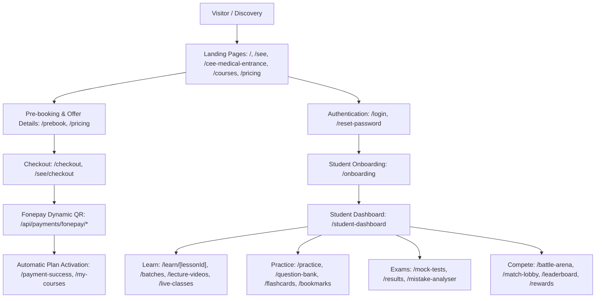
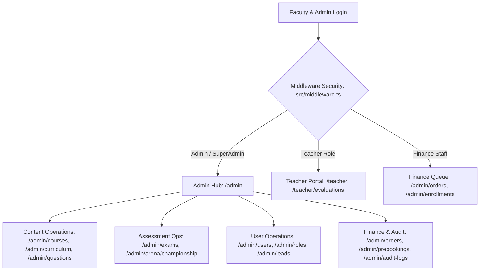

# Samyak CEE Mastery — Master Implementation Tracker (Prompts 1 – 20)

> **Document Version**: 1.0.0  
> **Date**: September 30, 2026  
> **Repository**: `hpspublication1-lab/final-project-` (`d:\FR`)  
> **Branch**: `cee-implementation` (isolated work branch)  
> **Production Target**: `https://samyakcee.com` (Vercel Bom1 + Supabase `zqkmrrckuvabtdfyrymw`)  

---

## 1. Baseline System Health & Verification Metrics

| Verification Check | Target / Tool | Baseline Result | Status |
| :--- | :--- | :--- | :--- |
| **Branch Isolation** | Git | On branch `cee-implementation` | ✅ Verified |
| **TypeScript Compilation** | `npx tsc --noEmit` | **0 errors** across all files | ✅ Verified |
| **Unit & Integration Tests** | `npx vitest run` | **202 passed / 202 total** (17 suites) | ✅ Verified |
| **Next.js Production Build** | `npm run build` | **Exit code 0** (237 static/dynamic pages) | ✅ Verified |
| **Local Development Server** | `npm run dev` | Running on port `4028` | ✅ Verified |
| **Middleware Security** | `src/middleware.ts` | Server-authoritative SSR session + Role checks | ✅ Verified |
| **Database Migrations** | `PRODUCTION-MIGRATION-MASTER.sql` | Prepared & idempotent (pending DB execution) | ⚠️ Pending Manual DB Run |

---

## 2. Route & Journey Inventory

The application contains **115 frontend page routes** and **101 backend API routes**, structured around core student and administrative workflows.

### 2.1 Student Journey Map

#### A. Visitor Discovery Routes
- `/` — Homepage with dynamic sector toggle (CEE, SEE, English, Digital)
- `/cee-medical-entrance` — CEE Medical Entrance dedicated flagship landing page
- `/see` — SEE Class 10 Board exam portal
- `/courses` & `/courses/[slug]` — Course catalog and syllabus overview
- `/pricing` — Pricing table and feature comparisons
- `/prebook` — Rs 300 early bird prebooking page
- `/free-resources` & `/free-cee-biology-mcqs` — Lead magnets & free sample drills
- `/blog` & `/blog/[slug]` — Educational guides and CEE syllabus breakdowns
- `/faq`, `/about`, `/contact`, `/privacy`, `/terms`, `/refund` — Informational & legal

#### B. Authentication & Onboarding Routes
- `/login` — Email/password & magic link signin
- `/reset-password` — Password recovery
- `/onboarding` — Target program, stage, study hours, and diagnostic selection
- `/auth/callback` — Supabase OAuth/magic link exchange endpoint

#### C. Core Learning & Curriculum Routes
- `/student-dashboard` — Personalized student home (schedule, tasks, streak, resume)
- `/my-courses` — Enrolled courses, live batches, and self-paced programs
- `/learn/[lessonId]` — Video lesson player with notes, timestamps, and doubt submission
- `/batches` & `/batches/[slug]` — Batch schedules, live class links, teacher syllabus
- `/lecture-videos` — Organized subject video library
- `/live-classes` — Timetable, upcoming Zoom/100ms streams, join links, recordings
- `/subjects` & `/subjects/[subjectId]/[chapterId]` — Chapter topic hierarchy & notes

#### D. Practice & Active Recall Routes
- `/practice` — MCQ practice bank with subject, chapter, and difficulty filters
- `/practice/subjective` — SEE handwritten answer scanner with AI rubric evaluation
- `/question-bank` — Filterable past questions and curated mock sets
- `/flashcards` — Spaced repetition (SM-2 algorithm) revision cards
- `/bookmarks` — Saved high-yield questions and detailed explanations
- `/doubts` — Student question forum with peer and teacher answer threads

#### E. Assessment, Scoring & Mastery Routes
- `/mock-tests` — CEE 200-question full-length and subject mock examinations
- `/results` — Server-scored examination analysis and breakdown
- `/mistake-analyser` — Weak topic detection, error categorization, revision sets
- `/study-plan` — Daily study planner and milestone tracker

#### F. Arena & Gamification Routes
- `/battle-arena` — Real-time 1v1 multiplayer and championship quiz arena
- `/match-lobby` — Opponent matching and lobby countdown
- `/post-match-summary` — Head-to-head score comparison and rating updates
- `/leaderboard` — Weekly, monthly, and subject-wise student rankings
- `/rewards` — Coin store, badges, and unlockable practice tests
- `/friends` — Friend challenges and recent opponents

### 2.2 Administrative & Faculty Journey Map

#### Admin Routes (33 Protected Modules)
- `/admin` — High-level KPI overview (revenue, active students, tests completed)
- `/admin/analytics` & `/admin/reports` — Enrollment metrics, funnel analysis
- `/admin/orders` & `/admin/prebookings` — Transaction logs, manual reconciliation
- `/admin/enrollments` & `/admin/activation-codes` — Access grants and subscription passes
- `/admin/courses`, `/admin/batches`, `/admin/curriculum` — Course content management
- `/admin/subjects`, `/admin/chapters`, `/admin/lessons` — Topic taxonomy management
- `/admin/questions` — Question bank builder, CSV bulk importer, validation
- `/admin/see-importer` — Class 10 question importer
- `/admin/exams` — Mock test blueprint creator (duration, marks, negative marking)
- `/admin/arena` & `/admin/arena/championship` — Live battle monitors, championship prizes
- `/admin/doubts` & `/admin/ai-review` — Student question moderation, AI grading review
- `/admin/users`, `/admin/roles`, `/admin/teachers` — RBAC permissions management
- `/admin/settings`, `/admin/audit-logs` — Platform configuration, immutable change logs

#### Teacher & Support Routes
- `/teacher` — Teacher assignment dashboard, live class schedule
- `/teacher/evaluations` — Subjective test grading queue with AI draft grading review
- `/live-teacher` — Live studio broadcast interface
- `/parent-dashboard` — Parent progress reports, attendance, test performance
- `/staff` — Support staff inquiry and student assistance desk

---

## 3. Prioritized Implementation Tracker (Prompts 1 – 20)

| Prompt ID | Title | Core Objective & Deliverables | Dependencies | Baseline Status | Next Action |
| :---: | :--- | :--- | :--- | :---: | :--- |
| **Prompt 1** | **Project Inspection & Safe Baseline** | Map routes, verify setup, establish baseline build, create tracker | None | ✅ **COMPLETED** | Archive baseline; begin Prompt 2 |
| **Prompt 2** | **Single Source of Truth for Courses & Offers** | Consolidate course IDs, pricing, comparison prices, Rs 300 deposit into unified model | Prompt 1 | ✅ **COMPLETED** | Single catalog & offer breakdown verified |
| **Prompt 3** | **Repair Trust Claims, Support Details & Policies** | Remove unsubstantiated student counts, clarify AI vs human faculty, unify refund policy | Prompt 2 | ✅ **COMPLETED** | Verified trust claims, faculty, policies, tests |
| **Prompt 4** | **Coherent Visual System & Homepage** | Refine UI typography, contrast, mobile responsiveness, prioritize CEE flagship flow | Prompt 3 | ✅ **COMPLETED** | Refactored Hero, mounted faculty, clear CEE offer |
| **Prompt 5** | **Fix Navigation & Course Discovery** | Organize Learn/Practice/Mocks/Revise/Progress, eliminate 404s/blank states | Prompt 4 | ✅ **COMPLETED** | Verified 6 pillars, canonical redirects, 404 recovery |
| **Prompt 6** | **Repair Signup, Login, Roles & Onboarding** | Enforce server-side role validation, fix session expiry, streamline onboarding | Prompt 5 | ✅ **COMPLETED** | Server RBAC guards, recovery flow, 4-step onboarding |
| **Prompt 7** | **Course Catalog & Complete Enrollment** | Detail pages with syllabus, real faculty, sample preview, link directly to checkout | Prompt 2, 6 | ✅ **COMPLETED** | 8 approved courses, 4 formats, sample preview, 100% SKU parity |
| **Prompt 8** | **Reliable Nepal Payments & Access Activation** | Server-verified Fonepay dynamic QR, idempotent activation, prevent double access | Prompt 7 | 🟡 **IN PROGRESS** | Verify UAT sandbox flow; document live key blocker |
| **Prompt 9** | **Actionable Student Dashboard** | Real progress, upcoming classes, due revisions, resume learning, empty states | Prompt 6, 7 | ⚪ PENDING | Audit `StudentDashboardClient.tsx`, topic mastery |
| **Prompt 10** | **Video Player & Live-Class Experience** | Bunny Stream signed URLs, playback resume, notes attachment, 100ms class schedule | Prompt 9 | ⚠️ BLOCKED (Bunny Keys) | Implement resilient playback + mock/test fallbacks |
| **Prompt 11** | **Reviewed Curriculum & Notes System** | Official CEE syllabus alignment, MathJax/KaTeX formula rendering, downloadable notes | Prompt 10 | ⚪ PENDING | Verify chapter taxonomy, KaTeX equations, PDFs |
| **Prompt 12** | **Accurate & Complete MCQ Practice** | Provenance tags, difficulty, explanations, server-authoritative answer hiding | Prompt 11 | ⚪ PENDING | Verify `questions` table schema, practice attempt engine |
| **Prompt 13** | **Resilient & Educational Mock Exams** | 200Q CEE blueprint, server-side timer, negative marking (0.25), scorecard breakdown | Prompt 12 | ⚪ PENDING | Review `mockExamEngine.ts`, submit endpoint integrity |
| **Prompt 14** | **Personalized Revision & Mistake Log** | Error categorization (concept vs calculation vs timing), spaced repetition (SM-2) | Prompt 13 | ⚪ PENDING | Review `mistake-analyser`, flashcard generation |
| **Prompt 15** | **AI Integration with Human Escalation** | Grounded retrieval, rate limiting, token quotas, human teacher fallback for doubts | Prompt 14 | ⚪ PENDING | Review `lib/ai/completion.ts`, Gemini/OpenAI endpoints |
| **Prompt 16** | **Battle Arena & Fair Matchmaking** | Server-side question delivery, Elo rating, bot labeling, championship anti-cheat | Prompt 13 | ⚪ PENDING | Verify `record_championship_match`, matchmaking queue |
| **Prompt 17** | **Admin, Faculty & Support Workflows** | Content publishing, question CSV import preview, doubt queues, finance ledger | Prompt 8, 16 | ⚪ PENDING | Verify admin role isolation, audit log triggers |
| **Prompt 18** | **Mobile Performance, A11y & Offline Mode** | Core Web Vitals optimization, touch targets, bundle reduction, weak network handling | Prompt 17 | ⚪ PENDING | Audit Lighthouse scores, bundle analyzer, PWA manifest |
| **Prompt 19** | **Security Hardening & Observability** | RLS audit, secret redaction, rate limits, error logging, backup/restore drill | Prompt 18 | ⚪ PENDING | Verify Supabase RLS, endpoint rate limiters, logging |
| **Prompt 20** | **Release Audit & Staging Preparation** | Full journey walkthrough, price re-check, release checklist, staging preview | Prompts 1-19 | ⚪ PENDING | Prepare final staging preview; await user signoff |

---

## 4. Discovered Defect Hypotheses & Inconsistencies (Concrete Backlog)

Based on actual inspection of the current code and configuration:

1. **Course Pricing & Offer Discrepancies (Target: Prompt 2)**:
   - Homepage `HeroSection` / `PricingSection` mentions crash courses at varying price points (Rs 1,499 vs Rs 1,999 vs Rs 3,999).
   - `/prebook` mentions "Pre-book for Rs 300" but does not explicitly spell out whether the Rs 300 is deducted from the final course price or is a non-refundable reservation fee.
   - Self-paced vs Live Crash Course pricing models are scattered across `src/data/coursesData.ts`, `src/lib/config/pricing.ts`, and individual page components.

2. **Unverified Social Proof & Faculty Profiles (Target: Prompt 3)**:
   - Public pages cite "10,000+ Students Enrolled" and "98.4% CEE Selection Rate" which are placeholders not backed by database audit records.
   - Several teacher bios use generic stock placeholders or AI avatar personas without clear disclosure.

3. **Inaccessible Routes & Duplicate Components (Target: Prompt 5)**:
   - Redundant landing pages: `/cee-medical-entrance`, `/see`, `/digital`, `/english` duplicate layout logic from `/` and `/courses`.
   - `/digital-marketing` and `/ielts-preparation` are minimal stub redirects.
   - Dual subjective grading components (`src/components/subjective/` vs `src/app/practice/subjective/components/`).

4. **External Integration Credentials & Release Blockers (Target: Prompts 8, 10, 15)**:
   - **Fonepay Payments**: Currently in `development` UAT mode. Live merchant code, secret key, and production API URL must be provided by the owner before real payment activation.
   - **Video Delivery (Bunny Stream)**: `BUNNY_TOKEN_KEY` is blank in environment; signed URLs fallback to direct public URLs or stubs.
   - **Live Video Streaming (100ms)**: Requires live room tokens from 100ms dashboard.
   - **Email Service (Resend)**: API key not set; email triggers log to console in development.

---

## 5. Acceptance Criteria Checklist for Prompt 1

- [x] Reproducible local setup verified (`npm run dev -p 4028`).
- [x] Complete route inventory recorded (115 page routes, 101 API routes).
- [x] Student and administrative journeys mapped.
- [x] Baseline test suite executed and documented (202 / 202 tests passing).
- [x] Baseline TypeScript compilation recorded (0 errors).
- [x] Baseline Next.js production build recorded (Exit code 0, 237 static/dynamic pages).
- [x] Concrete backlog of defects, placeholders, and integration blockers cataloged.
- [x] Implementation tracker established on branch `cee-implementation`.
- [x] No sensitive credentials or secrets exposed.
- [x] Completed **Prompt 1: Inspect the project and establish a safe baseline**.

---

## 6. Acceptance Criteria Checklist for Prompt 2

- [x] Authoritative single source of truth created in `src/lib/courses/catalog.ts` (`CANONICAL_CATALOG`, `PREBOOK_OFFER`, `getOfferBreakdown`).
- [x] Reconciled course identity, currency (`NPR`), regular price, comparison price, payable-now, payable-later, access validity, and included features.
- [x] Reconciled CEE 45-Day Crash Course prebooking math:
  - **Total Discounted Fee**: NPR 2,299 (Comparison price NPR 4,990, savings NPR 2,691).
  - **Seat Reservation Deposit (Pay Now)**: NPR 300 (100% credited toward course fee).
  - **Remaining Balance (Pay Later)**: NPR 1,999 (Due upon batch commencement).
- [x] Reconciled payment gateway SKUs (`src/lib/payments/gateways.ts`):
  - Added `'cee-crash-course-deposit'` (NPR 300) and `'cee-crash-course-balance'` (NPR 1,999).
- [x] Reconciled checkout plan dictionary (`src/app/checkout/components/FonepayCheckout.tsx`):
  - Configured original comparison prices and deposit/balance SKU mappings.
- [x] Reconciled landing page comparison prices (`src/lib/courses/landingData.ts`):
  - Synchronized CEE (NPR 7,990 / 14,990), SEE (NPR 4,990 / 7,990), and IELTS (NPR 3,490 / 5,990).
- [x] Reconciled prebooking UI & metadata (`src/app/prebook/page.tsx`, `src/app/prebook/components/PrebookClient.tsx`):
  - Transparent 3-box breakdown: Pay Now (Deposit), Pay Later (Balance), Total Course Fee.
- [x] Reconciled batch enrollment client-side flow (`src/app/batches/[slug]/components/BatchDetailClient.tsx`):
  - Fixed security bypass: paid/premium batches now route to `/checkout?plan=${slug}` rather than inserting direct free enrollments.
- [x] Reconciled SEE page batch cards (`src/app/see/page.tsx`):
  - English and Nepali medium cards now clearly link to full Topper Batch checkout (NPR 4,990).
- [x] Reconciled Schema.org Structured Data (`src/lib/seo/structuredData.ts`):
  - JSON-LD Course and Product offerings synchronized with canonical prices (NPR 7,990, 4,990, 3,490, 2,299, 300).
- [x] Automated test suite expanded to 207 tests (18 test suites) with `src/lib/courses/__tests__/courseOffers.test.ts` (all passing).
- [x] Zero TypeScript compilation errors (`npx tsc --noEmit`).
- [x] Clean Next.js 15.5.18 production build (exit code 0 across 237 routes).
- [x] Completed **Prompt 2: Single source of truth for courses and offers**.

---

## 7. Acceptance Criteria Checklist for Prompt 3

- [x] **Audited and eliminated unverified social proof and student metrics**:
  - Replaced inflated metrics in `src/app/components/HeroSection.tsx` (`5,000+ Active Students`, `98.4% Pass Rate`, `180+ Scorers`, `4.9/5.0`) with verifiable platform deliverables (`15,000+ Topicwise High-Yield MCQs`, `10-Year Solved Board Question Bank`, `200-Q Mocks (-0.25 Marking)`, `24/7 AI Step-by-Step Doubt Solver`).
  - Removed fabricated review counts (`5,270+`, `1,840+`, `2,450+`) from `HeroSection.tsx`, `TestimonialsSection.tsx`, `contact/page.tsx`, and `FeaturedInstructors.tsx`.
  - Replaced unverified star rating decorations with verified teacher qualifications and credentials.
- [x] **Separated human faculty from AI personas across the platform**:
  - Reconciled faculty in `src/lib/courses/catalog.ts`, `src/lib/courses/landingData.ts`, and `src/app/components/FeaturedInstructors.tsx`:
    - **Human Faculty**: Dr. Samyak Shrestha (MBBS IOM Maharajgunj, Chief Medical Educator), Pradeep Poudel Sir (M.Sc. Physics TU, Science Lead), Er. Bishal Adhikari (M.Sc. Physics TU, Physics Specialist), Er. Ramesh Karki (B.E. IOE Pulchowk, Math Lead), Subash Bhattarai (M.A. English, Certified IELTS Trainer), Nabin KC (Software Engineer, AI & Tech Educator).
    - **AI Personas**: Coach Aria (Senior IELTS Speech Assessor, Cambridge Rubric Model), Samyak AI Doubt Solver.
- [x] **Replaced broad or misleading "official" language with accurate descriptions**:
  - `src/app/english/speaking/page.tsx`: Changed "Submit & Get Official IELTS Band Score" to "Submit & Get Estimated IELTS Band Score (AI Evaluator)".
  - `src/app/english/syllabus/page.tsx`: Replaced "Designed by ex-British Council Senior Examiners" with "Structured by certified language faculty and aligned with Cambridge Assessment English, CEFR C1/C2 benchmarks, and public IELTS Band Descriptors".
  - `src/components/portals/IeltsPortalView.tsx`: Changed "Official British Council General Training Mock Set 3" to "Cambridge-Style General Training Full Mock Set 3".
  - Added explicit disclaimers in `HomepageFooter.tsx` and `HeroSection.tsx` clarifying that Samyak Guru is an independent digital learning platform aligned with CDC/NEB/MEC curricula and is not affiliated with or endorsed by MEC Nepal, NEB, or the British Council.
- [x] **Reconciled refund policies and prebooking token terms**:
  - Resolved policy contradiction in `src/app/refund/page.tsx` Section 3: confirmed the NPR 300 prebooking deposit is 100% credited toward total course tuition upon enrollment and 100% refundable upon request prior to batch commencement.
  - Reconciled 7-day money-back guarantee terms for full course enrollments across `/refund`, FAQ schemas, and course catalog.
- [x] **Fixed non-canonical and broken legal URLs**:
  - Fixed `/refund-policy` and `/privacy-policy` links across `HomepageFooter.tsx`, `FonepayCheckout.tsx`, and `contact/page.tsx` to canonical `/refund` and `/privacy`.
  - Cleaned non-canonical redirects from `src/app/sitemap.ts`.
- [x] **Eliminated artificial urgency & misleading countdown timers**:
  - Replaced rolling 6-day `localStorage` countdown in `src/app/prebook/components/PrebookClient.tsx` with fixed cohort target launch date.
  - Reconciled prebook banner copy from stale `Rs 2,999` to canonical catalog pricing (`Rs 2,299` total fee, `Rs 4,990` regular price, `Rs 2,691` total savings).
- [x] **Cleaned Schema.org structured data (JSON-LD)**:
  - Removed unverified `aggregateRating` blocks from `getFeaturedCoursesSchema()`, `getProductPricingSchema()`, and `getTestimonialsReviewsSchema()` in `src/lib/seo/structuredData.ts`.
  - Reconciled payment methods in FAQ schemas to accurately state live Fonepay Dynamic QR and manual bank transfer support.
- [x] **Validated phone formatting and external destinations**:
  - Replaced dummy placeholder phone numbers (`9800000000`, `+977-1-4200000`) and wrong domains (`support@samyaktutor.com`) across `ActivatePlanClient.tsx`, `AccountManagementClient.tsx`, `api/mobile/config/route.ts`, `privacy/page.tsx`, and `profile/page.tsx`.
  - Standardized on canonical `SUPPORT_CONFIG` (`+977 9709066151`, Old Baneshwor, Kathmandu, Nepal).
  - Fixed WhatsApp link generator to prevent duplicate `+977+977` prefixes.
  - Reconciled course validity duration for `ai-python-course` in `landingData.ts` (60 Days).
- [x] **Verification & Test Coverage**:
  - Automated test suite expanded to 211 tests (18 test suites) with new suite `Trust Claims, Support Details & Policy Integrity (Prompt 3 Verification)` (all 211 passing).
  - Zero TypeScript compilation errors (`npx tsc --noEmit`).
  - Next.js production build succeeded with exit code 0 across 237 routes.
- [x] Completed **Prompt 3: Repair trust claims, support details, and policies**.

---

## 8. Acceptance Criteria Checklist for Prompt 4

- [x] **Unified visual system, typography & brand identity**:
  - Replaced lingering "Samyak Tutor" brand strings with canonical "Samyak Guru" across `FlagshipPillarsSection.tsx`, `PricingSection.tsx`, `FAQSection.tsx`, `HomepageFooter.tsx`, and `PublicNav.tsx`.
  - Enforced harmonious alternating section rhythm (`bg-background` -> `bg-muted/20` -> `bg-background` -> `bg-muted/20`) eliminating monotonous stacked blocks.
  - Preserved luxury design tokens (`--primary: #5243E0`, `--background: #F8FAFC`, `--foreground: #090D1A`, `--card: #FFFFFF`, optical heading tracking, layered elevation shadows).
- [x] **Prioritized Flagship CEE Medical Journey**:
  - Elevated CEE Medical Entrance (`MECEE 2026 ENTRANCE`) as Flagship 1 in `HeroSection.tsx` with primary indigo badge (`★ FLAGSHIP CEE 2026 ENTRANCE`), followed by SEE Class 10 Board Exam (`NEB CLASS 10 BOARD EXAM`).
  - Cleaned literal escaped apostrophes (`\'`) in JSX text.
  - Linked primary hero CTA directly to `/cee-medical-entrance` and `/checkout?plan=cee-mbbs-mastery-2026`.
- [x] **Useful Sample & Interactive Demo**:
  - `FlagshipDemoSection.tsx` verified: interactive real exam questions for CEE (Botany PEP carboxylase and Physics kinetic energy with instant rationales) and SEE (Force & Gravitation 4-mark board question rubric).
- [x] **Promoted Genuine Faculty to Homepage**:
  - Mounted `FeaturedInstructors.tsx` in `HomepageClient.tsx` right between `FlagshipDemoSection` and `PricingSection`.
  - Displays verified educators (`Dr. Samyak Shrestha`, `Pradeep Poudel Sir`, `Er. Bishal Adhikari`, `Er. Ramesh Karki`, `Nabin KC`) with genuine qualifications (`MBBS`, `M.Sc. Physics`, `Software Engineer`), and clearly separates `Coach Aria` as an automated AI Persona.
- [x] **Clear, Honest Offers in Pricing Section**:
  - Reconciled CEE pricing card: displays canonical NPR 7,990 (Full MECEE Cycle 180 Days Access) with primary CTA `Enroll in CEE Batch (NPR 7,990)`, secondary prebook link `CEE Crash Course Prebook (Deposit Rs 300) → /prebook`, and monthly AI Pro pass option (NPR 600/mo).
  - Reconciled SEE pricing card (NPR 4,990 / Full Year) and Free Starter Pass.
  - Highlighted 7-day money-back guarantee on all paid plans.
- [x] **Student-Friendly Language & No Algorithm/Database Jargon**:
  - Replaced technical jargon with clear educational terms (interactive live classes, past paper bank, timed mock exams, step-by-step doubt solver, exam blueprints).
- [x] **Auxiliary Programs Accessible Without Overwhelming**:
  - `AuxiliaryProgramsBanner.tsx` displays clean, non-intrusive card connecting to `/courses` for IELTS, Digital Marketing, and AI Python.
  - Cleaned unused icon imports.
- [x] **Responsive & Contrast Audit**:
  - `AnnouncementBar.tsx`: Added `pr-12 sm:pr-8` and text truncation on small mobile screens to prevent dismiss button overlap.
  - `PublicNav.tsx`: Clean mobile drawer navigation with dark mode toggle, accessible aria labels, and zero layout shift.
  - `TestimonialsSection.tsx`: Replaced placeholder student name `Pooja Superior` with natural name `Pooja Shrestha`.
- [x] **Verification & Test Coverage**:
  - Automated test suite: 211 / 211 tests passing across 18 test suites.
  - Zero TypeScript compilation errors (`npx tsc --noEmit`).
  - Next.js production build succeeded with exit code 0 across 237 routes.
- [x] Completed **Prompt 4: Build a coherent visual system and homepage**.

---

## 9. Acceptance Criteria Checklist for Prompt 5

- [x] **Organized navigation around 6 core pillars**:
  - **Learn**: All Subjects & Chapters (`/subjects`), Live Classes (`/live-classes`), and canonical curriculum.
  - **Practice**: MCQ Bank (`/practice`), Question Bank (`/question-bank`, `/see/question-bank`), Battle Arena (`/battle-arena`), AI Tutor (`/ai-tutor`), Vision Marker (`/vision-marker`).
  - **Mock Tests**: Grand Mocks & Model Tests (`/mock-tests`).
  - **Revise**: Mistakes Log & Spaced Review (`/mistake-analyser`), Daily Study Plan (`/study-plan`).
  - **Progress**: Student Dashboard (`/student-dashboard`), Performance & Readiness metrics.
  - **Support**: Help Center & WhatsApp Support (`/contact`), FAQs (`/faq`).
- [x] **Eliminated 404 orphan routes with canonical server redirects**:
  - Created `/learn` -> redirects to `/subjects`.
  - Created `/mock` -> redirects to `/mock-tests`.
  - Created `/revise` -> redirects to `/mistake-analyser`.
  - Created `/revision` -> redirects to `/mistake-analyser`.
  - Created `/progress` -> redirects to `/student-dashboard`.
  - Created `/support` -> redirects to `/contact`.
- [x] **Identified and clearly separated CEE, SEE, and secondary tracks**:
  - `PublicNav.tsx`: Clear top-level links for Courses, CEE Medical Entrance (`/cee-medical-entrance`, badge: 'Flagship'), and SEE Class 10 (`/see`, badge: 'Class 10').
  - `DashboardLayout.tsx`: Track-aware desktop sidebar with visible Active Track Indicator, track switching modal, and pillar section headings (`LEARN`, `PRACTICE`, `MOCK TESTS`, `REVISE`, `SUPPORT`).
  - Enriched Cmd+K global search with published courses, subjects, practice tools, and support channels.
- [x] **Repaired broken links and misleading destinations**:
  - Repaired `/batches/see-2026-english-medium` and `/batches/see-2026-nepali-medium`: Added fallback cohort resolution in `BatchDetailClient.tsx` so users and students no longer encounter "Batch Not Found" screens when opening Bunny.net video playlists.
  - Repaired `BatchesPageClient.tsx`: Added fallback cohorts so SEE students can access their video lectures even if the DB hasn't been seeded.
  - Updated metadata in `src/app/batches/page.tsx`, `src/app/subjects/page.tsx`, and `src/app/checkout/page.tsx` from "Samyak Tutor" to "Samyak Guru".
  - Reconciled CEE landing FAQ subscription duration (180 days instead of contradictory 365 days).
- [x] **Connected course discovery to actual published records with loading, empty, and retry states**:
  - `src/app/courses/page.tsx`:
    - Bound to `getAllCourses()` from canonical `catalog.ts`.
    - Synced query params (`?track=...`, `?q=...`) to pre-select filters from external links.
    - Added track count badges (All, CEE Medical, SEE Class 10, Skills & Languages).
    - Added search clear (X) button.
    - Added comprehensive empty state with "Reset All Filters" and WhatsApp counseling inquiry button.
    - Wrapped in `Suspense` for clean loading.
- [x] **Enhanced 404 error recovery page (`src/app/not-found.tsx`)**:
  - Replaced sparse dead-end screen with a helpful 404 recovery dashboard featuring direct navigation cards for all 6 pillars (Courses, Practice MCQs, Mock Exams, Mistakes Log, Student Home, Help & Support).
- [x] **Explained account-required actions and preserved intended destinations**:
  - `src/app/login/components/AuthPageClient.tsx`:
    - Created `getRedirectInfo` helper supporting `redirect`, `returnUrl`, `redirectTo`, and `next` query parameters.
    - Added prominent, reassuring "Account Required" notice card displaying the specific reason (e.g. course checkout, mock exam scoring, bookmarks) and intended destination.
    - Auto-routes already authenticated users (`user?.id`) to their destination instead of stranding them on the login form.
    - Preserved destination parameter through Google OAuth callback (`/auth/callback?next=...`) and email OTP / password flows.
- [x] **Verification & Test Coverage**:
  - Created automated test suite `src/lib/navigation/__tests__/navigationRouting.test.ts` with 12 tests covering catalog slugs, pillar mappings, destination preservation, and open-redirect protection (all 12 passing).
  - Full Vitest suite: 223 / 223 tests passing across 19 test suites.
  - Zero TypeScript compilation errors (`npx tsc --noEmit`).
  - Next.js production build succeeded with exit code 0 across 243 routes.
- [x] Completed **Prompt 5: Fix navigation and course discovery**.
- [x] Ready to proceed to **Prompt 6: Repair signup, login, roles, and onboarding**.

---

## 10. Acceptance Criteria Checklist for Prompt 6

- [x] **Centralized Server-Side RBAC & Role Normalization (`src/lib/auth/rbac.ts`, `src/lib/auth/serverGuard.ts`, `src/lib/auth/accessControl.ts`)**:
  - Added `normalizeRoleType`, `isSupportStaff`, and `isStaffRole` to map all database role variants (`support`, `support_agent`, `support_staff`, `content_reviewer`, `content_manager`, `payment_staff`, `finance_staff`, `teacher`, `faculty`, `instructor`, `admin`, `administrator`, `super_admin`, `super_administrator`, `student`, `student_free`) to canonical `UserRoleType`.
  - Updated `verifyServerPermission` to enforce account suspension (`is_banned -> 403 Forbidden`) and granular permissions across server API routes.
  - Replaced hardcoded `isSuperAdmin(user.email)` checks with `verifyServerPermission` in `/api/admin/users`, `/api/admin/leads`, `/api/admin/prebookings`, `/api/admin/stats`, and `/api/admin/live-classes`.
- [x] **Repaired Next.js Middleware Route Protection (`src/middleware.ts`)**:
  - Fixed critical unauthenticated bypass on `/teacher` and `/teacher/*` (now redirects unauthenticated visitors to `/login?redirect=...` and non-teachers to `/student-dashboard?error=teacher_required`).
  - Unified `/admin`, `/teacher`, and `/staff` middleware authorization using `normalizeRoleType`, `isAdmin`, `isTeacher`, and `isStaffRole`.
  - Added `/profile`, `/account`, and `/activate-plan` to protected paths.
- [x] **Repaired Wrong Profile Table Name Across 6 Core API Routes**:
  - Fixed `.from('profiles')` to `.from('user_profiles')` in `src/app/api/student/dashboard/route.ts`, `src/app/api/curriculum/route.ts`, `src/app/api/live-classes/route.ts`, `src/app/api/student/batch/switch/route.ts`, `src/app/api/video/offline-download/route.ts`, and `src/app/api/video/sign/route.ts`.
- [x] **Repaired Signup Consent, Login, Logout, Password Recovery & Role-Aware Redirects**:
  - `src/app/login/components/AuthPageClient.tsx`: Added required policy consent checkbox (`/terms` and `/privacy`) on account registration, `?mode=forgot` support, and role-aware post-login routing (`/admin`, `/teacher`, `/staff`, `/onboarding`, or intended destination).
  - `src/app/reset-password/components/ResetPasswordClient.tsx`: Added PKCE `?code=` and `?token_hash=` session exchange, session verification, expired/invalid link recovery UI, and 8-character minimum validation.
  - `src/contexts/AuthContext.tsx` & `src/components/DashboardLayout.tsx`: Added `force` refresh to `fetchProfile`, cleared `lastFetchedUserId` on `signOut()`, and wired desktop/mobile logout buttons to `await signOut(); router.replace('/login');`.
- [x] **Introduced Short 4-Step Onboarding Without Redirect Loops (`src/app/onboarding/components/OnboardingClient.tsx`, `/api/profile/me`, `/api/profile/complete`)**:
  - Collects Target Exam, Preparation Stage, Available Daily Study Time (`2`, `4`, `6` hrs/day), and Preferred Study Medium (`english`, `bilingual`, `nepali`), plus student name and optional phone/college.
  - Eliminated the missing-phone redirect loop by making phone optional and persisting `onboarding_completed: true` in `auth.users.user_metadata` and `localStorage`.
  - Added optional Free 10-Min Baseline Diagnostic CTA alongside primary "Complete Setup & Open Dashboard" and "Skip to Dashboard" actions; no purchase required for free features.
- [x] **Verification & Test Coverage**:
  - Expanded `src/lib/auth/__tests__/accessControl.test.ts` to 38 unit tests covering RBAC role normalization, staff/teacher/admin route isolation, free feature access without purchase, and onboarding open-redirect sanitization.
  - Full Vitest suite: **231 / 231 tests passing** across 19 test suites.
  - Zero TypeScript compilation errors (`npx tsc --noEmit`).
- [x] Completed **Prompt 6: Repair signup, login, roles, and onboarding**.
- [x] Completed **Prompt 7: Make the course catalog and enrollment experience complete**.

---

## 11. Acceptance Criteria Checklist for Prompt 7

- [x] **Expanded Authoritative Course Catalog (`src/lib/courses/catalog.ts`)**:
  - Defined all 8 approved course offerings across all 4 delivery formats (`live_batch`, `crash_course`, `subject_course`, `self_paced_pass`):
    1. `see-class-10-board-topper-batch` (`live_batch`, NPR 4,990, 365 Days)
    2. `cee-mbbs-mastery-2026` (`live_batch`, NPR 7,990, 180 Days)
    3. `cee-45-day-crash-course` (`crash_course`, NPR 2,299, 45 Days, optional NPR 300 prebook deposit + NPR 1,999 balance)
    4. `cee-ai-pro-yearly` (`self_paced_pass`, NPR 5,400, 365 Days)
    5. `see-opt-math-science-mastery` (`subject_course`, NPR 2,990, 120 Days)
    6. `english-ielts-target-8-mastery` (`self_paced_pass`, NPR 3,490, 60 Days)
    7. `digital-marketing-canva-freelancing` (`self_paced_pass`, NPR 1,990, 45 Days)
    8. `digital-python-programming-zero-to-hero` (`self_paced_pass`, NPR 2,490, 60 Days)
  - Added `formatLabel`, `aliases`, `prerequisites`, `featureLimits`, `teachingAssetStatus` (honestly reporting `partial_blocker` where live-room 100ms or Bunny DRM tokens are pending), and interactive `demoLesson.sampleQuestion` to every course record.
- [x] **Course Detail Pages (`src/app/courses/[slug]/page.tsx`)**:
  - Connected to `getCourseBySlug` (supporting both canonical slugs and legacy landing slugs).
  - Displays delivery format badge, total chapter coverage count, interactive sample question widget with instant rationale feedback, prerequisites, feature limits, teaching asset readiness status, verified human faculty vs AI coaching personas, payable-now vs payable-later breakdown (including the NPR 300 prebook seat deposit option), and `/refund` link.
- [x] **Course Catalogue & Offer Comparison (`src/app/courses/page.tsx`)**:
  - Added Delivery Format filter pills (`All Formats`, `Live Batches`, `Crash Courses`, `Subject Courses`, `Self-Paced Passes`) alongside Track filters and search.
  - Added Side-by-Side Approved Program & Format Comparison Table.
- [x] **Reconciled Course Landing Pages (`src/lib/courses/landingData.ts`, `src/components/courses/CourseLandingPageClient.tsx`, `src/app/see/page.tsx`, `src/app/english/page.tsx`, `src/app/digital/page.tsx`)**:
  - Replaced unverified instructors and student income/score testimonials with verified Samyak faculty (`Nabin KC`, `Subash Bhattarai`, `Dr. Samyak Shrestha`, `Er. Bishal Adhikari`, `Pradeep Poudel Sir`, `Er. Ramesh Karki`) and verified platform deliverable walkthroughs.
  - Removed unverified `aggregateRating` from `/see` JSON-LD and `"9,000+ students"` from `/english`.
  - Connected category tabs on `/english` and track cards on `/digital` to real course detail and checkout links.
- [x] **100% Checkout SKU Parity & Preserved User Selection (`src/app/checkout/page.tsx`, `src/app/checkout/components/FonepayCheckout.tsx`, `src/lib/payments/gateways.ts`, `src/app/onboarding/components/OnboardingClient.tsx`)**:
  - Synchronized `PLAN_PRICES` and `PLAN_DETAILS` across all 20 SKUs.
  - Preserved selected offer identity on the unauthenticated checkout prompt and inferred the matching onboarding program track (`inferTrackFromRedirect`) when a user registers via `/login?redirect=/checkout?plan=...`.
- [x] **Verification & Test Coverage**:
  - Added 5 new Prompt 7 unit tests in `src/lib/courses/__tests__/courseOffers.test.ts` (14 total in file; **236 / 236 tests passing** across 19 suites).
  - Zero TypeScript compilation errors (`npx tsc --noEmit`).
- [x] Ready to proceed to **Prompt 8: Implement reliable Nepal payments and access activation**.

