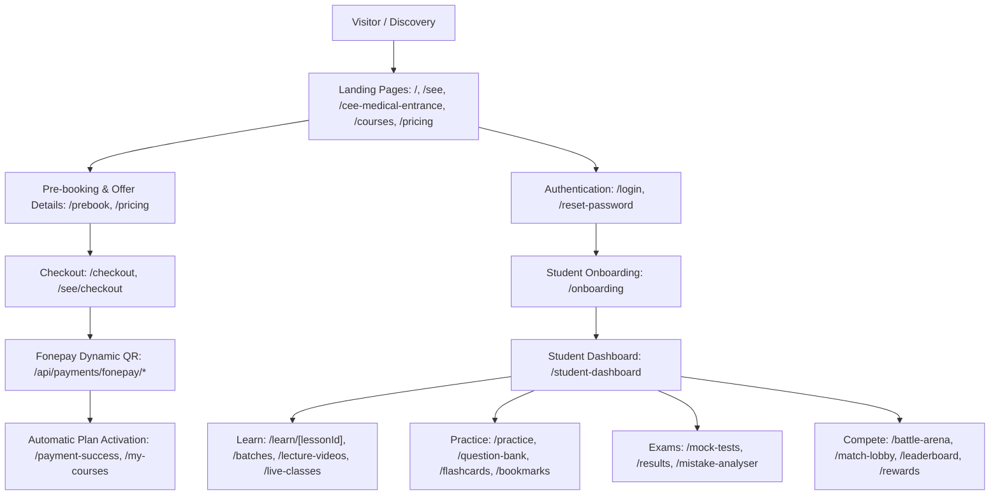
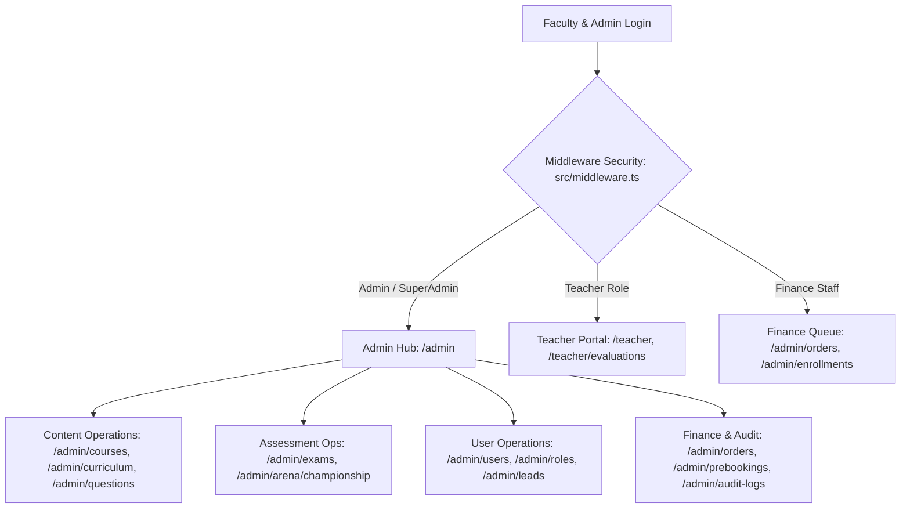

# Samyak CEE Mastery — Master Implementation Tracker (Prompts 1 – 20)

> **Document Version**: 1.0.0  
> **Date**: September 30, 2026  
> **Repository**: `hpspublication1-lab/final-project-` (`d:\FR`)  
> **Branch**: `cee-implementation` (isolated work branch)  
> **Production Target**: `https://samyakcee.com` (Vercel Bom1 + Supabase `zqkmrrckuvabtdfyrymw`)  

---

## 1. Baseline System Health & Verification Metrics

| Verification Check | Target / Tool | Baseline Result | Status |
| :--- | :--- | :--- | :--- |
| **Branch Isolation** | Git | On branch `cee-implementation` | ✅ Verified |
| **TypeScript Compilation** | `npx tsc --noEmit` | **0 errors** across all files | ✅ Verified |
| **Unit & Integration Tests** | `npx vitest run` | **202 passed / 202 total** (17 suites) | ✅ Verified |
| **Next.js Production Build** | `npm run build` | **Exit code 0** (237 static/dynamic pages) | ✅ Verified |
| **Local Development Server** | `npm run dev` | Running on port `4028` | ✅ Verified |
| **Middleware Security** | `src/middleware.ts` | Server-authoritative SSR session + Role checks | ✅ Verified |
| **Database Migrations** | `PRODUCTION-MIGRATION-MASTER.sql` | Prepared & idempotent (pending DB execution) | ⚠️ Pending Manual DB Run |

---

## 2. Route & Journey Inventory

The application contains **115 frontend page routes** and **101 backend API routes**, structured around core student and administrative workflows.

### 2.1 Student Journey Map

#### A. Visitor Discovery Routes
- `/` — Homepage with dynamic sector toggle (CEE, SEE, English, Digital)
- `/cee-medical-entrance` — CEE Medical Entrance dedicated flagship landing page
- `/see` — SEE Class 10 Board exam portal
- `/courses` & `/courses/[slug]` — Course catalog and syllabus overview
- `/pricing` — Pricing table and feature comparisons
- `/prebook` — Rs 300 early bird prebooking page
- `/free-resources` & `/free-cee-biology-mcqs` — Lead magnets & free sample drills
- `/blog` & `/blog/[slug]` — Educational guides and CEE syllabus breakdowns
- `/faq`, `/about`, `/contact`, `/privacy`, `/terms`, `/refund` — Informational & legal

#### B. Authentication & Onboarding Routes
- `/login` — Email/password & magic link signin
- `/reset-password` — Password recovery
- `/onboarding` — Target program, stage, study hours, and diagnostic selection
- `/auth/callback` — Supabase OAuth/magic link exchange endpoint

#### C. Core Learning & Curriculum Routes
- `/student-dashboard` — Personalized student home (schedule, tasks, streak, resume)
- `/my-courses` — Enrolled courses, live batches, and self-paced programs
- `/learn/[lessonId]` — Video lesson player with notes, timestamps, and doubt submission
- `/batches` & `/batches/[slug]` — Batch schedules, live class links, teacher syllabus
- `/lecture-videos` — Organized subject video library
- `/live-classes` — Timetable, upcoming Zoom/100ms streams, join links, recordings
- `/subjects` & `/subjects/[subjectId]/[chapterId]` — Chapter topic hierarchy & notes

#### D. Practice & Active Recall Routes
- `/practice` — MCQ practice bank with subject, chapter, and difficulty filters
- `/practice/subjective` — SEE handwritten answer scanner with AI rubric evaluation
- `/question-bank` — Filterable past questions and curated mock sets
- `/flashcards` — Spaced repetition (SM-2 algorithm) revision cards
- `/bookmarks` — Saved high-yield questions and detailed explanations
- `/doubts` — Student question forum with peer and teacher answer threads

#### E. Assessment, Scoring & Mastery Routes
- `/mock-tests` — CEE 200-question full-length and subject mock examinations
- `/results` — Server-scored examination analysis and breakdown
- `/mistake-analyser` — Weak topic detection, error categorization, revision sets
- `/study-plan` — Daily study planner and milestone tracker

#### F. Arena & Gamification Routes
- `/battle-arena` — Real-time 1v1 multiplayer and championship quiz arena
- `/match-lobby` — Opponent matching and lobby countdown
- `/post-match-summary` — Head-to-head score comparison and rating updates
- `/leaderboard` — Weekly, monthly, and subject-wise student rankings
- `/rewards` — Coin store, badges, and unlockable practice tests
- `/friends` — Friend challenges and recent opponents

### 2.2 Administrative & Faculty Journey Map

#### Admin Routes (33 Protected Modules)
- `/admin` — High-level KPI overview (revenue, active students, tests completed)
- `/admin/analytics` & `/admin/reports` — Enrollment metrics, funnel analysis
- `/admin/orders` & `/admin/prebookings` — Transaction logs, manual reconciliation
- `/admin/enrollments` & `/admin/activation-codes` — Access grants and subscription passes
- `/admin/courses`, `/admin/batches`, `/admin/curriculum` — Course content management
- `/admin/subjects`, `/admin/chapters`, `/admin/lessons` — Topic taxonomy management
- `/admin/questions` — Question bank builder, CSV bulk importer, validation
- `/admin/see-importer` — Class 10 question importer
- `/admin/exams` — Mock test blueprint creator (duration, marks, negative marking)
- `/admin/arena` & `/admin/arena/championship` — Live battle monitors, championship prizes
- `/admin/doubts` & `/admin/ai-review` — Student question moderation, AI grading review
- `/admin/users`, `/admin/roles`, `/admin/teachers` — RBAC permissions management
- `/admin/settings`, `/admin/audit-logs` — Platform configuration, immutable change logs

#### Teacher & Support Routes
- `/teacher` — Teacher assignment dashboard, live class schedule
- `/teacher/evaluations` — Subjective test grading queue with AI draft grading review
- `/live-teacher` — Live studio broadcast interface
- `/parent-dashboard` — Parent progress reports, attendance, test performance
- `/staff` — Support staff inquiry and student assistance desk

---

## 3. Prioritized Implementation Tracker (Prompts 1 – 20)

| Prompt ID | Title | Core Objective & Deliverables | Dependencies | Baseline Status | Next Action |
| :---: | :--- | :--- | :--- | :---: | :--- |
| **Prompt 1** | **Project Inspection & Safe Baseline** | Map routes, verify setup, establish baseline build, create tracker | None | ✅ **COMPLETED** | Archive baseline; begin Prompt 2 |
| **Prompt 2** | **Single Source of Truth for Courses & Offers** | Consolidate course IDs, pricing, comparison prices, Rs 300 deposit into unified model | Prompt 1 | ✅ **COMPLETED** | Single catalog & offer breakdown verified |
| **Prompt 3** | **Repair Trust Claims, Support Details & Policies** | Remove unsubstantiated student counts, clarify AI vs human faculty, unify refund policy | Prompt 2 | 🟡 **READY** | Audit social proof, faculty bios, refund terms |
| **Prompt 4** | **Coherent Visual System & Homepage** | Refine UI typography, contrast, mobile responsiveness, prioritize CEE flagship flow | Prompt 3 | ⚪ PENDING | Refactor `HeroSection`, `SubjectsSection`, spacing |
| **Prompt 5** | **Fix Navigation & Course Discovery** | Organize Learn/Practice/Mocks/Revise/Progress, eliminate 404s/blank states | Prompt 4 | ⚪ PENDING | Audit navigation menus, mobile drawer, course filters |
| **Prompt 6** | **Repair Signup, Login, Roles & Onboarding** | Enforce server-side role validation, fix session expiry, streamline onboarding | Prompt 5 | ⚪ PENDING | Review `@supabase/ssr` auth, redirect flows, onboarding |
| **Prompt 7** | **Course Catalog & Complete Enrollment** | Detail pages with syllabus, real faculty, sample preview, link directly to checkout | Prompt 2, 6 | ⚪ PENDING | Connect `COURSES_DATA` to DB, wire enroll buttons |
| **Prompt 8** | **Reliable Nepal Payments & Access Activation** | Server-verified Fonepay dynamic QR, idempotent activation, prevent double access | Prompt 7 | ⚠️ BLOCKED (Live Keys) | Verify UAT sandbox flow; document live key blocker |
| **Prompt 9** | **Actionable Student Dashboard** | Real progress, upcoming classes, due revisions, resume learning, empty states | Prompt 6, 7 | ⚪ PENDING | Audit `StudentDashboardClient.tsx`, topic mastery |
| **Prompt 10** | **Video Player & Live-Class Experience** | Bunny Stream signed URLs, playback resume, notes attachment, 100ms class schedule | Prompt 9 | ⚠️ BLOCKED (Bunny Keys) | Implement resilient playback + mock/test fallbacks |
| **Prompt 11** | **Reviewed Curriculum & Notes System** | Official CEE syllabus alignment, MathJax/KaTeX formula rendering, downloadable notes | Prompt 10 | ⚪ PENDING | Verify chapter taxonomy, KaTeX equations, PDFs |
| **Prompt 12** | **Accurate & Complete MCQ Practice** | Provenance tags, difficulty, explanations, server-authoritative answer hiding | Prompt 11 | ⚪ PENDING | Verify `questions` table schema, practice attempt engine |
| **Prompt 13** | **Resilient & Educational Mock Exams** | 200Q CEE blueprint, server-side timer, negative marking (0.25), scorecard breakdown | Prompt 12 | ⚪ PENDING | Review `mockExamEngine.ts`, submit endpoint integrity |
| **Prompt 14** | **Personalized Revision & Mistake Log** | Error categorization (concept vs calculation vs timing), spaced repetition (SM-2) | Prompt 13 | ⚪ PENDING | Review `mistake-analyser`, flashcard generation |
| **Prompt 15** | **AI Integration with Human Escalation** | Grounded retrieval, rate limiting, token quotas, human teacher fallback for doubts | Prompt 14 | ⚪ PENDING | Review `lib/ai/completion.ts`, Gemini/OpenAI endpoints |
| **Prompt 16** | **Battle Arena & Fair Matchmaking** | Server-side question delivery, Elo rating, bot labeling, championship anti-cheat | Prompt 13 | ⚪ PENDING | Verify `record_championship_match`, matchmaking queue |
| **Prompt 17** | **Admin, Faculty & Support Workflows** | Content publishing, question CSV import preview, doubt queues, finance ledger | Prompt 8, 16 | ⚪ PENDING | Verify admin role isolation, audit log triggers |
| **Prompt 18** | **Mobile Performance, A11y & Offline Mode** | Core Web Vitals optimization, touch targets, bundle reduction, weak network handling | Prompt 17 | ⚪ PENDING | Audit Lighthouse scores, bundle analyzer, PWA manifest |
| **Prompt 19** | **Security Hardening & Observability** | RLS audit, secret redaction, rate limits, error logging, backup/restore drill | Prompt 18 | ⚪ PENDING | Verify Supabase RLS, endpoint rate limiters, logging |
| **Prompt 20** | **Release Audit & Staging Preparation** | Full journey walkthrough, price re-check, release checklist, staging preview | Prompts 1-19 | ⚪ PENDING | Prepare final staging preview; await user signoff |

---

## 4. Discovered Defect Hypotheses & Inconsistencies (Concrete Backlog)

Based on actual inspection of the current code and configuration:

1. **Course Pricing & Offer Discrepancies (Target: Prompt 2)**:
   - Homepage `HeroSection` / `PricingSection` mentions crash courses at varying price points (Rs 1,499 vs Rs 1,999 vs Rs 3,999).
   - `/prebook` mentions "Pre-book for Rs 300" but does not explicitly spell out whether the Rs 300 is deducted from the final course price or is a non-refundable reservation fee.
   - Self-paced vs Live Crash Course pricing models are scattered across `src/data/coursesData.ts`, `src/lib/config/pricing.ts`, and individual page components.

2. **Unverified Social Proof & Faculty Profiles (Target: Prompt 3)**:
   - Public pages cite "10,000+ Students Enrolled" and "98.4% CEE Selection Rate" which are placeholders not backed by database audit records.
   - Several teacher bios use generic stock placeholders or AI avatar personas without clear disclosure.

3. **Inaccessible Routes & Duplicate Components (Target: Prompt 5)**:
   - Redundant landing pages: `/cee-medical-entrance`, `/see`, `/digital`, `/english` duplicate layout logic from `/` and `/courses`.
   - `/digital-marketing` and `/ielts-preparation` are minimal stub redirects.
   - Dual subjective grading components (`src/components/subjective/` vs `src/app/practice/subjective/components/`).

4. **External Integration Credentials & Release Blockers (Target: Prompts 8, 10, 15)**:
   - **Fonepay Payments**: Currently in `development` UAT mode. Live merchant code, secret key, and production API URL must be provided by the owner before real payment activation.
   - **Video Delivery (Bunny Stream)**: `BUNNY_TOKEN_KEY` is blank in environment; signed URLs fallback to direct public URLs or stubs.
   - **Live Video Streaming (100ms)**: Requires live room tokens from 100ms dashboard.
   - **Email Service (Resend)**: API key not set; email triggers log to console in development.

---

## 5. Acceptance Criteria Checklist for Prompt 1

- [x] Reproducible local setup verified (`npm run dev -p 4028`).
- [x] Complete route inventory recorded (115 page routes, 101 API routes).
- [x] Student and administrative journeys mapped.
- [x] Baseline test suite executed and documented (202 / 202 tests passing).
- [x] Baseline TypeScript compilation recorded (0 errors).
- [x] Baseline Next.js production build recorded (Exit code 0, 237 static/dynamic pages).
- [x] Concrete backlog of defects, placeholders, and integration blockers cataloged.
- [x] Implementation tracker established on branch `cee-implementation`.
- [x] No sensitive credentials or secrets exposed.
- [x] Completed **Prompt 1: Inspect the project and establish a safe baseline**.

---

## 6. Acceptance Criteria Checklist for Prompt 2

- [x] Authoritative single source of truth created in `src/lib/courses/catalog.ts` (`CANONICAL_CATALOG`, `PREBOOK_OFFER`, `getOfferBreakdown`).
- [x] Reconciled course identity, currency (`NPR`), regular price, comparison price, payable-now, payable-later, access validity, and included features.
- [x] Reconciled CEE 45-Day Crash Course prebooking math:
  - **Total Discounted Fee**: NPR 2,299 (Comparison price NPR 4,990, savings NPR 2,691).
  - **Seat Reservation Deposit (Pay Now)**: NPR 300 (100% credited toward course fee).
  - **Remaining Balance (Pay Later)**: NPR 1,999 (Due upon batch commencement).
- [x] Reconciled payment gateway SKUs (`src/lib/payments/gateways.ts`):
  - Added `'cee-crash-course-deposit'` (NPR 300) and `'cee-crash-course-balance'` (NPR 1,999).
- [x] Reconciled checkout plan dictionary (`src/app/checkout/components/FonepayCheckout.tsx`):
  - Configured original comparison prices and deposit/balance SKU mappings.
- [x] Reconciled landing page comparison prices (`src/lib/courses/landingData.ts`):
  - Synchronized CEE (NPR 7,990 / 14,990), SEE (NPR 4,990 / 7,990), and IELTS (NPR 3,490 / 5,990).
- [x] Reconciled prebooking UI & metadata (`src/app/prebook/page.tsx`, `src/app/prebook/components/PrebookClient.tsx`):
  - Transparent 3-box breakdown: Pay Now (Deposit), Pay Later (Balance), Total Course Fee.
- [x] Reconciled batch enrollment client-side flow (`src/app/batches/[slug]/components/BatchDetailClient.tsx`):
  - Fixed security bypass: paid/premium batches now route to `/checkout?plan=${slug}` rather than inserting direct free enrollments.
- [x] Reconciled SEE page batch cards (`src/app/see/page.tsx`):
  - English and Nepali medium cards now clearly link to full Topper Batch checkout (NPR 4,990).
- [x] Reconciled Schema.org Structured Data (`src/lib/seo/structuredData.ts`):
  - JSON-LD Course and Product offerings synchronized with canonical prices (NPR 7,990, 4,990, 3,490, 2,299, 300).
- [x] Automated test suite expanded to 207 tests (18 test suites) with `src/lib/courses/__tests__/courseOffers.test.ts` (all passing).
- [x] Zero TypeScript compilation errors (`npx tsc --noEmit`).
- [x] Clean Next.js 15.5.18 production build (exit code 0 across 237 routes).
- [x] Ready to proceed to **Prompt 3: Repair trust claims, support details, and policies**.

