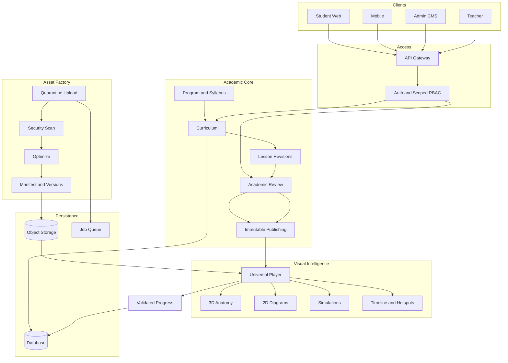
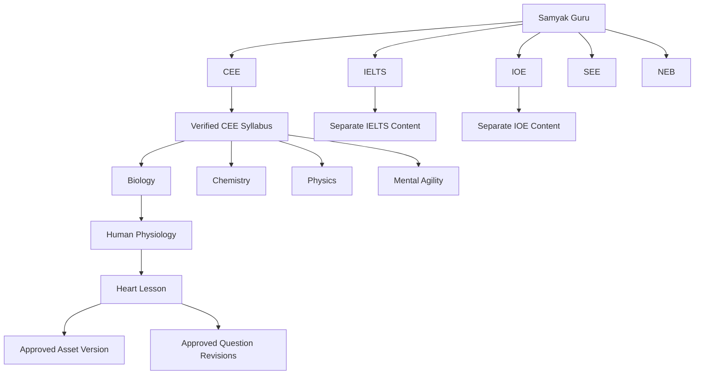
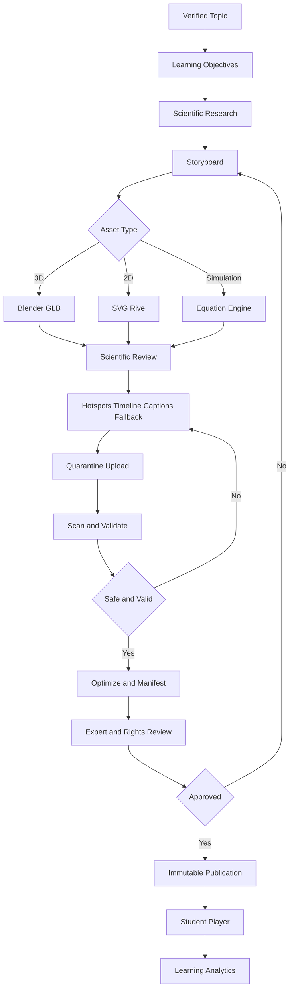
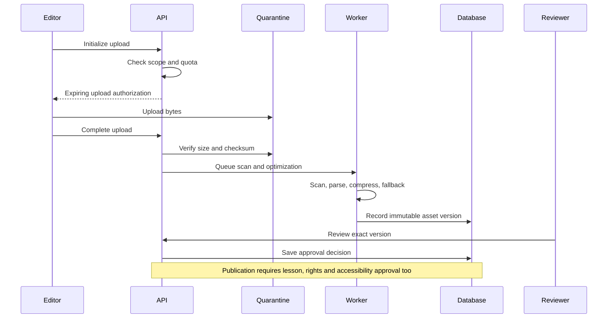
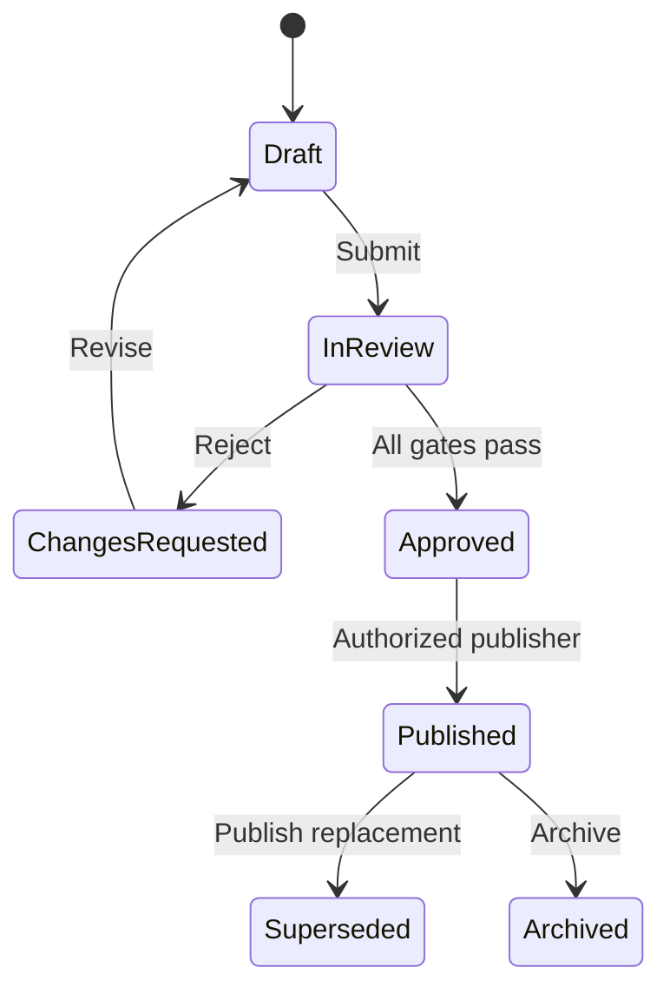
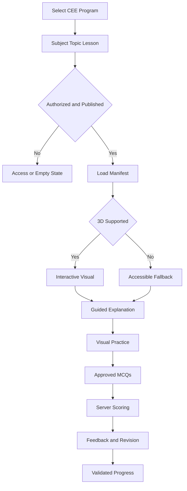
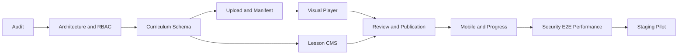

# Editable System Flowcharts (Mermaid)

## Master architecture

## Curriculum isolation

## Scientific asset factory

## Asset upload sequence

## Review state machine

## Student learning pipeline

## Sprint critical path

