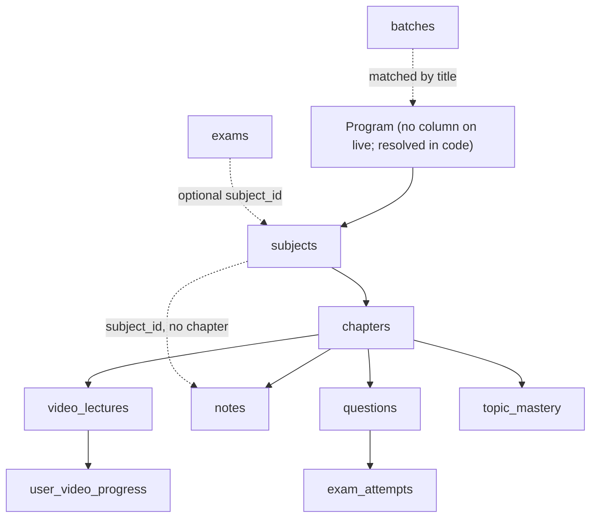
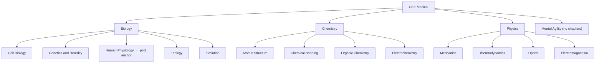
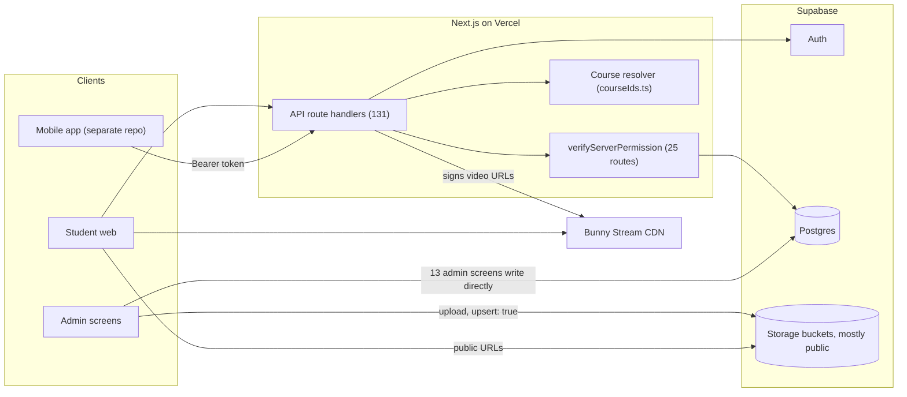

# Current Architecture (as built)

Measured on `recovery/production-nov12` at `a16e0bd`, 23 Nov 2026. Figures below are counts from the code or responses from the live site, not estimates.

## 1. Stack

| Layer | What is there | Evidence |
|---|---|---|
| Web app | Next.js 15.5.18 (App Router), React 19.0.3, TypeScript, Tailwind 3 | `package.json` |
| Size | 132 pages (37 admin), 131 API route handlers, 73 database tables referenced from code | counted from `src/app`, `.from('…')` calls |
| Auth | Supabase Auth: cookie sessions on web, `Authorization: Bearer` for the mobile app | `src/lib/supabase/route-auth.ts:5, 47` |
| Database | Supabase Postgres; 48 migration files in `supabase/migrations` (they **do not match live**, see §5) | |
| File storage | Supabase Storage buckets `notes-pdfs`, `lecture-videos`, `study-materials`, `diagrams-images`, `live-resources`, `doubt-images` | `supabase/migrations/20260715050000_admin_uploads.sql:8-14` |
| Video | Bunny Stream (HLS) + `hls.js` player; signed URLs when `BUNNY_TOKEN_KEY` is set | `src/components/video/BunnyHlsPlayer.tsx`, `src/app/api/video/sign/route.ts:95-115` |
| Validation | `zod` 4 in some routes | `src/lib/validation/schemas.ts:1` |
| Hosting | Vercel (project `samyakceemastery`); production deploys from branch `recovery/production-nov12`; previews per deployment; instant rollback to earlier deployments | Vercel deployments `dpl_C4dMcPdZ…` (live) and `dpl_A8Rq7vfY…` (previous) |
| Scheduled jobs | Two daily Vercel crons; no queue | `vercel.json` |
| CI | GitHub Actions: type check + 608 unit tests (57 files) on pushes and PRs to `main`, `recovery/**`, `feature/**` | `.github/workflows/ci.yml:31-35` |
| Mobile | Separate app (`com.samyakguru.learning`), **not in this repo**; uses the same APIs with bearer tokens and reads `/api/mobile/config` | `src/app/api/mobile/config/route.ts:10` |
| 3D / WebGL | None. One decorative 2D canvas animation on the home page | `src/components/3d/InteractiveParticleConstellation.tsx:23` |

## 2. How content is organised today

The hierarchy is **program → subject → chapter → resource**. A resource is a video (`video_lectures`), a note (`notes`), a question (`questions`) or an exam (`exams`). Programs are not a foreign key: since 23 Nov, `src/lib/courses/courseIds.ts:155` decides which course a row belongs to from the row's name and title, because the live tables have no `program_type` column.

Missing levels, against the target: syllabus version, topic, learning objective, lesson identity, lesson revision, asset, asset version, publication.

### CEE content on the live site (measured 23 Nov from `/api/curriculum?course=cee_medical`)

- **Chapters and quizzes:** 13 chapters, each with published questions, so each shows a chapter quiz.
- **Lessons:** 76 lessons (75 text notes, 1 PDF). 73 of them have a subject but no chapter.
- **Batches:** 3 CEE batches.
- **What's missing for the pilot:** there is no "Circulatory System" or "Human Heart" level, because the schema has no topics.

## 3. Request paths

Key facts behind the diagram:

- **Admin writes.** 13 admin screens and 32 browser components in total insert, update or delete rows directly with the browser Supabase client. For those writes, the only protection is row-level security; the server permission check never runs.
- **Server checks.** 25 route handlers call `verifyServerPermission` (`src/lib/auth/serverGuard.ts:65`). It resolves the role from `user_profiles`, or from a super-admin email allowlist (`:89`), then checks a role-wide permission.
- **Uploads.** Files go from the browser to storage with `upsert: true`, so a re-upload silently replaces a file (`src/app/admin/uploads/components/AdminUploadsClient.tsx:370, 572, 585, 792`). Public URLs are stored in the content rows.

## 4. Reusable building blocks

| Block | Where | Reuse for |
|---|---|---|
| Session + bearer auth | `src/lib/supabase/route-auth.ts:5` | Web player and mobile WebView requests |
| Role engine | `src/lib/auth/rbac.ts:8, 230`; `serverGuard.ts:65` | Base of scoped permissions (needs scope + persistence) |
| Audit service with seal | `src/lib/services/auditService.ts:35, 134` | CEE audit events |
| Server MCQ scoring | `src/app/api/exams/submit/route.ts:185` | Visual-lesson MCQ scoring logic |
| Signed CDN URLs | `src/app/api/video/sign/route.ts:95-115` | Pattern for signed asset URLs |
| Upload validators (unused) | `src/lib/security/uploadValidation.ts:62, 152` | Magic-byte and size checks in the upload pipeline |
| Rate limiter (in-memory) | `src/lib/security/rateLimiter.ts` | Per-instance limits on upload/progress routes |
| Course resolver | `src/lib/courses/courseIds.ts:155`; `programColumn.ts:24` | Program isolation for existing content |
| Lesson player shell | `src/app/learn/[lessonId]/components/LessonPlayerClient.tsx:34` (1,417 lines) | Host for a new visual-lesson panel |
| CEE exam blueprint | `src/lib/cee/blueprint.ts:26` | Botany/Zoology split, MEC marking |
| CI gate | `.github/workflows/ci.yml` | Extend with DB and E2E stages |

## 5. Schema drift: the repository is not the source of truth

| Table | Repository migrations say | Live database shows | How it was observed |
|---|---|---|---|
| `subjects`, `batches`, `notes`, `video_lectures` | `program_type VARCHAR(20) NOT NULL DEFAULT 'cee'` | column does not exist | Preview server logs, 23 Nov: `[course-isolation] subjects.program_type does not exist…` (and the same for the other three) |
| `chapters` | `chapter_number INTEGER` (`20260715003118_initial_schema.sql:62`) | queried by `sort_order` successfully (`src/app/api/curriculum/route.ts:116`) | Live curriculum responses |
| `subjects.name` | enum of 4 CEE names (initial schema) | 14 names incl. `loksewa_gk`, `engineering_math`, `neb_computer_science` | Live curriculum responses |

**Consequence.** No migration in this repo can be assumed to describe production, so any new migration must be written against a schema dump taken from live.
