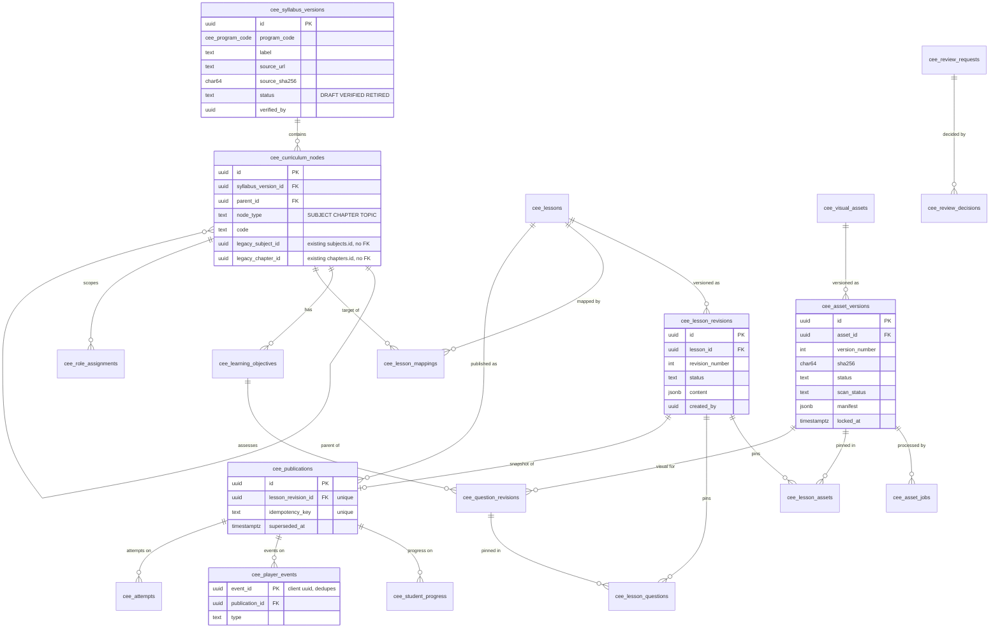

# Database Design (proposed, tested on a scratch database, not applied)

The schema is `supabase/proposed/20261124_cee_visual_foundation.sql`, with its rollback `…_ROLLBACK.sql` and tests `tests/cee_visual_foundation_test.sql`. They sit outside `supabase/migrations`, so `supabase db push` never applies them.

**It is additive.** It creates 21 `cee_*` tables, plus functions and triggers. It does not alter any existing table, put a foreign key on one, or lock one.

**Before it goes anywhere near production:**

1. It must be re-checked against a schema dump of the live database (see `CURRENT_ARCHITECTURE.md` §5).
2. It must be dry-run on the staging project.
3. It needs your approval.

## 1. Entity relationships

## 2. Tables

| Table | Purpose | Key rules (enforced in the database) |
|---|---|---|
| `cee_settings` | Feature flag `cee_visual_enabled` (starts `false`) | Server-read; no redeploy to switch |
| `cee_syllabus_versions` | One official syllabus per program and label | `VERIFIED` requires verifier, time and source hash (CHECK) |
| `cee_curriculum_nodes` | SUBJECT → CHAPTER → TOPIC (topics may nest) | Parent in the same syllabus; shape rules; no cycles; depth ≤ 32 (trigger). Sibling codes unique; partial index for roots (no nullable-unique trap) |
| `cee_learning_objectives` | Objectives per topic | Unique code per node |
| `cee_lessons` | Stable lesson identity | Unique slug; belongs to one program |
| `cee_lesson_revisions` | Versioned lesson content | Unique `(lesson, revision_number)`. Content frozen from `IN_REVIEW` onward. Status moves only along the state machine. `PUBLISHED` reachable only through `cee_publish_revision()` |
| `cee_lesson_mappings` | Lesson ↔ curriculum node | A lesson can't map into another program unless `cross_program` is set explicitly (trigger); the service gates that behind its own review |
| `cee_visual_assets` | Stable asset identity | Kind allowlist; licence and credit recorded |
| `cee_asset_versions` | Immutable bytes + manifest | Bytes, checksum and size never change. Published key is permanent. Manifest frozen once a review is requested. ≤ 50 MB (CHECK); lowercase-hex `sha256` |
| `cee_asset_jobs` | Processing steps per version | One row per step; ≤ 3 attempts, then `DEAD` |
| `cee_lesson_assets` | Pins exact asset versions to a revision | Role `PRIMARY` / `FALLBACK` / `SUPPORTING` |
| `cee_question_revisions` | Immutable MCQ revisions | Exactly 4 options; key A–D; rationale required; frozen from `IN_REVIEW` onward. Can link an asset version and visual state; `source_question_id` records an import from the existing `questions` table |
| `cee_lesson_questions` | Pins question revisions to a lesson revision | |
| `cee_review_requests` | One open request per entity and gate | Asset manifests lock when their first review is requested |
| `cee_review_decisions` | Append-only decisions | No update or delete. The creator of the reviewed item can't decide (separation of duties). One decision closes the request |
| `cee_publications` | Immutable publication snapshots | One per revision. One **active** per lesson (partial unique index). Idempotency key unique |
| `cee_role_assignments` | Scoped roles (program, optionally a subject node) | One active assignment per user, role and scope |
| `cee_audit_logs` | Append-only audit trail | No update or delete |
| `cee_student_progress` | One row per student and publication | Unique `(student, publication)`; completion set only by the server |
| `cee_player_events` | Raw player events | Client UUID primary key (duplicates rejected); type allowlist; payload ≤ 8 KB; append-only |
| `cee_attempts` | Submitted MCQ attempts | Append-only; idempotency key unique |

### Deviations from the handoff's schema (`04_DATABASE_SCHEMA.md`), and why

| Handoff | Here | Reason |
|---|---|---|
| `cee_exam_programs`, `cee_subjects` tables | `cee_program_code` domain; subjects are SUBJECT nodes linked to existing `subjects` rows | The platform already identifies programs by the canonical ids in `src/lib/courses/courseIds.ts`; existing CEE subjects stay the source of truth |
| `cee_asset_hotspots`, `cee_animation_sequences` tables | Inside `cee_asset_versions.manifest`, validated by zod and frozen with the version | They're versioned with the asset anyway, so one immutable unit avoids keeping two copies consistent. Node names are checked against the GLB at validation time |
| `cee_permissions (role_key, permission_key, scope_json)` | `cee_role_assignments` with typed scope columns | Typed columns can be indexed and constrained; free JSON scope can't |
| Foreign keys to existing subjects and chapters | Plain `legacy_*_id` uuids | A foreign key would change how existing admin screens delete chapters. That isn't additive, so the service checks these instead |

## 3. Publication transaction

`cee_publish_revision(revision_id, publisher_id, idempotency_key)` does all of this in one transaction:

1. **Retry check.** If the idempotency key was seen before, it returns the earlier publication.
2. **Lock and state.** It locks the revision row and requires the revision to be `APPROVED`.
3. **Who may publish.** The publisher must not be the author, and must hold an active `PUBLISHER` role for the lesson's program.
4. **Lesson review gates.** It requires the latest decision on each of `SYLLABUS_MAPPING`, `SCIENTIFIC`, `VISUAL`, `ASSESSMENT`, `ACCESSIBILITY` and `RIGHTS` to be `APPROVE`, for **this** revision.
5. **Mapping.** It requires an approved mapping into a `VERIFIED` syllabus.
6. **Assets.** Every pinned asset version must be:
   - `VALIDATED`, scanned `CLEAN`, promoted to a published key, and locked;
   - approved on `SCIENTIFIC`, `VISUAL` and `RIGHTS`.

   A 3D model also needs a `FALLBACK` asset.
7. **Questions.** Every pinned question revision must be `APPROVED`.
8. **Write.** It supersedes the previous active publication, then writes the publication and an audit row.

Any failure raises a named error, for example `ACADEMIC_APPROVAL_REQUIRED`, `ASSET_NOT_READY` or `FALLBACK_REQUIRED`, and nothing is written. The API maps these to the error codes in `API_SPECIFICATION.md`.

## 4. Access model

- **Row security** is enabled on all 21 tables. All privileges are revoked from `PUBLIC`, `anon` and `authenticated`, and no policies are created. The browser therefore can't read or write any of these tables.
- **Server access.** Route handlers use the service role, but only after `verifyCeeScope()`: session, role permission, program/subject scope, and separation of duties.
- **Publishing.** `cee_publish_revision` can't be called by `anon` or `authenticated`.
- **Server role.** `service_role` is granted exactly `SELECT, INSERT, UPDATE, DELETE` on each `cee_*` table and `EXECUTE` on the publish function, stated in the migration rather than inherited from Supabase's default privileges (no `TRUNCATE`, `REFERENCES` or `TRIGGER`).

**API-level evidence.** `src/lib/cee-visual/__tests__/admin.integration.test.ts` runs the whole editorial flow (roles, syllabus, lessons, drafts, submit, six reviews, publish) through the admin routes: 9 of 9 pass. `src/lib/cee-visual/__tests__/api.integration.test.ts` runs the real route handlers through supabase-js against PostgREST 12 on this schema (set up by `scripts/cee/it-setup.sh`): 12 of 12 pass, covering the flag, sign-in, course access, answer-key hiding, idempotent events and attempts, server-side completion and student isolation.

## 5. Test evidence (executed 24 Nov 2026, local Postgres 16, scratch database)

The schema was applied to a scratch database that mimics Supabase's default grants (`anon` and `authenticated` get table privileges by default, which the migration revokes). Then `tests/cee_visual_foundation_test.sql` ran: **61 of 61 checks passed** (re-run 24 Nov after adding the pin guard and the submit/decide functions below). They include the handoff's scenarios:

| Scenario | Check |
|---|---|
| CEE-001 | Biology → Human Physiology → Circulatory System → Human Heart tree accepted |
| CEE-002 | Mapping a CEE lesson into an IELTS node rejected (`CROSS_PROGRAM_MAPPING`) |
| CEE-004 | A signed-in or anonymous browser client gets `permission denied` on lesson revisions, lessons and the publish function |
| CEE-005 | A revision with requested changes can't be published (`STATE_CONFLICT`); unapproved gates block it (`ACADEMIC_APPROVAL_REQUIRED`) |
| CEE-006 | A submitted revision can't be edited (`IMMUTABLE_REVISION`); revising creates a new revision |
| CEE-009 | A duplicate event id is rejected |
| CEE-010 | A published revision can't be changed; the previous publication becomes `SUPERSEDED`; exactly one is active |
| Pins | Assets and questions pinned to a revision can't be added, removed or changed once it leaves DRAFT (`cee_guard_revision_pins`), so nothing can be swapped in after review |
| Submit | `cee_submit_revision()` moves a draft to review, freezes its questions and opens the six gates in one transaction; a second submit is refused |
| Decide | `cee_decide_review()` records a decision (authors refused), sends the revision back and cancels the other gates on requested changes, approves pinned questions on the assessment gate and the mapping on the syllabus gate, and approves the revision after six approvals |
| Concurrency | `cee_lesson_revisions.updated_at` moves on every change; the API saves a draft only if it still matches what the editor opened |

Also checked:

- Separation of duties, for review and for publishing.
- The publisher role is required, and publishing by a direct status flip is refused.
- Publishing is idempotent and writes an audit row.
- An unscanned asset, a missing fallback, or an unapproved question each block publication.
- Asset bytes and approved manifests are frozen.
- Decisions, audit rows, events and attempts are append-only.
- Questions need exactly 4 options.
- Events need an allowlisted type and a payload of ≤ 8 KB.

**The harness was also run against wrong expectations**, and it correctly reported FAIL.

**Rollback:**

- On a database where a lesson had been published, the rollback refused to run.
- On a fresh install it removed all 21 tables, 10 functions and the domain, and left a pre-existing `subjects` table and its row intact.
- Re-applying afterwards succeeded.

**What this does not prove:** that the schema applies cleanly to the live database. That needs the live schema dump and a staging dry-run (see `IMPLEMENTATION_ROADMAP.md`, FND-003).

## 6. Migration procedure (from handoff file 04, adapted)

1. **Baseline.** `supabase db dump --schema-only` from live → commit as `supabase/baseline/…` → reconcile against the repo's migrations.
2. **Staging.** Restore the baseline into the staging Supabase project.
3. **Dry run.** Apply `20261124_cee_visual_foundation.sql` on staging, run the test file, run the rollback, and re-apply.
4. **Integrity checks.** Confirm no existing table changed: diff the schema dump before and after, excluding `cee_*`.
5. **Production.** Apply only with your written approval, with the flag `cee_visual_enabled = false`. The app ships with the feature off, so app rollback never needs a schema rollback.
6. **Later changes.** Expand/contract only. Destructive changes need separate approval.
