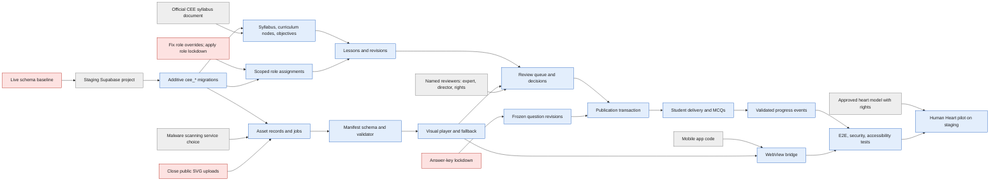

# Gap Analysis

What stands between today's platform (`CURRENT_ARCHITECTURE.md`) and the Foundation slice (`11_SPRINTS_AND_BACKLOG.md`). Everything proposed is **additive**: no existing table, route or page is replaced. Requirement IDs (A1…I7) refer to `FEATURE_INVENTORY.md`.

## 1. Reuse as is

| Existing piece | Evidence | Used for |
|---|---|---|
| Supabase Auth, cookie and bearer sessions | `src/lib/supabase/route-auth.ts:5, 47` | Every new route; the mobile WebView passes the same bearer token |
| Server MCQ grading logic | `src/app/api/exams/submit/route.ts:185` | Grading visual-lesson MCQs against frozen question revisions |
| Bunny video player | `src/components/video/BunnyHlsPlayer.tsx` | `VideoRenderer` inside the visual player |
| Audit service | `src/lib/services/auditService.ts:35, 134` | Called by every CEE CMS action, with a new `cee_audit_logs` table |
| CEE subjects and chapters | live: Biology → Human Physiology | Linked from new curriculum nodes (`legacy_chapter_id`); not duplicated |
| `zod` | `src/lib/validation/schemas.ts:1` | Manifest, request and event schemas |
| Lesson player shell | `src/app/learn/[lessonId]/components/LessonPlayerClient.tsx:34` | Hosts a link or panel to the visual lesson; the visual lesson gets its own route |
| CI gate | `.github/workflows/ci.yml` | Extended with a database stage and Playwright |

## 2. Fix before building on it

These are pre-existing defects that the new subsystem would otherwise inherit:

| Gap | Requirement | Evidence | Fix | Blocks |
|---|---|---|---|---|
| Repo migrations ≠ live schema | A6, I6 | `CURRENT_ARCHITECTURE.md` §5 | Take a schema-only dump from live; commit it as the baseline; write new migrations against it | Every migration |
| No isolated staging | I4 | Previews use the production database | Create a second Supabase project; point preview deployments at it | Dry runs, E2E, pilot |
| Permission overrides in memory and mis-parsed | H3 | `src/lib/auth/rbac.ts:132, 153` | Persist overrides; split on the first `:` only | Scoped RBAC |
| Answer keys readable by students | F2 | `src/app/components/MCQPreviewSection.tsx:60` | Review and merge `4c30093` (`20261122120000_answer_key_lockdown.sql`) | MCQ integrity for the pilot |
| Possible self-promotion to admin | H1 | `20261123130000_signup_trigger_and_role_lockdown.sql` written, not applied | Review and apply | Any role-based gate |
| Public SVG uploads | D6, H6 | `supabase/migrations/20260715050000_admin_uploads.sql:13` | Remove `image/svg+xml` from public buckets; SVGs go only through the new sanitising pipeline | Diagram assets |
| Upload validators unused | D3 | `src/lib/security/uploadValidation.ts:62, 152` | Call them server-side in the new upload routes, and later in the old ones | Asset pipeline |

## 3. Add (new, additive)

| Capability | Requirement(s) | Proposed home |
|---|---|---|
| Syllabus versions, curriculum nodes (subject → chapter → topic), learning objectives, verified mappings | B2, B4, B5, B6 | `cee_*` tables (`DATABASE_DESIGN.md`) |
| Lesson identity, immutable revisions, review requests and decisions, publications | B8, C2–C5 | `cee_lessons`, `cee_lesson_revisions`, `cee_review_*`, `cee_publications` |
| Scoped role assignments, checked server-side | H2 | `cee_role_assignments` + a `verifyCeeScope()` wrapper around `verifyServerPermission` |
| Asset identity and versions; quarantine and published buckets; upload init/complete; validation jobs | D1–D9 | `cee_visual_assets`, `cee_asset_versions`, `cee_asset_jobs`; private buckets `cee-quarantine`, `cee-published` |
| Manifest schema and validator; hotspots and sequences | E3, E4 | `src/lib/cee-visual/manifest.ts` (zod); `cee_asset_hotspots`, `cee_animation_sequences` |
| Visual player: shell, renderer registry, GLB and SVG renderers, fallback, accessibility | E1, E2, E5 | `src/components/visual-player/*`, lazy-loaded |
| Frozen question revisions linked to lesson revisions and visual state | F3, F7 | `cee_question_revisions`, `cee_lesson_questions` |
| Validated, idempotent progress events; server-computed completion | F5, F6 | `cee_player_events`, `cee_student_progress`; routes under `/api/v1/cee/me/…` |
| WebView bridge protocol | G3 | `src/lib/cee-visual/bridge.ts` + embed route, once the app code is available (G1) |
| Standard API envelope with request IDs | A5 | `src/lib/cee-visual/http.ts`, for the new routes only |
| Integration and E2E tests; migration dry-run | I2, I3, I6 | CI jobs against the staging project |

## 4. Gap and dependency graph

Arrows read "must exist before". Red: pre-existing problems to fix. Blue: new build. Grey: needs something outside the code.

## 5. What changes for existing users

Nothing, until the feature flag is switched on:

- No existing table is altered by the `cee_*` migrations.
- No existing route changes behaviour.
- No page links to visual lessons until a lesson is published and the flag is on.

The pre-existing fixes in §2 are separate changes, each with its own review. The answer-key lockdown and role lockdown touch live security behaviour, so they need your approval before they're applied.
