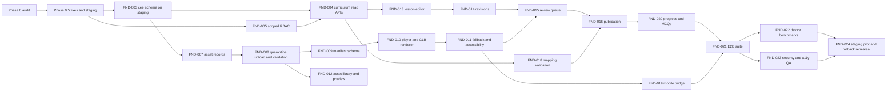

# Implementation Roadmap

Built on `11_SPRINTS_AND_BACKLOG.md`, recalibrated after the audit.

**About the estimates.** They are illustrative engineer-days for one full-stack engineer working with an AI assistant. Content production and academic review are separate human dependencies; they are not in the estimates, and they are usually the long pole.

## Phase 0: Discovery (this PR)

| Output | Status |
|---|---|
| `PROJECT_AUDIT.md`, `CURRENT_ARCHITECTURE.md`, `FEATURE_INVENTORY.md`, `GAP_ANALYSIS.md`, `RISK_REGISTER.md` | Done |
| `TARGET_ARCHITECTURE.md`, `DATABASE_DESIGN.md`, `API_SPECIFICATION.md`, this roadmap, `SPRINT_BACKLOG.md` | Done (proposals) |
| Proposed schema, tested on a scratch database (51 of 51 checks), with a tested rollback | Done; **not applied** |
| **Your decisions D1–D7** (`TARGET_ARCHITECTURE.md` §13) | **Waiting** |
| **Live schema dump; staging Supabase project** | **Waiting** (owner) |

## Foundation code built so far (branch `feat/cee-visual-foundation`)

Built and tested **locally**. Nothing is applied to any database, the feature flag is off, and every route returns 404 until the tables exist and the flag is turned on.

| Item | State |
|---|---|
| FND-005 scoped permissions | Rules in `src/lib/cee-visual/authz.ts`, unit-tested; CMS routes that use them not built yet |
| FND-008/009 file checks | GLB (structure + Khronos validator), SVG (allowlist) and manifest-vs-model checks, tested with malicious files; upload pipeline not built yet |
| FND-010/011 player | 3D player, layers, parts, guided tour, 2D fallback, context-loss recovery, keyboard, screen reader, reduced motion; checked in Chrome |
| FND-004/020 student API | Read routes, events, attempts, progress; integration-tested against PostgREST; lesson page tested end to end in Chrome |
| FND-019 bridge | Message protocol and validation, unit-tested; mobile harness not built |
| FND-013–017 CMS | Admin API and screens: roles, syllabus (with verification), lessons, draft editor, questions, submit, review queue, publish, audit; integration-tested and browser-tested end to end |

**24 Nov 2026, parallel build.** A separate implementation was pushed straight to the production branch (not deployed). The owner chose this design as the base. Its admin studio, review queue and course-page links were moved onto it. Its migrations are in `supabase/superseded/` (not to be applied), and its lesson text is in `content/cee-visual-drafts/` as unreviewed draft material.

## Phase 0.5: Fix what the new work depends on (≈3 days, needs your approval)

1. **Baseline.** Commit a schema dump of live; record every difference from the repo's migrations (FND-000).
2. **Staging.** Create the staging Supabase project and point Vercel preview deployments at it (FND-006a).
3. **Answer keys.** Merge the answer-key lockdown (`4c30093`) after re-review against the baseline.
4. **Roles.** Apply the role lockdown (`20261123130000`); fix the role-override parsing and persistence (`src/lib/auth/rbac.ts:132, 153`).
5. **SVG.** Stop accepting SVG into public buckets.

## Foundation: four weekly sprints

| Week | Goal | Exit criteria (all on **staging**) |
|---|---|---|
| 1 | Schema, scoped RBAC, curriculum APIs | Migration applied, tested and rolled back on staging. Scoped-permission tests pass: a Biology editor can't touch IELTS or IOE. Curriculum tree API returns the Human Physiology → Circulatory System → Human Heart nodes. No existing table changed (schema diff) |
| 2 | Asset pipeline and player | A labelled dev-fixture GLB and its SVG fallback upload to quarantine, validate, and preview in the player. A malicious SVG and a GLB with an external URI are rejected. WebGL disabled → fallback shown. The asset can't be published while unscanned |
| 3 | CMS, review and publication | Editor → six reviewers → publisher flow completes on staging. A rejection blocks publish. Editing creates a new revision. The author can't approve or publish. Every action is in the audit log |
| 4 | Progress, MCQs, mobile, release readiness | A student completes the lesson; progress is computed on the server, and duplicate events give no extra credit. MCQs are graded on the server with answers revealed only after submit. The bridge works in a WebView harness. E2E, security and accessibility suites pass. Benchmarks recorded on a named mid-range Android. Rollback rehearsed |

## What can't be finished in the Foundation without you

| Dependency | Needed by | If it's missing |
|---|---|---|
| Live schema dump | Week 1 | Nothing can be applied to staging with confidence |
| Staging project | Week 1 | No integration or E2E testing without risking production data |
| Malware scanner choice | Week 2 | Assets stay `NOT_SCANNED`; publication is refused by design |
| Official MEC CEE syllabus document | Week 3 | Mapping can't be verified; publication refused |
| Named reviewers (director, expert, rights; visual, assessment and accessibility can overlap) | Week 3 | Review flow can only be exercised with test accounts on staging |
| Approved heart model with rights | Pilot | The pilot runs with a labelled dev fixture on staging only; production publication stays blocked |
| Mobile app code or technology | Week 4 | The bridge is tested in a browser WebView harness only |
| A reference Android device (model named) | Week 4 | Performance targets stay "unmeasured" |

## After the Foundation

1. **Human Heart pilot on staging with real content**, then an academic sign-off, then a production rollout behind the flag:
   - staff first;
   - then a student cohort;
   - then everyone.
2. **More Biology topics:** Nephron, Mitosis/Meiosis, DNA replication, Photosynthesis. Each needs its own content production and review.
3. **Chemistry and Physics simulations, the AI tutor, offline packs.** These are later phases per handoff file 11. The AI tutor stays behind its own flag, grounded only in approved content.

## Release gates (from handoff file 10; none of them is met yet)

- Critical E2E tests pass, with recorded runs.
- Zero unresolved critical or high security findings.
- The syllabus is verified, and real published content has been academically reviewed.
- Every published 3D lesson has a fallback (enforced by the database).
- Role isolation is tested.
- A migration dry-run has passed on staging.
- Rollback has been rehearsed.
- Reference-device benchmarks are recorded.
