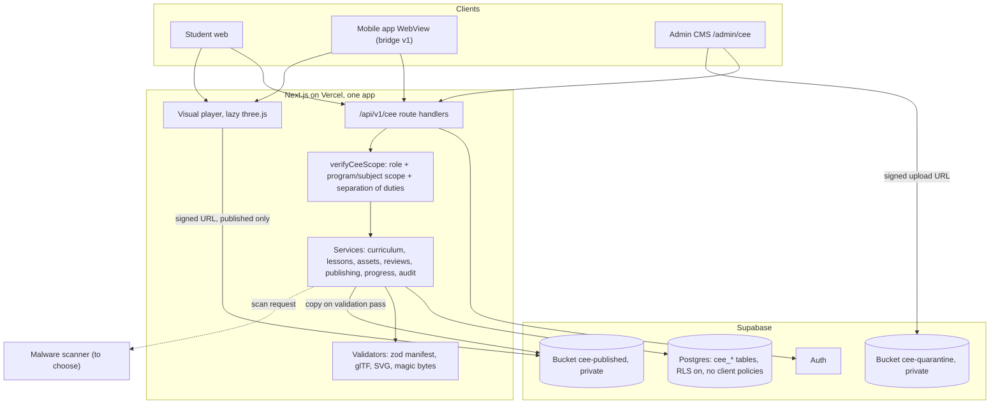
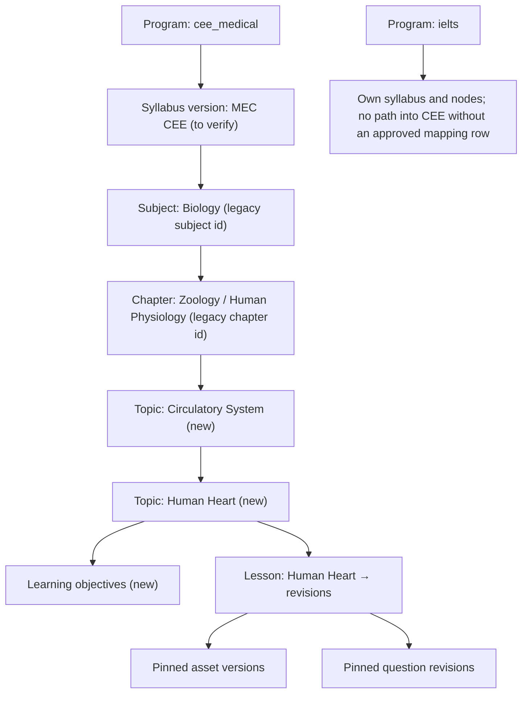
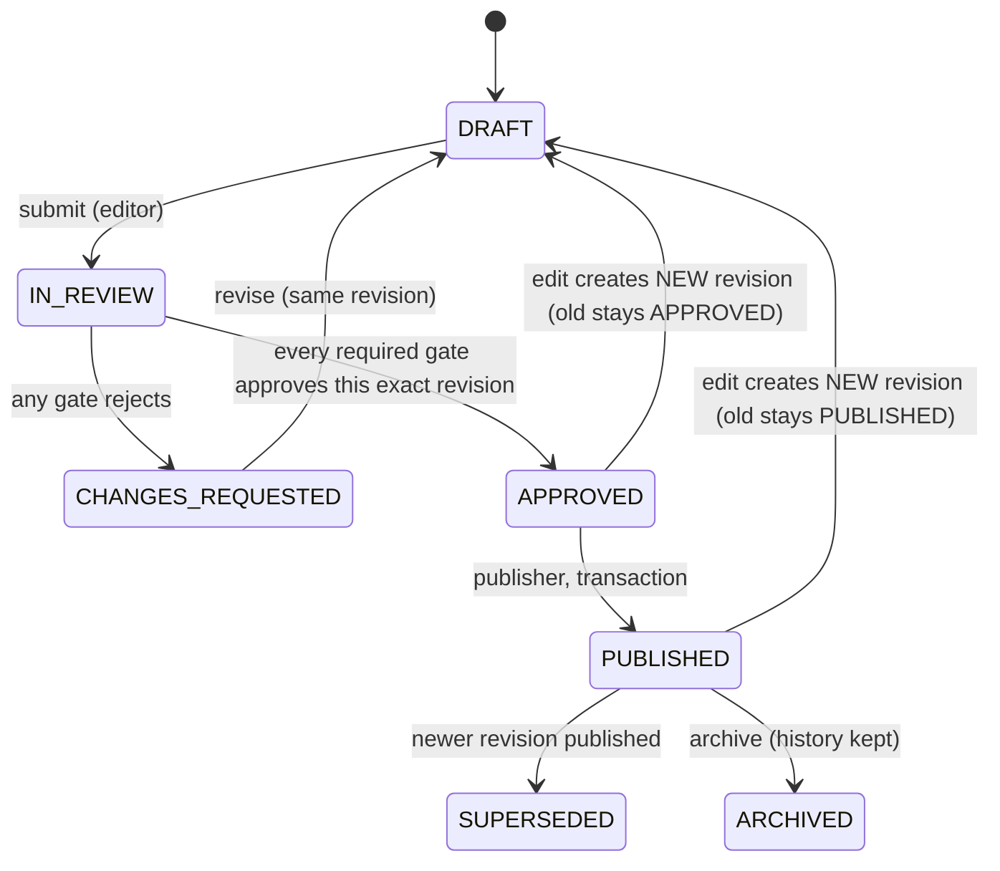
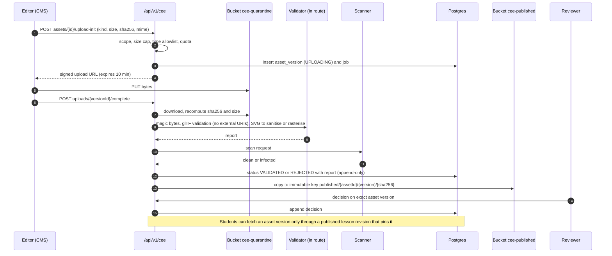
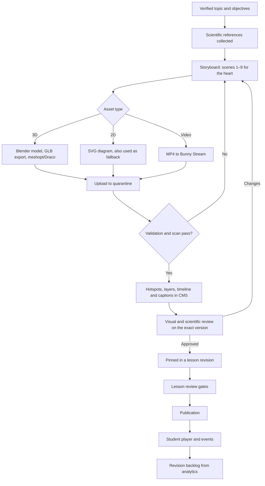
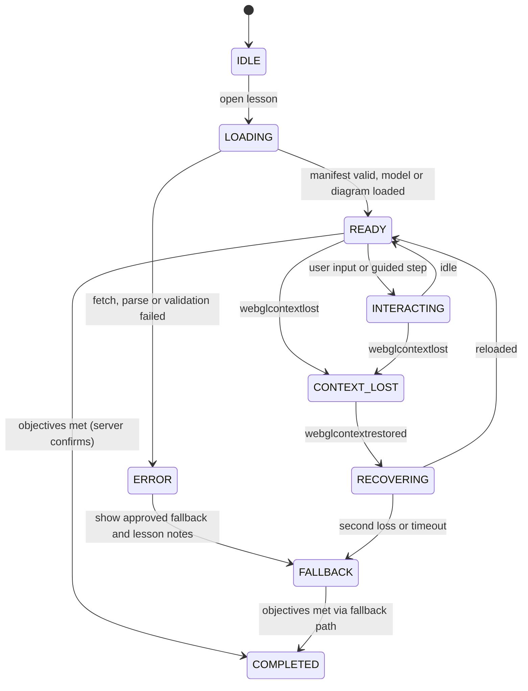
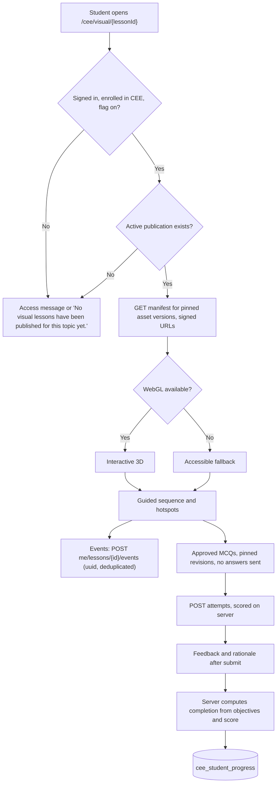
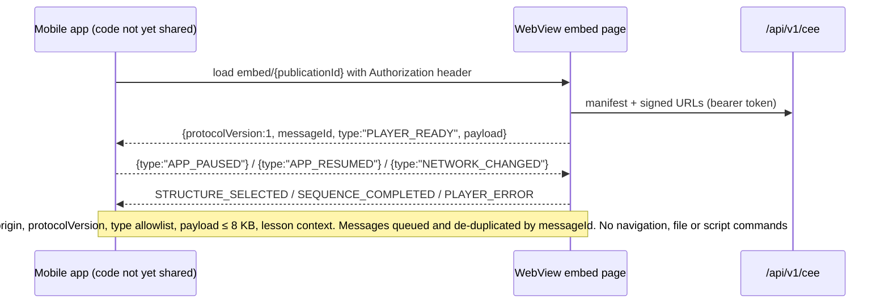
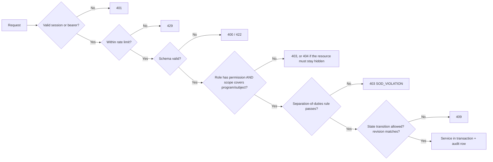

# Target Architecture (proposed)

**Status: proposal for approval. Nothing here is built.**

This document adapts the handoff's target (`02_SYSTEM_ARCHITECTURE.md`, `06`–`10`) to the stack the platform actually runs: Next.js 15 on Vercel, Supabase Auth, Postgres and Storage, and Bunny for video. As the handoff asks, it is a **modular monolith**: a new module inside the existing app, with no new services, and the existing auth system reused rather than replaced.

## 1. Principles

1. **Additive only.** New `cee_*` tables, new routes under `/api/v1/cee`, new pages under `/cee/visual`. No existing table or route changes behaviour.
2. **Server owns every decision.** The browser never writes CEE CMS tables directly, unlike the 13 admin screens today. Row security is on for every `cee_*` table, with **no** policies for `anon` or `authenticated`. All access goes through route handlers that check scope, then use the service role.
3. **Explicit program scope.** Every curriculum node carries its program and syllabus version. Sharing between programs needs a mapping row approved by an authorised person; nothing is shared by name or title.
4. **Immutable once approved.** Approved or published lesson revisions, asset versions and question revisions cannot be updated; a database trigger rejects it. Editing one creates a new draft.
5. **Nothing public until published.** Assets sit in private buckets and are served through short-lived signed URLs, only for published versions, and only to students allowed to see them.
6. **Feature-flagged.** The whole subsystem is behind `cee_visual_enabled`, a database flag the server reads, so it can be switched off without a redeploy.

## 2. Module layout inside the existing app

```text
src/
  app/
    api/v1/cee/                 route handlers (thin: parse → authorise → call service → envelope)
      curriculum/ lessons/ assets/ reviews/ publications/ me/
    cee/visual/[lessonId]/      student visual lesson page
    cee/visual/embed/[pubId]/   minimal page for the mobile WebView
    admin/cee/                  CMS screens (call /api/v1/cee only)
  lib/cee-visual/
    schemas.ts                  zod: requests, manifest, events, bridge messages
    http.ts                     envelope, error codes, request ids
    authz.ts                    verifyCeeScope(): role + scope + separation of duties
    curriculum.ts lessons.ts assets.ts reviews.ts publishing.ts progress.ts audit.ts
    storage.ts                  signed upload/download URLs, checksum
    validators/                 glb.ts, svg.ts, image.ts (magic bytes reuse uploadValidation.ts)
  components/visual-player/
    VisualPlayerShell.tsx  RendererRegistry.ts  Model3DRenderer.tsx (lazy)
    Diagram2DRenderer.tsx  VideoRenderer.tsx (wraps BunnyHlsPlayer)
    HotspotController.ts  LayerController.ts  AnimationTimeline.tsx
    FallbackController.tsx  AccessibilityController.tsx  PlayerEventBus.ts
    MobileBridgeAdapter.ts  VisualQuizPanel.tsx
supabase/migrations/            cee_* migrations, written against the live baseline
tests/e2e/                      Playwright, run against staging
```

## 3. Target architecture



## 4. Curriculum and isolation

Curriculum nodes form a tree: subject → chapter → topic. Each node belongs to one syllabus version, and each syllabus version to one program. Existing CEE subjects and chapters are **linked**, not copied. The "Human Physiology" node points at the live chapter through `legacy_chapter_id`, so existing questions and progress stay where they are. Tables are in `DATABASE_DESIGN.md`.



Rules enforced on the server and tested:

- A node's parent must belong to the same syllabus version.
- Cycles are rejected inside the transaction.
- A lesson can be mapped only to a node whose syllabus version is verified.
- A mapping across programs needs `content:map_cross_program` scope **and** a review decision.

## 5. Lesson revisions, review and publication



**Review gates** come from handoff file 08, configurable per lesson type. For the Human Heart lesson they are:

- syllabus mapping (academic director);
- scientific accuracy (subject expert);
- visual accuracy (visual reviewer);
- answer keys (question reviewer);
- accessibility;
- rights.

A gate is satisfied only by a decision on the **exact** revision, or on the exact asset version.

**Separation of duties.** The creator of a revision cannot approve any gate for it, and the publisher cannot be the creator. This is enforced in `verifyCeeScope` and again inside the publish transaction.

**The publish transaction.** It runs in one Postgres function, `cee_publish_revision(revision_id, publisher_id, idempotency_key)`, and does all of the following:

1. Locks the revision with `SELECT … FOR UPDATE`.
2. Checks that its state is `APPROVED`.
3. Checks every gate decision, and that the mapping's syllabus is verified.
4. Checks that every pinned asset version is `VALIDATED` with an approved scan, fallback and rights.
5. Checks that every pinned question revision is approved.
6. Supersedes the previous active publication.
7. Inserts the publication and an audit row.

The function is called through the service role, and either everything commits or nothing does. The idempotency key makes retries safe.

## 6. Asset pipeline



Choices, adapted to the stack:

**Storage.** Supabase Storage, in two private buckets:

- **Quarantine:** writable only through signed upload URLs.
- **Published:** written only by the server, under a content-addressed key that is never overwritten.

Delivery is through `createSignedUrl` with a short expiry. Moving to Bunny CDN later uses the same signed-URL contract.

**Validation in the route.** The work in the route is bounded by size caps:

- glTF validation uses `gltf-validator` (npm, runs in Node).
- External URIs and embedded scripts are rejected.
- Total size, triangle count and texture dimensions are capped.
- SVGs are either sanitised to an allowlist (no script, `foreignObject`, event handlers or external `href`) or rasterised to PNG for the fallback.

Anything beyond the bounds is rejected with a clear message. The animator optimises in Blender (meshopt or Draco) **before** upload, per handoff file 07.

**Jobs.** The job table `cee_asset_jobs` holds the state, attempts and last error. A failed step can be retried with `POST /admin/asset-versions/:id/validate`. After 3 attempts a job is marked `DEAD`, and nothing can publish from it. No new queue infrastructure is needed: Vercel cron is daily-only here, so jobs run in-request with retries.

**Malware scanning: decision needed.**

- Options: a hosted scanning API, or a ClamAV container on a small VM.
- Until a scanner is configured, scan status stays `NOT_SCANNED`, and **publication is refused** for that asset. This is the secure default.

## 7. Content and animation factory

This is the human workflow the CMS supports (handoff file 07).



## 8. Visual player

**Renderer choice (decision D2).** three.js through `@react-three/fiber` and `@react-three/drei`, imported with `next/dynamic` inside the visual lesson route only, so no other page grows.

**Rejected alternative:** Google `<model-viewer>`. It's lighter and has hotspots and a poster fallback built in, but it can't hide or isolate individual meshes, and the handoff requires layer isolation and clipping. It remains the fallback plan if bundle size on reference devices is unacceptable.

**Manifest.** Validated with zod before anything renders. The shape is handoff file 06's `VisualAssetManifest`, plus:

- a `layers[].nodeNames` mapping;
- `sequences[].steps` (time, camera, visible layers, caption);
- `fallback.kind` (`svg` | `png`), which is required for 3D.

**Allowed sources.** URLs must come from the signed-URL origin. Every GLB node name referenced by a hotspot or layer is checked against the actual file at validation time.



The fallback is never a dead end. Every objective must be reachable through the SVG or PNG fallback plus the text notes, per handoff 06 §Accessibility. With `prefers-reduced-motion`, timelines step instead of animating.

## 9. Student learning, MCQs and progress



**Grading.** Visual-lesson MCQs reuse the grading logic from `src/app/api/exams/submit/route.ts:185`. Answers are graded against the pinned `cee_question_revisions`, and the student never receives `answer_key` before submitting.

**Events.** Events have a whitelisted type, a client-generated UUID and a server receive time. A duplicate UUID returns `200` with `duplicate: true` and no credit.

**Completion.** It is computed on the server. All objectives must be met, by viewing the required sequence steps or fallback sections, plus the configured MCQ threshold. The client's "done" is never trusted.

## 10. Mobile bridge

The app opens `/cee/visual/embed/{publicationId}` in a WebView and passes its bearer token in a header. The embed page renders only the player and the quiz.



This work is **blocked** until the app's code or technology is known (G1). The web side can be built and tested first in a desktop browser and a mobile Chrome WebView harness.

## 11. Security



These controls map to the threat model in handoff file 10:

| Threat | Control |
|---|---|
| Cross-program IDOR | Scope check on every route; 404 for hidden resources |
| Drafts exposed | No client policies on `cee_*` tables; student routes read only `cee_publications` |
| Malicious GLB or SVG | Validators and scanner (§6) |
| URL leakage | Signed URLs expiring in ≤10 min; content-addressed keys |
| XSS | Notes rendered as sanitised markdown, as on the existing pages |
| Privilege escalation | Persisted scoped assignments; role lockdown migration (P2) |
| Duplicate events | Unique `event_id` |
| Publish races | Row lock plus idempotency key |

## 12. CI/CD and rollback

```mermaid
flowchart LR
  PR[Pull request] --> L[Type check, lint, unit tests]
  L --> DB["Migration dry-run on a throwaway Postgres seeded from the live baseline"]
  DB --> INT["Integration tests: routes + Postgres functions"]
  INT --> E2E[Playwright E2E on a preview pointed at STAGING]
  E2E --> SEC["Security checks: authz matrix, upload fuzz cases"]
  SEC --> REV[Human review and merge]
  REV --> STG[Staging deploy and academic pilot]
  STG --> APPROVE{Owner approves production?}
  APPROVE -->|Yes| PROD[Production deploy, flag OFF]
  PROD --> FLAG[Flag ON for staff, then a cohort, then everyone]
  FLAG --> MON{Errors or fallback rate above threshold?}
  MON -->|Yes| OFF[Flag OFF immediately, then Vercel rollback if needed]
  MON -->|No| DONE[Keep]
```



**Migrations are expand-only.** Down-migrations are written and rehearsed on staging, and destructive changes are never auto-run. A rollback of the app doesn't need a rollback of the schema, because the new tables are unused when the flag is off.

## 13. Architecture decisions to approve

| ID | Decision | Alternatives considered |
|---|---|---|
| D1 | `cee_*` tables in the existing Supabase Postgres | Separate database (rejected: duplicates auth and users) |
| D2 | three.js + R3F, lazy-loaded | `<model-viewer>` (kept as fallback plan) |
| D3 | Supabase Storage private buckets + signed URLs | Bunny Storage now (later, same contract) |
| D4 | In-request validation + job table + retry endpoint | External queue/worker (not justified at pilot volume) |
| D5 | Scoped role assignments, server-only CMS writes | Row-security policies per role (harder to audit and test) |
| D6 | Feature flag in a database settings row | Env var (needs redeploy) |
| D7 | Malware scanner | Hosted API vs ClamAV VM: **owner to choose** |
