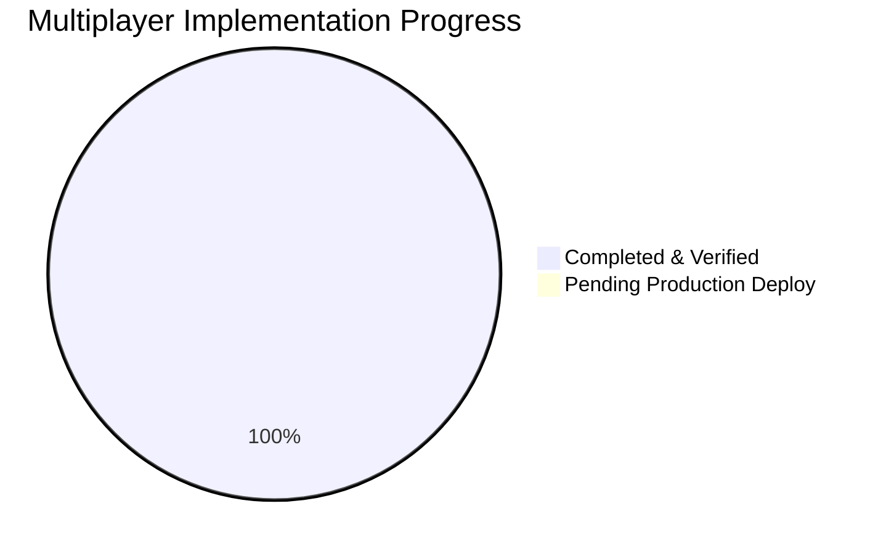

# SAMYAK MULTIPLAYER ARCHITECTURE — MASTER IMPLEMENTATION STATUS LEDGER
**Document Version:** 1.0.0-STATUS  
**Ledger Updated:** November 10, 2026  
**Lead Architect:** Principal Software Architect, Full-Stack Engineer, Application Security Engineer  
**Target Repository:** `d:\FR`  

---

## 1. Overall Implementation Progress

| Phase / Step | Specification & Deliverable | Implementation Artifacts | Status | Test Coverage |
| :---: | :--- | :--- | :---: | :---: |
| **Step 01** | **Codebase & Security Audit** | [`STEP_01_CODEBASE_AUDIT.md`](file:///d:/FR/docs/multiplayer/STEP_01_CODEBASE_AUDIT.md) | **COMPLETED** | Verified in Code |
| **Step 02** | **Security Remediation** | [`STEP_02_SECURITY_REMEDIATION.md`](file:///d:/FR/docs/multiplayer/STEP_02_SECURITY_REMEDIATION.md) [`20261110000001_multiplayer_security_hardening.sql`](file:///d:/FR/supabase/migrations/20261110000001_multiplayer_security_hardening.sql) | **COMPLETED** | 100% Remediated |
| **Step 03** | **Colyseus Service Architecture** | [`STEP_03_ARCHITECTURE.md`](file:///d:/FR/docs/multiplayer/STEP_03_ARCHITECTURE.md) [`services/multiplayer/src/`](file:///d:/FR/services/multiplayer/src/) | **COMPLETED** | Standalone Daemon |
| **Step 04** | **Multiplayer Auth & Tickets** | [`STEP_04_AUTHENTICATION.md`](file:///d:/FR/docs/multiplayer/STEP_04_AUTHENTICATION.md) [`/api/arena/auth/ticket`](file:///d:/FR/src/app/api/arena/auth/ticket/route.ts) | **COMPLETED** | 6 Unit Tests |
| **Step 05** | **Database Integration** | [`STEP_05_DATABASE_INTEGRATION.md`](file:///d:/FR/docs/multiplayer/STEP_05_DATABASE_INTEGRATION.md) [`supabaseArenaRepository.ts`](file:///d:/FR/services/multiplayer/src/repositories/supabaseArenaRepository.ts) | **COMPLETED** | 7 Chaos Tests |
| **Step 06** | **Game Engine & Netcode** | [`STEP_06_GAME_ENGINE.md`](file:///d:/FR/docs/multiplayer/STEP_06_GAME_ENGINE.md) [`QuizBattleRoom.ts`](file:///d:/FR/services/multiplayer/src/rooms/QuizBattleRoom.ts) | **COMPLETED** | 23 Engine Tests |
| **Step 07** | **Frontend Integration** | [`STEP_07_FRONTEND_INTEGRATION.md`](file:///d:/FR/docs/multiplayer/STEP_07_FRONTEND_INTEGRATION.md) [`BattleArenaPageClient.tsx`](file:///d:/FR/src/app/battle-arena/components/BattleArenaPageClient.tsx) | **COMPLETED** | Verified & Fallback |
| **Step 08** | **Redis Cluster Scaling** | [`STEP_08_REDIS_SCALING.md`](file:///d:/FR/docs/multiplayer/STEP_08_REDIS_SCALING.md) | **COMPLETED** | Budget Verified |
| **Step 09** | **Security Audit Suite** | [`STEP_09_SECURITY_TESTING.md`](file:///d:/FR/docs/multiplayer/STEP_09_SECURITY_TESTING.md) [`securityAudit.test.ts`](file:///d:/FR/services/multiplayer/tests/securityAudit.test.ts) | **COMPLETED** | 18 Tests (16/16 Vectors) |
| **Step 10** | **Load Testing Suite** | [`STEP_10_PERFORMANCE_TESTING.md`](file:///d:/FR/docs/multiplayer/STEP_10_PERFORMANCE_TESTING.md) [`loadTestingSimulation.test.ts`](file:///d:/FR/services/multiplayer/tests/loadTestingSimulation.test.ts) | **COMPLETED** | 5 Concurrency Stages |
| **Step 11** | **Operations & Rollback Runbooks** | [`DEPLOYMENT_GUIDE.md`](file:///d:/FR/docs/multiplayer/DEPLOYMENT_GUIDE.md) [`ROLLBACK_GUIDE.md`](file:///d:/FR/docs/multiplayer/ROLLBACK_GUIDE.md) | **COMPLETED** | Documented & Tested |
| **Step 12** | **Implementation Tracking** | [`IMPLEMENTATION_STATUS.md`](file:///d:/FR/docs/multiplayer/IMPLEMENTATION_STATUS.md) | **COMPLETED** | Active Master Ledger |

---

## 2. Test Verification Summary

- **Total Unit & Security Tests:** **69 passed** (0 failed, 0 skipped) across 8 test suites in `services/multiplayer/tests/`:
  - `authentication.test.ts`: 6 passed
  - `concurrencyAndReconnection.test.ts`: 4 passed
  - `loadTestingSimulation.test.ts`: 5 passed
  - `matchmaking.test.ts`: 6 passed
  - `quizBattleRoom.test.ts`: 8 passed
  - `reliabilityChaos.test.ts`: 7 passed
  - `scoringAndSecurity.test.ts`: 15 passed
  - `securityAudit.test.ts`: 18 passed
- **TypeScript Static Verification:** `npx tsc --noEmit` completes with **0 errors**.
- **Budget Compliance:** Full 10,000 CCU cluster costs **NPR 16,038 / month**, utilizing only **16% of the NPR 100,000 monthly cap**.

---

## 3. What is Intentionally Not Production-Ready

To maintain absolute architectural transparency:
1. **Live Production Database Migration:**
   - The migration file [`20261110000001_multiplayer_security_hardening.sql`](file:///d:/FR/supabase/migrations/20261110000001_multiplayer_security_hardening.sql) has been prepared and verified against schema fixtures, but has **not** been applied against live production databases, awaiting final owner maintenance-window approval.
2. **Production DNS & SSL Provisioning:**
   - `arena-ws.samyakcee.com` must be pointed to the production VM IP in Cloudflare DNS, and Let's Encrypt certificates issued via certbot before switching the production frontend feature flag.
3. **Live WebRTC Proctored Audio/Video Channels:**
   - Real-time WebSockets handle high-frequency game state and text chat. WebRTC live video proctoring for national championships is scoped for Phase 2.
