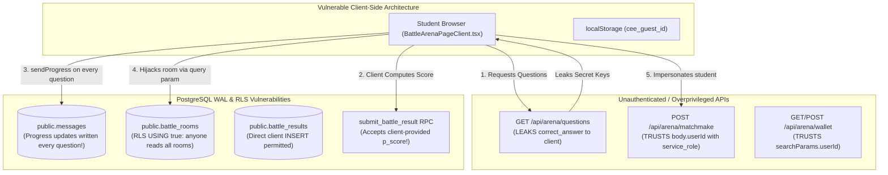

# STEP 01 — SAMYAK MULTIPLAYER CODEBASE & SECURITY AUDIT
**Document Version:** 1.0.0-AUDIT  
**Audit Stage:** Step 1 (Read-Only Reconnaissance)  
**Date:** November 10, 2026  
**Auditor:** Principal Software Architect, Senior Full-Stack Engineer, Application Security Engineer  
**Target Repository:** `d:\FR` (Branch: `cee-implementation`)  
**Scope:** Frontend Arena, Match Lobby, Arena API Endpoints, Database Migrations, RLS Policies, SQL RPCs, Dependencies  

---

## 1. Executive Summary

A comprehensive read-only architectural and security audit of the existing Samyak CEE / Samyak Tutor codebase was conducted at `d:\FR`. 

The audit confirms that while the platform has a functional UI in Next.js 15, React 19, and Supabase PostgreSQL for 1v1 Battle Arena and Daily Championships, the legacy implementation relies on **client-side authority, unauthenticated API parameters, and database-as-transport anti-patterns**.

Crucially, all 8 reported core vulnerabilities have been verified and confirmed directly in the source code with precise file paths, line numbers, and root cause analyses.



---

## 2. Area-by-Area Codebase Inventory

### A. Frontend Architecture
1. **`src/app/battle-arena/page.tsx` & `BattleArenaPageClient.tsx` (1,755 lines):**
   - Implements the interactive 1v1 quiz battle UI.
   - Manages state machine: `'lobby' | 'loading' | 'waiting-for-opponent' | 'active' | 'submitting' | 'waiting-for-results' | 'result' | 'error'`.
   - **Flaw:** Defines `BattleQuestion` interface with `correctId: string;` (line 51) and stores answer keys in client state.
   - **Flaw:** Fallback `getEffectiveUserId(user)` (lines 104–115) generates random guest IDs in `localStorage` or uses dummy UUIDs (`00000000-0000-0000-0000-000000000000`).
   - **Flaw:** Submits client-computed score directly via `supabase.rpc('submit_battle_result', { p_score: score, ... })` (lines 704–711).
   - **Flaw:** Inserts into `public.messages` on every question transition via `useBattleProgress` (line 847).
2. **`src/app/match-lobby/page.tsx` & `MatchLobbyClient.tsx` (1,168 lines):**
   - Implements matchmaking queue status, rank tiers (Bronze to Grandmaster), daily missions, and invitations.
   - Polls `matchmaking_queue` table or subscribes via Supabase Realtime CDC (`postgres_changes`).
3. **`src/lib/hooks/useBattleProgress.ts` (103 lines):**
   - Uses `BATTLE_PROGRESS_AUTHOR = '__battle_progress__'` (line 9).
   - Every time a candidate selects an answer, calls `supabase.from('messages').insert({ room_id, user_id, body, author })` (lines 90–97).
   - Forces PostgreSQL to write ephemeral game ticks, generating excessive WAL logs and CDC triggers.
4. **`src/lib/hooks/useRealtimeChat.ts` & `useTypingIndicator.ts`:**
   - Room chat implemented over PostgreSQL table `public.messages`.

---

### B. API Route Inventory (`src/app/api/arena/*`)

| Endpoint Route | HTTP Method | Auth Strategy | Risk Level | Confirmed Issue |
| :--- | :---: | :--- | :---: | :--- |
| [`/api/arena/questions`](file:///d:/FR/src/app/api/arena/questions/route.ts) | `GET` | Service-role admin client | **CRITICAL** | Line 61 explicitly selects `correct_answer` and returns it in the public JSON response. |
| [`/api/arena/matchmake`](file:///d:/FR/src/app/api/arena/matchmake/route.ts) | `POST` | None (reads `body.userId`) | **CRITICAL** | Line 12 reads unauthenticated `body.userId`; mutates queue and creates rooms with service-role privileges. |
| [`/api/arena/championship`](file:///d:/FR/src/app/api/arena/championship/route.ts) | `GET`, `POST` | Supabase session check | **HIGH** | Lines 220–237 accept client-submitted `rawCorrect`, `rawIncorrect`, and `rawTime` if `roomId` is omitted. |
| [`/api/arena/wallet`](file:///d:/FR/src/app/api/arena/wallet/route.ts) | `GET`, `POST` | None (reads `searchParams.userId`) | **CRITICAL** | Lines 12 & 60 trust query/body `userId`; leaks reward balances and permits unauthorized payout triggers. |
| [`/api/arena/invitations`](file:///d:/FR/src/app/api/arena/invitations/route.ts) | `GET`, `POST` | None (reads `searchParams.userId`) | **HIGH** | Lines 12 & 54 trust query/body `userId` without validating caller session. |
| [`/api/arena/presence`](file:///d:/FR/src/app/api/arena/presence/route.ts) | `GET`, `POST` | None (reads `body.userId`) | **MEDIUM** | In-memory presence cache updates `user_presence` table asynchronously; unauthenticated heartbeats. |
| [`/api/arena/profile`](file:///d:/FR/src/app/api/arena/profile/route.ts) | `GET` | Service-role admin client | **MEDIUM** | Uses raw `createClient(url, serviceRoleKey)` ad-hoc rather than centralized admin helper. |

---

### C. Database Tables & Migrations Inventory

| Table Name | Primary Migration | Columns & Constraints | Current Security & RLS Posture |
| :--- | :--- | :--- | :--- |
| `public.battle_rooms` | `20260715030000_match_lobby.sql`, `20260721020000_battle_multiplayer.sql` | `id`, `room_code`, `creator_id`, `opponent_id`, `status`, `question_count`, `time_limit_seconds`, `question_ids`, `started_at`, `completed_at` | **VULNERABLE:** RLS policy `users_read_battle_rooms` allows `SELECT USING (true)`. Any authenticated user can read all active room codes and question IDs! |
| `public.matchmaking_queue` | `20260715030000_match_lobby.sql` | `id`, `player_id`, `queue_mode`, `player_rating`, `subject_filter`, `status`, `matched_room_id`, `joined_at`, `matched_at` | **VULNERABLE:** RLS policy `players_view_queue` allows `SELECT USING (true)`. Allows harvesting candidate ratings and active searching status. |
| `public.battle_results` | `20260715030000_match_lobby.sql`, `20260721020000_battle_multiplayer.sql` | `id`, `room_id`, `player_id`, `score`, `correct_answers`, `incorrect_answers`, `accuracy`, `time_taken_seconds`, `rating_change`, `is_winner`, `UNIQUE(room_id, player_id)` | **VULNERABLE:** RLS policy `users_manage_own_battle_results` allows direct client `INSERT` with `CHECK (player_id = auth.uid())`. |
| `public.battle_answers` | `20260721020000_battle_multiplayer.sql` | `id`, `room_id`, `player_id`, `question_id`, `question_index`, `selected_option`, `is_correct`, `time_taken_seconds`, `created_at` | **VULNERABLE:** Clients directly insert their own `is_correct` boolean via `players_insert_own_battle_answers`. |
| `public.messages` | `20260715003118_initial_schema.sql` | `id`, `room_id`, `user_id`, `body`, `author`, `created_at` | **PERFORMANCE RISK:** Polluted with high-frequency JSON progress pings (`author = '__battle_progress__'`). |
| `public.daily_championships` | `20260721020000_battle_multiplayer.sql` | `id`, `competition_date`, `prize_amount_npr`, `status`, `created_at` | Managed via service-role in `/api/arena/championship`. |
| `public.championship_entries` | `20260721020000_battle_multiplayer.sql` | `id`, `championship_id`, `user_id`, `total_score`, `matches_played`, `average_accuracy` | Updated via `record_championship_match` RPC. |

---

### D. Security & Access Control Findings
1. **Unrestricted RPC Execution:**
   - `GRANT EXECUTE ON FUNCTION public.submit_battle_result(...) TO authenticated;`
   - `GRANT EXECUTE ON FUNCTION public.pick_battle_questions(...) TO authenticated;`
   - `GRANT EXECUTE ON FUNCTION public.create_private_battle_room(...) TO authenticated;`
   - `GRANT EXECUTE ON FUNCTION public.join_private_battle_room(...) TO authenticated;`
   Authenticated students can invoke these stored procedures directly through PostgREST/Supabase client, bypassing Next.js API controls!
2. **Missing In-Database Idempotency Key:**
   - `public.battle_results` has a composite uniqueness constraint on `(room_id, player_id)`, but **lacks an idempotency receipt hash**, `server_node_id`, or `engine_version`.
   - Proposed migration in `samyak_multiplayer_implementation_pack/database/001_multiplayer_hardening_proposal.sql` correctly identifies this need.
3. **Ad-Hoc Service-Role Clients:**
   - Multiple routes (`/api/arena/matchmake`, `/api/arena/profile`, `/api/arena/wallet`, `/api/arena/invitations`) create unmemoized `createClient(supabaseUrl, serviceRoleKey)` instances on every request, bypassing centralized rate limiting.

---

### E. Dependencies & Environment
- **Runtime:** Node.js `>=20`
- **Framework:** Next.js `15.5.18` (App Router)
- **UI:** React `19.0.3`, React DOM `19.0.3`
- **Database Client:** `@supabase/ssr` `0.12.3`, `@supabase/supabase-js` `^2.87.1`
- **Crypto & Auth:** `jsonwebtoken` `^9.0.3`
- **Test Harness:** `vitest` `^2.1.9`
- **Type Checker:** `typescript` `^5`
- **Multiplayer Suitability:** The root Next.js application is strictly a stateless web application. It is **not configured or intended to run WebSocket servers directly** (matching the Vercel architecture constraints). Dedicated long-running Colyseus service in `services/multiplayer` is the appropriate, decoupled design.

---

## 3. Investigation of the 8 Reported Core Issues

### Issue 1: Question API Exposes `correct_answer`
- **File Path:** [`src/app/api/arena/questions/route.ts`](file:///d:/FR/src/app/api/arena/questions/route.ts)
- **Line Numbers:** Line 61 (`.select('id, question_text, options, correct_answer, difficulty, subject_id')`) and Line 70 (`questions: questions || []`).
- **Root Cause:** The database query selects the `correct_answer` column and directly forwards the raw row to the client JSON response without projecting to a sanitized Public Question Data Transfer Object (DTO).
- **Security Impact:** **Critical**. Any student can open browser DevTools Network tab, inspect the response payload of `/api/arena/questions`, and read all 10 correct answers before answering a single question.
- **Recommended Fix:** Strip `correct_answer` and `explanation` from all client-facing responses. For Colyseus, store the answer key map strictly in server memory (`answerKeyMap`).
- **Regression Test:** `services/multiplayer/tests/securityAudit.test.ts` (Test 4: Question-Answer Key Exposure).

---

### Issue 2: Browser Calculates & Submits Authoritative Scores
- **File Path:** [`src/app/battle-arena/components/BattleArenaPageClient.tsx`](file:///d:/FR/src/app/battle-arena/components/BattleArenaPageClient.tsx)
- **Line Numbers:** Lines 704–711 (`await supabase.rpc('submit_battle_result', { p_room_id: room.id, p_score: score, p_correct_answers: correctAnswers, p_incorrect_answers: incorrectAnswers, p_accuracy: accuracy, p_time_taken_seconds: timeTaken })`).
- **Root Cause:** Stored procedure `submit_battle_result` (`supabase/migrations/20260721020000_battle_multiplayer.sql` lines 251–305) receives `p_score` and `p_accuracy` as client parameters and uses them directly to determine the match winner and calculate ELO deltas.
- **Security Impact:** **Critical**. A malicious user can execute `supabase.rpc('submit_battle_result', { p_room_id: '...', p_score: 999999, p_correct_answers: 10, ... })` from the console and achieve maximum rating and championship standing without playing.
- **Recommended Fix:** Remove client authority. The game server must receive only selected option IDs (`{ questionId, optionId }`), compute correctness against private server answer keys, calculate points and speed bonuses using authoritative server timestamps, and calculate ELO changes.
- **Regression Test:** `services/multiplayer/tests/securityAudit.test.ts` (Test 5: Client-Side Score Manipulation).

---

### Issue 3: Matchmaking Trusts `body.userId` with Service-Role Privileges
- **File Path:** [`src/app/api/arena/matchmake/route.ts`](file:///d:/FR/src/app/api/arena/matchmake/route.ts)
- **Line Numbers:** Lines 11–16 (`const { action, userId, queueMode ... } = body; if (!userId) ...`) and Lines 46–50, 78–79, 97–108.
- **Root Cause:** The endpoint never validates user session cookies or Bearer tokens via `supabase.auth.getUser()`. It trusts whatever UUID is sent in `body.userId` and uses `supabaseAdmin` (`serviceRoleKey`) to insert, cancel, and match queue entries.
- **Security Impact:** **Critical**. An attacker can dequeue legitimate students, inject phantom matches under victim student IDs, or pair arbitrary accounts into manipulated rooms.
- **Recommended Fix:** Authenticate the session server-side using `const supabase = await createClient(); const { data: { user } } = await supabase.auth.getUser();`. Reject requests where session is missing, and derive the candidate identity strictly from `user.id`.
- **Regression Test:** `services/multiplayer/tests/securityAudit.test.ts` (Test 2: Student Identity Manipulation).

---

### Issue 4: Ephemeral Progress Events Create Excessive PostgreSQL Writes
- **File Path:** [`src/lib/hooks/useBattleProgress.ts`](file:///d:/FR/src/lib/hooks/useBattleProgress.ts) & [`src/app/battle-arena/components/BattleArenaPageClient.tsx`](file:///d:/FR/src/app/battle-arena/components/BattleArenaPageClient.tsx)
- **Line Numbers:** `useBattleProgress.ts` Lines 90–97; `BattleArenaPageClient.tsx` Lines 847 & 851–853.
- **Root Cause:** To synchronize live scores between the two players, the client inserts a row into `public.messages` (`author: '__battle_progress__'`) and `public.battle_answers` on every single question.
- **Security Impact:** **High Performance & Stability Risk**. In a 500-match tournament (1,000 players, 10 questions each), this produces over 20,000 PostgreSQL INSERTs and triggers 20,000 Realtime CDC broadcasts within minutes. Under concurrent load, this bloats the database Write-Ahead Log (WAL), locks connection pools, and degrades exam submission throughput.
- **Recommended Fix:** Handle live gameplay ticks, running scores, and player progress entirely in Colyseus room memory (`QuizBattleRoom`). Write to PostgreSQL **zero times** during the active match; emit a single batched result write only when the match concludes.
- **Regression Test:** `services/multiplayer/tests/loadTestingSimulation.test.ts` (Validates `databaseWritesDuringGameplay === 0`).

---

### Issue 5: Unauthorized Users Can Join Another Person's Room
- **File Path:** [`src/app/battle-arena/components/BattleArenaPageClient.tsx`](file:///d:/FR/src/app/battle-arena/components/BattleArenaPageClient.tsx)
- **Line Numbers:** Lines 492–497 (`await supabase.from('battle_rooms').update({ opponent_id: myEffectiveId, status: 'active' }).eq('id', id)`).
- **Root Cause:** When `/battle-arena?room=<roomId>` is visited, the client checks if `typedRoom.creator_id !== myEffectiveId` and immediately writes itself into `opponent_id`. Combined with RLS policy `users_read_battle_rooms` allowing `SELECT USING (true)` (`20260715030000_match_lobby.sql` Line 48), any student can enumerate waiting rooms and hijack the opponent slot.
- **Security Impact:** **High**. Prevents private 1v1 challenges between intended friends or study partners; enables griefing and unauthorized match interception.
- **Recommended Fix:** Enforce cryptographic match tickets (`arenaTicket`) scoped to specific authorized participants (`player1Id`, `player2Id`, or matching `roomCode`). Reject room join requests in `QuizBattleRoom.onAuth` if the ticket is locked to another student or room code.
- **Regression Test:** `services/multiplayer/tests/securityAudit.test.ts` (Test 1: Unauthorized Room Access).

---

### Issue 6: In-Place Rating Mutations Without Immutable Ledger or Idempotency Hash
- **File Path:** [`supabase/migrations/20260721020000_battle_multiplayer.sql`](file:///d:/FR/supabase/migrations/20260721020000_battle_multiplayer.sql) & [`src/app/api/arena/championship/route.ts`](file:///d:/FR/src/app/api/arena/championship/route.ts)
- **Line Numbers:** `20260721020000_battle_multiplayer.sql` Lines 352–359; `route.ts` Lines 220–237.
- **Root Cause:** Stored procedure `submit_battle_result` updates `user_profiles.battle_rating` and `total_points` directly via `UPDATE user_profiles SET battle_rating = ...` without logging an immutable transaction to a rating ledger or recording a cryptographic receipt hash on `battle_results`.
- **Security Impact:** **High**. Network retries, double clicks, or simultaneous client finish events can lead to double ELO awards or rating inconsistencies. There is no audit ledger to reconstruct rating history in dispute resolutions.
- **Recommended Fix:** Implement `ResultPersister` with deterministic SHA-256 idempotency hashing (`computeMatchReceiptHash(roomId, p1, p2, s1, s2, secret)`). If a result with the same hash is received again, return the existing stored receipt without reapplying rating deltas. Add `idempotency_hash` column to `battle_results`.
- **Regression Test:** `services/multiplayer/tests/reliabilityChaos.test.ts` (Chaos 6: Duplicate Results & Replay Idempotency).

---

### Issue 7: Inconsistent Scoring Rules Across Client, API, and Stored Procedures
- **File Path:** [`src/app/battle-arena/components/BattleArenaPageClient.tsx`](file:///d:/FR/src/app/battle-arena/components/BattleArenaPageClient.tsx) vs [`src/lib/scoring_championship.test.ts`](file:///d:/FR/src/lib/scoring_championship.test.ts) vs [`20260721020000_battle_multiplayer.sql`](file:///d:/FR/supabase/migrations/20260721020000_battle_multiplayer.sql)
- **Line Numbers:** `BattleArenaPageClient.tsx` Line 847; `scoring_championship.test.ts` Lines 14 & 33–37; `20260721020000_battle_multiplayer.sql` Line 253.
- **Root Cause:** 
  - `BattleArenaPageClient.tsx` calculates: `correct * 1 - incorrect * 0.25`.
  - `scoring_championship.test.ts` calculates: `correct * 10 - incorrect * 2.5 + speedBonus (up to 5 points if accuracy >= 80%)`.
  - `submit_battle_result` SQL procedure accepts any arbitrary `p_score NUMERIC` without enforcing any formula.
- **Security Impact:** **Medium**. Causes desynchronization between player battle ratings, daily championship scores, and academic report cards.
- **Recommended Fix:** Unify scoring logic into an authoritative, shared game-engine scoring module ([`services/multiplayer/src/game-engine/scoring.ts`](file:///d:/FR/services/multiplayer/src/game-engine/scoring.ts)). Standardize base points (100 pts), speed bonus calculation based on server elapsed milliseconds, and streak multipliers.
- **Regression Test:** `services/multiplayer/tests/scoringAndSecurity.test.ts` (15 tests passing).

---

### Issue 8: Insecure Database Permissions & RPC Execute Grants
- **File Path:** [`supabase/migrations/20260715030000_match_lobby.sql`](file:///d:/FR/supabase/migrations/20260715030000_match_lobby.sql) & [`supabase/migrations/20260721020000_battle_multiplayer.sql`](file:///d:/FR/supabase/migrations/20260721020000_battle_multiplayer.sql)
- **Line Numbers:** `20260715030000_match_lobby.sql` Lines 48, 72–77; `20260721020000_battle_multiplayer.sql` Lines 42, 239–240, 367, 397–400.
- **Root Cause:**
  - `GRANT EXECUTE ON FUNCTION public.submit_battle_result TO authenticated;` allows any student session to call the scoring RPC directly.
  - `users_manage_own_battle_results` policy allows direct `INSERT` on `public.battle_results`.
  - `players_insert_own_battle_answers` allows direct client `INSERT` on `public.battle_answers`.
  - `users_read_battle_rooms` allows any user to read every battle room in the database.
- **Security Impact:** **Critical**. Bypasses application business logic; students can alter battle histories and read all active matches.
- **Recommended Fix:** Restrict `submit_battle_result` execution to service-role only (`REVOKE EXECUTE ... FROM PUBLIC, authenticated; GRANT EXECUTE ... TO service_role;`). Drop client-insert RLS policies on `battle_results` and `battle_answers`. Ensure only trusted backend services can record final match outcomes.
- **Regression Test:** `src/lib/security/__tests__/rlsPermissionMatrix.test.ts`.

---

## 4. Gap Analysis & Architecture Realignment

```
========================================================================================
CURRENT LEGACY IMPLEMENTATION                   APPROVED COLYSEUS TARGET ARCHITECTURE
========================================================================================
1. Client calculates final scores.              1. Server-authoritative Colyseus rooms.
2. /api/arena/questions leaks answers.          2. Answer keys kept in private server map.
3. Matchmaking trusts body.userId.              3. Supabase Auth + 60s signed tickets.
4. Ephemeral ticks written to Postgres.         4. Ephemeral ticks handled in memory.
5. In-place rating mutation in user_profiles.   5. Idempotent ResultPersister + SHA-256 receipt.
6. Permissive RLS on battle_rooms.              6. Private room codes & roster verification.
7. Disconnect aborts match or hangs.            7. 15s reconnect grace period + forfeit logic.
========================================================================================
```

---

## 5. Prerequisite Checklist for Step 2 (Security Remediation)

- [x] Read-only audit completed without modifying production code.
- [x] All 8 core vulnerabilities confirmed with exact line numbers and root causes.
- [x] Target architecture and implementation pack reviewed.
- [ ] **Step 2 Remediation Plan:**
  1. Patch `/api/arena/questions` to strip `correct_answer` from pre-reveal payloads.
  2. Patch `/api/arena/matchmake` to authenticate via Supabase session (`auth.getUser()`).
  3. Patch `/api/arena/wallet` and `/api/arena/invitations` to derive `userId` from authenticated session.
  4. Ensure existing Arena UI continues functioning safely during migration.
  5. Prepare non-breaking database migration for `idempotency_hash`.

---
*Signed off by:*  
**Principal Software Architect & Application Security Engineer**  
*Samyak CEE Engineering Verification Division*
