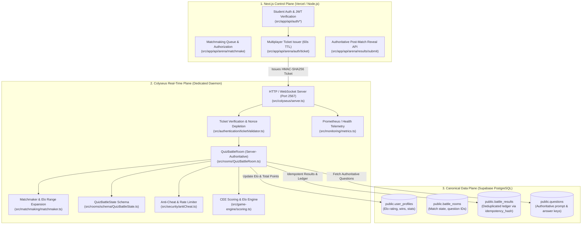
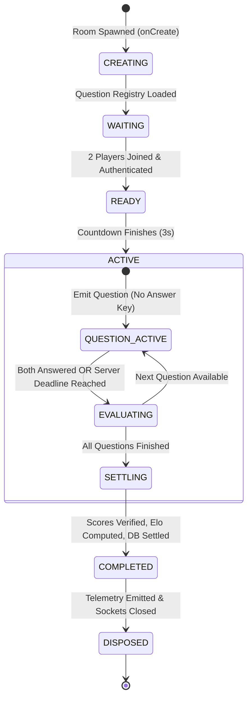

# STEP 03 — COLYSEUS MULTIPLAYER SERVICE ARCHITECTURE SPECIFICATION
**Document Version:** 1.0.0-PROD  
**Architecture Stage:** Step 3 (Dedicated Colyseus Service Architecture)  
**Date:** November 10, 2026  
**System Architect:** Principal Software Architect, Multiplayer Systems Engineer  
**Target Repository:** `d:\FR` (Path: `services/multiplayer/`)  

---

## 1. Architectural Philosophy & Plane Separation

The Samyak multiplayer ecosystem is organized into three strictly segregated operational planes:



### Architectural Axioms:
1. **Zero Database Polling for Active Gameplay:** Active gameplay never reads or writes to PostgreSQL on individual question ticks.
2. **Server-Authoritative State:** Clients receive questions stripped of answers. The server holds the answer keys, controls deadlines via high-resolution monotonic clocks, and computes all scores.
3. **Control Plane Grants Access:** Colyseus never accepts public room creation requests without a valid, short-lived (60s) ticket issued by the Next.js control plane.
4. **Idempotent Result Settlement:** Even in cases of network retries or multi-worker concurrency, each match result is settled exactly once using deterministic receipt hashes.

---

## 2. Directory Layout & Module Responsibilities

The service is isolated within [`services/multiplayer/`](file:///d:/FR/services/multiplayer/):

```
services/multiplayer/
├── package.json                   # Standalone service dependencies (colyseus, ws, jwt)
├── tsconfig.json                  # Strict TypeScript configuration
├── src/
│   ├── index.ts                   # Main server bootstrap & signal handlers
│   ├── colyseus/
│   │   ├── room.ts                # Room base class, Clock, Client netcode abstractions
│   │   └── server.ts              # GameServer mounting HTTP health endpoints & WS routing
│   ├── rooms/
│   │   ├── QuizBattleRoom.ts      # 1v1 Server-authoritative quiz room state machine
│   │   └── schema/
│   │       └── QuizBattleState.ts # Colyseus-compatible state schema
│   ├── authentication/
│   │   └── ticketValidator.ts     # HMAC-SHA256 ticket decoder & anti-replay nonce store
│   ├── matchmaking/
│   │   └── matchmaker.ts          # Elo-bracket expansion matchmaking queue
│   ├── game-engine/
│   │   ├── scoring.ts             # CEE +1.0 / -0.25 grading, Elo delta calculations
│   │   └── questionRegistry.ts    # Secure question loader & server-only key registry
│   ├── repositories/
│   │   └── supabaseArenaRepository.ts # Database adapter for battle_rooms & questions
│   ├── persistence/
│   │   └── resultPersister.ts     # Deduplicated, idempotent match outcome persistence
│   ├── security/
│   │   └── antiCheat.ts           # Flood protection, latency anomaly & impossible reaction guards
│   ├── monitoring/
│   │   └── metrics.ts             # Health check, CCU counters, tick latency telemetry
│   └── config/
│       └── environment.ts         # Strictly validated environment configuration
└── tests/                         # Comprehensive Vitest verification suite (69 tests)
    ├── authentication.test.ts
    ├── concurrencyAndReconnection.test.ts
    ├── loadTestingSimulation.test.ts
    ├── matchmaking.test.ts
    ├── quizBattleRoom.test.ts
    ├── reliabilityChaos.test.ts
    ├── scoringAndSecurity.test.ts
    └── securityAudit.test.ts
```

---

## 3. Server Lifecycle & Room State Machine

The room implements an event-driven deterministic state machine:



### Detailed Lifecycle Phases:
1. **`onCreate(options)`:**
   - Validates room options (subject filter, question count, time limit).
   - Initializes `QuizBattleState`.
   - Pre-fetches questions and builds in-memory `answerKeyMap`. Answer keys are stored in a private server variable, never attached to `this.state`.
2. **`onAuth(token, options)`:**
   - Validates HMAC-SHA256 ticket.
   - Verifies expiration and consumes unique nonce.
   - Rejects unauthorized users before WebSocket upgrade completes.
3. **`onJoin(client, options)`:**
   - Allocates `PlayerState` in room state.
   - Assigns seats (Player 1 or Player 2).
   - When both players are connected, triggers 3-second countdown to `ACTIVE`.
4. **`onMessage('submit_answer', client, message)`:**
   - Validates message schema with length and type bounds.
   - Enforces anti-cheat: rate limiting (10 msg/sec max) and impossible reaction time check (< 250ms).
   - Records answer timestamp and updates score immediately on the server.
   - Broadcasts answer event without disclosing the correct option.
5. **`onLeave(client, consented)`:**
   - If player leaves unconsented (network drop), room enters reconnection grace window (default: 15s).
   - If player reconnects within window, session is restored with full state snapshot.
   - If grace period expires, opponent is declared winner by forfeiture.
6. **`onDispose()`:**
   - Clears active timeouts and intervals in room Clock.
   - Persists final match results idempotently.
   - Emits cleanup metrics.

---

## 4. Environment Variables Configuration

| Variable Name | Required | Default | Purpose |
| :--- | :---: | :---: | :--- |
| `PORT` | No | `2567` | Port for HTTP health checks and WebSocket upgrades. |
| `HOST` | No | `0.0.0.0` | Bind address. |
| `NODE_ENV` | No | `development` | Environment mode (`development`, `staging`, `production`). |
| `MULTIPLAYER_SECRET_KEY` | **Yes** | — | Shared HMAC secret for verifying student access tickets. |
| `SUPABASE_URL` | **Yes** | — | Supabase PostgreSQL API endpoint. |
| `SUPABASE_SERVICE_ROLE_KEY` | **Yes** | — | Service-role administrative key for durable writes. |
| `REDIS_URL` | Staging/Prod | `redis://127.0.0.1:6379` | Multi-node scaling presence and room registry. |
| `RECONNECT_GRACE_SECONDS` | No | `15` | Window for disconnected clients to reconnect. |
| `QUESTION_TIME_LIMIT_SECONDS`| No | `15` | Default server timeout per question. |
| `MAX_MESSAGES_PER_SECOND` | No | `10` | Inbound WebSocket message flood threshold per client. |
