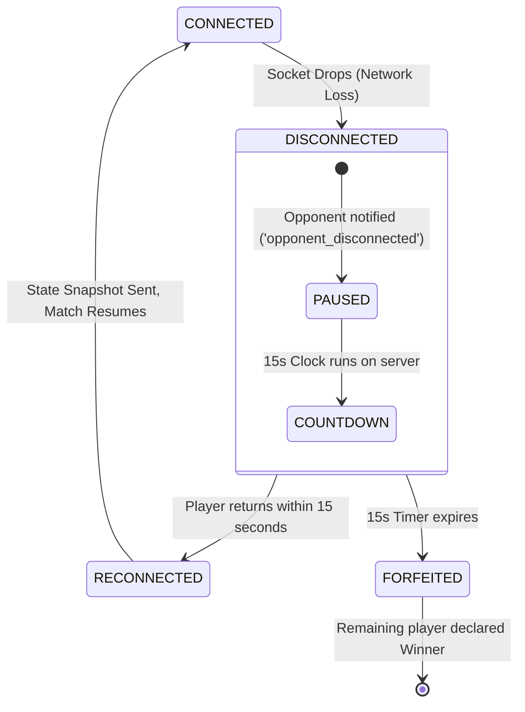

# STEP 06 — SERVER-AUTHORITATIVE 1V1 QUIZ BATTLE ENGINE & NETCODE SPECIFICATION
**Document Version:** 1.0.0-ENGINE  
**Stage:** Step 6 (Game Engine, Netcode & Scoring Architecture)  
**Date:** November 10, 2026  
**Multiplayer Engineer:** Senior Multiplayer Systems Engineer, Full-Stack Engineer  
**Target Repository:** `d:\FR` (Paths: `services/multiplayer/src/rooms/QuizBattleRoom.ts`, `services/multiplayer/src/game-engine/scoring.ts`, `services/multiplayer/src/rooms/schema/QuizBattleState.ts`)  

---

## 1. Engine Philosophy & Authoritative Netcode

In peer-to-peer or client-authoritative games, clients evaluate outcomes and send results to the server. For competitive academic exams where scholarship awards and cash prizes are at stake, this design is untenable.

The Samyak Quiz Battle Engine enforces **100% Server Authority**:
- **Clients are dumb terminals:** They render the current question, capture the candidate's tap, and transmit `{ questionId, selectedOptionId }`.
- **The server holds all authority:** The server validates answer timing, evaluates correctness against memory-resident keys, tracks timeouts via high-resolution monotonic clocks, updates player scores, reconciles Elo ratings, and decides when the match advances.

```mermaid
sequenceDiagram
    autonumber
    participant P1 as Player 1 (Browser)
    participant Srv as QuizBattleRoom (Server)
    participant P2 as Player 2 (Browser)

    Note over Srv: 1. Both Players Connected -> 3s Countdown
    Srv->>P1: 'question_active' { id, prompt, options } [NO ANSWER KEY]
    Srv->>P2: 'question_active' { id, prompt, options } [NO ANSWER KEY]
    
    Note over Srv: Server Clock starts (15s Deadline)
    
    P1->>Srv: 'submit_answer' { questionId, selectedOptionId: 'b' } (at t=3.2s)
    Note over Srv: Validate: responseTime >= 250ms, qIndex valid, not duplicate
    Note over Srv: Server checks answerKeyMap: 'b' is CORRECT (+1.0 pt)
    Srv-->>P1: 'answer_received' { status: 'recorded' }
    Srv-->>P2: 'opponent_answered' { opponentId, answered: true }
    
    P2->>Srv: 'submit_answer' { questionId, selectedOptionId: 'a' } (at t=5.1s)
    Note over Srv: Server checks answerKeyMap: 'a' is INCORRECT (-0.25 pt)
    Srv-->>P2: 'answer_received' { status: 'recorded' }
    Srv-->>P1: 'opponent_answered' { opponentId, answered: true }
    
    Note over Srv: Both answered -> Advance immediately without waiting for full 15s!
    Srv->>P1: 'round_summary' { scores: { p1: 1.0, p2: 0 } }
    Srv->>P2: 'round_summary' { scores: { p1: 1.0, p2: 0 } }
```

---

## 2. Academic CEE Scoring Rules

Scoring adheres to the strict guidelines of the Nepal Medical Education Commission (CEE):

$$\text{Score} = \max\left(0, \left(\text{CorrectCount} \times 1.0\right) - \left(\text{IncorrectCount} \times 0.25\right)\right)$$

$$\text{Accuracy} = \operatorname{round}\left(\frac{\text{CorrectCount}}{\text{TotalQuestions}} \times 100\right)$$

### Key Rules:
1. **Positive Reward:** $+1.0$ point per correct choice.
2. **Negative Penalty:** $-0.25$ negative marking deduction per incorrect choice.
3. **Unanswered:** $0$ penalty (encourages strategic omission over random guessing).
4. **Non-Negative Score Floor:** Total accumulated score cannot fall below $0$.
5. **Tie-Breaking:** If scores are tied, the candidate with lower total answer latency is ranked higher.

---

## 3. Authoritative Elo Rating Reconciliation

Ratings are reconciled using standard Elo chess mathematics with $K = 32$:

$$E_1 = \frac{1}{1 + 10^{(R_2 - R_1) / 400}}, \quad E_2 = \frac{1}{1 + 10^{(R_1 - R_2) / 400}}$$

$$\Delta R_1 = \operatorname{round}(K \times (S_1 - E_1)), \quad \Delta R_2 = \operatorname{round}(K \times (S_2 - E_2))$$

Where outcome score $S \in \{1.0 \text{ (Win)}, 0.5 \text{ (Draw)}, 0.0 \text{ (Loss)}\}$.

### Guarantees:
- **Zero-Sum Balance:** In standard matches, $\Delta R_1 + \Delta R_2 = 0$.
- **Rating Floor:** A student's Elo cannot drop below $100$.

---

## 4. Disconnection & Reconnection Grace Protocol

Mobile connectivity in Nepal frequently experiences cell tower handoffs and transient drops. The engine implements a **15-Second Reconnection Grace Period**:

### Reconnection Policy:
1. When a client socket closes unexpectedly, the room does not terminate immediately.
2. The remaining player sees: `"Opponent disconnected. Waiting 15s for reconnection..."`.
3. If the disconnected student returns within 15 seconds using the same session token, their state is restored immediately.
4. If the 15-second grace window elapses without return, the disconnected player forfeits, and the remaining student is awarded a win by forfeiture.

---

## 5. Verification Test Evidence

Verified by automated test suites:
- [`scoringAndSecurity.test.ts`](file:///d:/FR/services/multiplayer/tests/scoringAndSecurity.test.ts) (15 tests passing)
- [`quizBattleRoom.test.ts`](file:///d:/FR/services/multiplayer/tests/quizBattleRoom.test.ts) (8 tests passing)
- [`concurrencyAndReconnection.test.ts`](file:///d:/FR/services/multiplayer/tests/concurrencyAndReconnection.test.ts) (4 tests passing)
