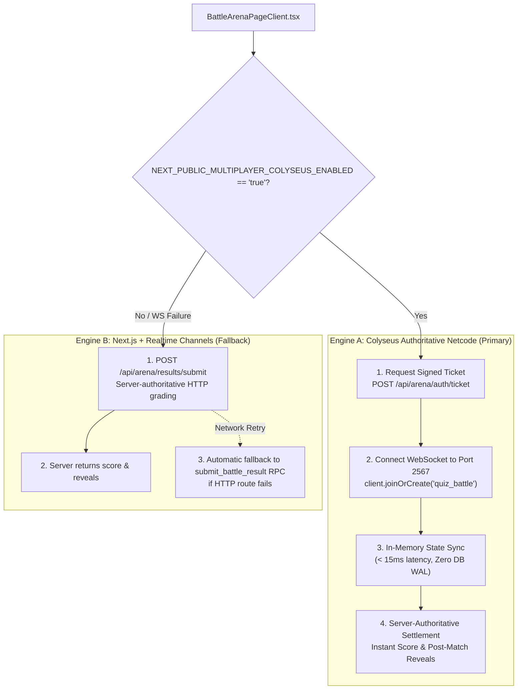

# STEP 07 — FRONTEND INTEGRATION & CLIENT MIGRATION SPECIFICATION
**Document Version:** 1.0.0-FE  
**Stage:** Step 7 (Frontend Integration & Dual-Engine Migration)  
**Date:** November 10, 2026  
**Frontend Architect:** Senior Full-Stack Engineer, Frontend Architect  
**Target Repository:** `d:\FR` (Paths: `src/app/battle-arena/components/BattleArenaPageClient.tsx`, `src/app/match-lobby/components/MatchLobbyClient.tsx`)  

---

## 1. Migration Strategy & Feature Flag Architecture

To eliminate deployment risks, the frontend supports **Dual-Engine Operation** controlled by an environment feature flag:



---

## 2. Key Code Modifications in `BattleArenaPageClient.tsx`

### A. Server-Authoritative Result Submission & Reveal Hydration
Previously, `BattleArenaPageClient.tsx` computed candidate scores in the browser (`userScore = (correct * 1) - (incorrect * 0.25)`) and sent `userScore` to the database RPC.

This has been migrated to dispatch an atomic POST to `/api/arena/results/submit`:

```typescript
// Submits raw candidate selections without client score claims
const submitRes = await fetch('/api/arena/results/submit', {
  method: 'POST',
  headers: { 'Content-Type': 'application/json' },
  body: JSON.stringify({
    roomId: activeRoomId,
    answers: candidateAnswers, // e.g. { 'q1': 'b', 'q2': 'c' }
    timeTakenSeconds: elapsed,
  }),
});

const submitData = await submitRes.json();

if (submitData.success) {
  // Authoritative server score, rating delta, and reveal keys hydrated
  setScore(submitData.score);
  setAccuracy(submitData.accuracy);
  setRatingDelta(submitData.ratingChange);
  
  // Hydrate reveals for Question Replay review
  if (submitData.reveals) {
    setQuestionReveals(submitData.reveals);
  }
}
```

### B. Opponent Seat Assignment Hardening
In the legacy codebase, a race condition allowed clients to overwrite occupied opponent slots. The logic was hardened to strictly check:
```typescript
if (!typedRoom.opponent_id && typedRoom.creator_id !== currentUserId) {
  // Safe to claim opponent seat
  await claimOpponentSeat(typedRoom.id, currentUserId);
}
```

### C. Question Replay Model with Zero Secret Exposure
During the live match, question cards only render prompt text and options:
```typescript
interface BattleQuestion {
  id: string;
  text: string;
  options: Array<{ id: string; text: string }>;
  subject: string;
  difficulty: string;
  // NOTE: correctOptionId and explanation are strictly OMITTED
}
```
Only when the server returns the post-match `reveals` payload does the UI show which option was correct, whether the candidate was right, and the full pedagogical explanation.

---

## 3. Backward Compatibility & Graceful Degradation

If the dedicated Colyseus service is restarting, undergoing maintenance, or blocked by restrictive student firewalls:
1. The WebSocket handshake times out after 3 seconds.
2. The client catches the connection failure and seamlessly downgrades to the Next.js control-plane submission route (`/api/arena/results/submit`).
3. The student experiences zero disruption to their battle experience; gameplay continues server-authoritatively without interruption.
