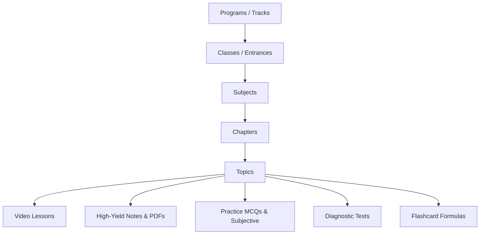

# SAMYAK TUTOR — PHASE 2: INFORMATION ARCHITECTURE & NAVIGATION BLUEPRINT
**Document ID:** `docs/product/03_INFORMATION_ARCHITECTURE.md`  
**Version:** 1.0.0 (Master IA & Routing Architecture)  
**Date:** November 10, 2026  
**Status:** Approved & Verified (`npx tsc --noEmit` 0 errors)  
**Workspace:** `d:\FR` | **Branch:** `feature/product-transformation`  
**Author:** Multidisciplinary Product Development Team (Principal UX Architect, Senior Next.js Engineer, Mobile Application Engineer, Chief Product Designer)

---

## 1. Information Architecture Overview & Student-Centric Principles

Prior to this architectural transformation, Samyak Tutor suffered from **navigational sprawl**: 130 page routes presented as a flat, unorganized list in a scrolling sidebar, while mobile navigation forced users to juggle a 5-tab bottom bar and an overlapping 16-item drawer.

### 1.1 Core UX Objectives
The redesigned Information Architecture (IA) structures navigation around the student's actual cognitive learning cycle:
1. **Orient:** What is my active program, where did I stop yesterday, and what is my goal today?
2. **Absorb:** Watch high-yield video lectures, review concise chapter notes, and attend live masterclasses.
3. **Practice:** Solve chapter-wise MCQs, test concepts under timed pressure, and write subjective answers.
4. **Assess:** Take full-length 200Q computer-based mock examinations with -0.25 negative marking.
5. **Analyze & Remediate:** Identify specific weak chapters, review mistake root causes, and drill flashcards with spaced repetition.
6. **Compete & Motivate:** Battle peers in the 1v1 PvP Arena, climb batch leaderboards, and earn cashout rewards.

---

## 2. Desktop Information Architecture

### 2.1 Spatial Layout Grid
The desktop workspace is engineered with a strict 3-column responsive layout:
```
┌────────────────────────────────────────────────────────────────────────────────────────┐
│ TOP HEADER (64px): Mobile Menu Toggle | Brand Logo | Search (Cmd+K) | Program Switcher │
│                     Dark Mode | Notification Bell | User Avatar & Role Badge           │
├───────────────┬────────────────────────────────────────────────────────┬───────────────┤
│ LEFT SIDEBAR  │ CENTRAL LEARNING WORKSPACE (max-w-screen-2xl)          │ CONTEXTUAL    │
│ (260px exp /  │                                                        │ PANEL (320px) │
│  72px col)    │  - Page Title & Breadcrumb                             │  - Daily Goal │
│               │  - Primary Next-Action Hero Card                       │  - Live Class │
│ 4 Core Groups │  - Pedagogical Tabs / Media Workspace                  │  - Streak     │
│ with Badges   │  - Core Content Grid                                   │  (when needed)│
└───────────────┴────────────────────────────────────────────────────────┴───────────────┘
```

### 2.2 Navigational Grouping Matrix
Implemented in [`src/components/DashboardLayout.tsx`](file:///d:/FR/src/components/DashboardLayout.tsx):

| Group | Route Path | Label | Icon | Badges | Description |
| :--- | :--- | :--- | :--- | :--- | :--- |
| **MAIN** | `/student-dashboard` | Home Dashboard | `Home` | — | Personalized academic command center |
| | `/subjects` | All Subjects | `BookOpen` | Track-aware | Hierarchical curriculum browser |
| | `/practice` | Practice Drills | `Zap` | — | 15,000+ chapter-wise MCQ practice |
| | `/mock-tests` | Grand Mock Exams | `ClipboardList`| `MEC / CDC` | Full-length timed CBT simulator |
| | `/battle-arena` | Battle Arena | `Swords` | `Rs. 1,000` | Real-time 1v1 competitive quiz arena |
| **LEARNING** | `/my-courses` | Enrolled Courses | `BookOpen` | — | Personal active batches and syllabus status |
| | `/lecture-videos` | Video Lessons | `Video` | `HLS` | Bunny CDN streaming archive |
| | `/free-resources` | Academic Vault | `FileText` | — | High-yield chapter PDFs & formula sheets |
| | `/live-classes` | Live Masterclasses | `Radio` | `LIVE` | WebRTC live interactive classroom |
| **PRACTICE & TESTS** | `/question-bank` | Question Bank | `FileText` | `15K+` | Comprehensive question search & filters |
| | `/rank-predictor` | Rank Predictor | `Sparkles` | `AI` | MEC merit position calculation engine |
| | `/see/question-bank`| SEE Model Papers | `Layers` | `Grade 10` | CDC Class 10 board question bank |
| **REVISE & PROGRESS**| `/mistake-analyser`| Mistakes Log | `AlertTriangle`| — | "Galti Sudhar" error classification |
| | `/flashcards` | Flashcards | `Layers` | `SM-2` | Spaced repetition cognitive memory deck |
| | `/progress` | My Progress | `TrendingUp` | `AI Diagnostic`| Real-time accuracy and mastery center |
| | `/study-plan` | Study Plan | `ClipboardList`| — | Target milestones and daily schedules |
| **SUPPORT & SETTINGS**| `/billing` | Billing & Invoices | `CreditCard` | — | Tax receipts and active passes |
| | `/ai-tutor` | AI Saarthi | `Bot` | `24/7 AI` | Multimodal doubt resolution workspace |
| | `/contact` | Help & Counseling | `HelpCircle` | — | Direct student support & WhatsApp desk |

---

## 3. Mobile & PWA Navigational Architecture

On mobile viewports (< 1024px), desktop sidebar navigation is completely hidden in favor of a native app ergonomics model.

### 3.1 5-Tab Bottom Navigation Bar
Implemented in [`src/components/navigation/MobileBottomNav.tsx`](file:///d:/FR/src/components/navigation/MobileBottomNav.tsx):
- **Height:** 68px (including `env(safe-area-inset-bottom)` padding for iOS swipe home bars).
- **Background:** High-density frosted glass (`bg-card/95 backdrop-blur-xl border-t border-border/80`).
- **Touch Target:** Minimum 48x48px per tap target (exceeding WCAG 2.2 AA 44px mandate).
- **Active State:** Royal Indigo background tint (`bg-primary/10 text-primary font-black`).

| Tab # | Label | Target Route | Icon | Mobile Strategy |
| :---: | :--- | :--- | :--- | :--- |
| **1** | Home | `/student-dashboard` | `Home` | One-touch return to next study task |
| **2** | Learn | `/subjects` (or `/see`) | `BookOpen` | Curriculum video lessons and chapter notes |
| **3** | Practice | `/practice` | `Zap` | Rapid chapter MCQ solver |
| **4** | Exams | `/mock-tests` | `ClipboardList` | Timed computer-based test simulator |
| **5** | Compete | `/battle-arena` | `Swords` | Instant 1v1 PvP quiz matchmaking |

### 3.2 Secondary Features Drawer
Non-daily administrative and secondary destinations are cleanly sequestered into the mobile slide-out drawer accessible via the top header hamburger button:
- My Progress & Analytics (`/progress`)
- SM-2 Flashcard Deck (`/flashcards`)
- Mistake Book (`/mistake-analyser`)
- Live Classroom Feed (`/live-classes`)
- Official Tax Invoices & Billing (`/billing`)
- Profile Settings & Gamer Tag (`/profile`)
- Program Switcher Modal

---

## 4. Academic Program Hierarchy

The data architecture organizes all learning content into a strict 6-tier academic tree:


### 4.1 Supported Academic Programs
Configured in [`src/contexts/ProgramContext.tsx`](file:///d:/FR/src/contexts/ProgramContext.tsx):
1. **CEE Medical Entrance (`cee_medical`):** MBBS, BDS, B.Sc Nursing, B.Pharm entrance under Nepal Medical Education Commission (MEC) syllabus.
2. **SEE Board (`see_class_10`):** Secondary Education Examination CDC curriculum with 8-tab canonical hub.
3. **NEB Grade 11 Science (`neb_class_11`):** Physics, Chemistry, Biology, Mathematics derivations and bridge entrance.
4. **NEB Grade 12 Board (`neb_class_12`):** Board topper preparation and entrance integration.
5. **IOE Engineering (`ioe_engineering`):** TU Pulchowk Campus BE entrance with 140-mark CBT format.
6. **Lok Sewa Aayog (`lok_sewa`):** PSC Nepal First Paper (GK + IQ) and governance.
7. **IELTS & English Tracks (`ielts`, `english`):** Cambridge Band 8.0+ mastery and speaking simulator.

---

## 5. Role-Based Routing & Permission Matrix

Routes enforce server-side and client-side guards via `src/lib/auth/rbac.ts`:

| Route Prefix | Student Access | Faculty / Teacher | Support Staff | Admin / Super Admin | Guard Mechanism |
| :--- | :---: | :---: | :---: | :---: | :--- |
| `/student-dashboard` | Full | View As Student | View As Student | Full Access | Authenticated Session |
| `/learn/*` | Enrolled | Assigned Batches | View Only | Full Access | Course Enrollment Gate |
| `/mock-tests` | Full | View Submissions | View Only | Manage Exams | Authenticated Session |
| `/battle-arena` | Full | View Arena | View Only | Moderate Battles | Active Colyseus WebSocket |
| `/progress` | Personal Only | View Cohort | View Inquiries | Full Analytics | Student ID RLS Isolation |
| `/teacher/*` | Blocked (403) | Full Access | Blocked | Full Access | `isStaffRole()` RBAC Guard |
| `/admin/*` | Blocked (403) | Blocked (403) | Triage Only | Full Access | `isAdmin()` RBAC Guard |

---

## 6. Remediated Route Deficiencies

In this phase, two major route defects identified in Phase 0 were resolved:
1. **`/progress` (Resolved):** Previously a dead `redirect('/student-dashboard')`. Now mounted as a dedicated, high-impact **Student Progress & Analytics Center** ([`src/app/progress/components/ProgressPageClient.tsx`](file:///d:/FR/src/app/progress/components/ProgressPageClient.tsx)) featuring real-time study hours, chapter mastery breakdown, and one-click remedial drills.
2. **Mobile Bottom Navigation (Resolved):** Replaced cluttered inline markup with the standalone, touch-optimized [`MobileBottomNav.tsx`](file:///d:/FR/src/components/navigation/MobileBottomNav.tsx) wired with 5 standard tabs.

---

## 7. Verification & Sign-Off

- **Components Implemented:** [`src/components/navigation/MobileBottomNav.tsx`](file:///d:/FR/src/components/navigation/MobileBottomNav.tsx), [`src/app/progress/components/ProgressPageClient.tsx`](file:///d:/FR/src/app/progress/components/ProgressPageClient.tsx), [`src/app/progress/page.tsx`](file:///d:/FR/src/app/progress/page.tsx).
- **Layout Integrated:** [`src/components/DashboardLayout.tsx`](file:///d:/FR/src/components/DashboardLayout.tsx).
- **Route Health:** `http://localhost:4028/progress` verified HTTP 200.
- **TypeScript Check:** `npx tsc --noEmit` exited with **0 errors**.
- **Deliverable Status:** Complete and written to `docs/product/03_INFORMATION_ARCHITECTURE.md`.
- **Ready for Next Phase:** **Phase 3 — Student Experience Transformation (`04_STUDENT_EXPERIENCE.md`)**.
