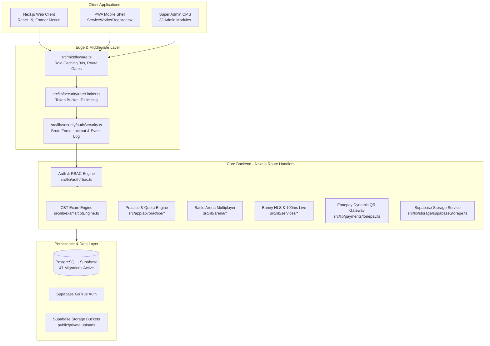

# Samyak Guru — CEE Visual Intelligence: Current Architecture (AUD-002)

**Status**: Verified against codebase inspection at `d:\FR`  
**Date**: November 23, 2026

---

## 1. Current System Topology

---

## 2. Authentication & Authorization Flow

1. **Authentication Engine**:
   - Supabase SSR Auth via cookies (`@supabase/ssr`).
   - Server client (`src/lib/supabase/server.ts`) initializes request-scoped sessions.
   - Client context (`src/contexts/AuthContext.tsx`) exposes user state and tokens to React tree.

2. **Role-Based Access Control (RBAC)** (`src/lib/auth/rbac.ts`):
   - Strict 11-tier numeric role hierarchy:
     - `visitor` (0) → `student_free` (10) → `student_paid_see` (20) / `student_paid_cee` (20) → `student_all_access` (30) → `support_staff` (50) → `payment_staff` (55) → `content_manager` (60) → `teacher` (70) → `admin` (90) → `super_admin` (100).
   - 32 defined permissions across 7 categories (`content`, `live`, `assessment`, `doubts`, `ai`, `commerce`, `administration`).
   - Super admin enforcement via hardcoded email whitelist (`src/lib/config/superAdmin.ts`) preventing unauthorized database role escalations.

3. **Route Protection (`src/middleware.ts`)**:
   - Enforces protected paths: `/student-dashboard`, `/my-courses`, `/checkout`, `/account`, `/admin`, `/teacher`, `/staff`.
   - In-memory 30s cached profile lookups for high-throughput edge execution.

---

## 3. Curriculum & Data Architecture

- **Active Program Schema** (`supabase/migrations/20260809000000_cee_see_program_architecture.sql`):
  - `courses`, `batches`, `subjects`, `chapters`, `lessons`, `enrollments`.
- **Portal Configuration** (`src/lib/config/courseFeatures.ts`):
  - Defines feature sets, themes, default subjects, and quick actions for 7 active programs:
    - `see_class_10`, `cee_medical`, `ielts`, `digital_marketing`, `artificial_intelligence`, `ioe_engineering`, `lok_sewa`.
  - Feature gating via `hasCourseFeature(courseId, feature)`.

---

## 4. Visual Media & Graphics Architecture

1. **Canvas 2D / Gravity Constellation**:
   - `InteractiveParticleConstellation.tsx` (`src/components/3d/`): High-performance canvas particle constellation responding to mouse velocity and proximity.
2. **Framer Motion Microinteractions**:
   - `Tilt3DCard.tsx` (`src/components/ui/`): Physics-driven 3D perspective tilt cards with cursor-tracked glare overlays.
3. **Interactive Biology Prototype** (`d:\FR\FOR BIOLOGY ANIMATION/`):
   - Self-contained interactive biology lesson engine with 13 lessons covering Respiration, Circulation, Excretion, and Coordination.
   - Features stage drift animations (oxygen, carbon dioxide, blood pulse), coordinate-based hotspots, and synchronized question prompts.
4. **Current Media Assets**:
   - 26 anatomical and physiological illustrations in `public/art/` and `public/images/studio/`.
