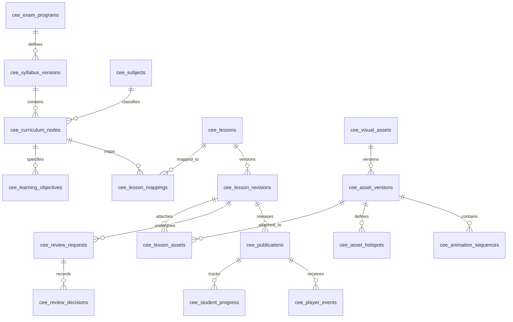

# Samyak Guru — CEE Visual Intelligence: Database Design (AUD-004)

**Status**: Additive Schema Specification (Non-Destructive)  
**Database**: PostgreSQL (Supabase)  
**Date**: November 23, 2026

---

## 1. Schema Design Principles

1. **Additive Exclusivity**: All new tables, views, and functions use the explicit prefix `cee_` to prevent namespace collisions with existing LMS tables (`courses`, `lessons`, `questions`).
2. **Referential Integrity**: All published references use `ON DELETE RESTRICT` to prevent accidental deletion of historical records or referenced assets.
3. **Immutability of History**: Revisions (`cee_lesson_revisions`) and Publications (`cee_publications`) are strictly append-only.
4. **Idempotency**: Progress events (`cee_player_events`) enforce uniqueness on `event_id` to guarantee at-most-once processing.

---

## 2. Entity Relationship Diagram (ERD)



---

## 3. Canonical SQL Table Specifications

```sql
-- 1. Programs & Official Syllabi
CREATE TABLE IF NOT EXISTS cee_exam_programs (
  id UUID PRIMARY KEY DEFAULT gen_random_uuid(),
  code TEXT NOT NULL UNIQUE,
  name TEXT NOT NULL,
  active BOOLEAN NOT NULL DEFAULT true,
  created_at TIMESTAMPTZ NOT NULL DEFAULT now()
);

CREATE TABLE IF NOT EXISTS cee_syllabus_versions (
  id UUID PRIMARY KEY DEFAULT gen_random_uuid(),
  program_id UUID NOT NULL REFERENCES cee_exam_programs(id) ON DELETE RESTRICT,
  label TEXT NOT NULL,
  source_url TEXT,
  source_hash CHAR(64),
  effective_date DATE NOT NULL,
  verified_at TIMESTAMPTZ,
  verified_by UUID,
  created_at TIMESTAMPTZ NOT NULL DEFAULT now(),
  UNIQUE(program_id, label)
);

CREATE TABLE IF NOT EXISTS cee_subjects (
  id UUID PRIMARY KEY DEFAULT gen_random_uuid(),
  code TEXT NOT NULL UNIQUE,
  name TEXT NOT NULL,
  color TEXT,
  icon TEXT,
  sort_order INT NOT NULL DEFAULT 0
);

-- 2. Curriculum Tree & Objectives
CREATE TABLE IF NOT EXISTS cee_curriculum_nodes (
  id UUID PRIMARY KEY DEFAULT gen_random_uuid(),
  syllabus_version_id UUID NOT NULL REFERENCES cee_syllabus_versions(id) ON DELETE RESTRICT,
  subject_id UUID NOT NULL REFERENCES cee_subjects(id) ON DELETE RESTRICT,
  parent_id UUID REFERENCES cee_curriculum_nodes(id) ON DELETE RESTRICT,
  node_type TEXT NOT NULL CHECK (node_type IN ('CHAPTER', 'TOPIC', 'SUBTOPIC')),
  title TEXT NOT NULL,
  sort_order INT NOT NULL DEFAULT 0,
  created_at TIMESTAMPTZ NOT NULL DEFAULT now()
);

CREATE TABLE IF NOT EXISTS cee_learning_objectives (
  id UUID PRIMARY KEY DEFAULT gen_random_uuid(),
  node_id UUID NOT NULL REFERENCES cee_curriculum_nodes(id) ON DELETE CASCADE,
  text TEXT NOT NULL,
  sort_order INT NOT NULL DEFAULT 0
);

-- 3. Visual Assets & Versions
CREATE TABLE IF NOT EXISTS cee_visual_assets (
  id UUID PRIMARY KEY DEFAULT gen_random_uuid(),
  title TEXT NOT NULL,
  kind TEXT NOT NULL CHECK (kind IN ('MODEL_3D', 'DIAGRAM_2D', 'ANIMATION_2D', 'VIDEO', 'SIMULATION')),
  created_by UUID NOT NULL,
  created_at TIMESTAMPTZ NOT NULL DEFAULT now()
);

CREATE TABLE IF NOT EXISTS cee_asset_versions (
  id UUID PRIMARY KEY DEFAULT gen_random_uuid(),
  asset_id UUID NOT NULL REFERENCES cee_visual_assets(id) ON DELETE RESTRICT,
  version_number INT NOT NULL CHECK (version_number > 0),
  storage_key TEXT NOT NULL UNIQUE,
  checksum_sha256 CHAR(64) NOT NULL,
  manifest_json JSONB NOT NULL,
  status TEXT NOT NULL CHECK (status IN ('QUARANTINED', 'SCANNING', 'VALIDATED', 'APPROVED', 'REJECTED')),
  created_at TIMESTAMPTZ NOT NULL DEFAULT now(),
  UNIQUE(asset_id, version_number)
);

CREATE TABLE IF NOT EXISTS cee_asset_hotspots (
  id UUID PRIMARY KEY DEFAULT gen_random_uuid(),
  asset_version_id UUID NOT NULL REFERENCES cee_asset_versions(id) ON DELETE CASCADE,
  hotspot_key TEXT NOT NULL,
  target_node TEXT,
  position_json JSONB NOT NULL,
  label TEXT NOT NULL,
  explanation TEXT,
  sort_order INT NOT NULL DEFAULT 0
);

CREATE TABLE IF NOT EXISTS cee_animation_sequences (
  id UUID PRIMARY KEY DEFAULT gen_random_uuid(),
  asset_version_id UUID NOT NULL REFERENCES cee_asset_versions(id) ON DELETE CASCADE,
  sequence_key TEXT NOT NULL,
  timeline_json JSONB NOT NULL,
  created_at TIMESTAMPTZ NOT NULL DEFAULT now()
);

-- 4. Lessons, Revisions & Mappings
CREATE TABLE IF NOT EXISTS cee_lessons (
  id UUID PRIMARY KEY DEFAULT gen_random_uuid(),
  title TEXT NOT NULL,
  slug TEXT NOT NULL UNIQUE,
  created_by UUID NOT NULL,
  created_at TIMESTAMPTZ NOT NULL DEFAULT now()
);

CREATE TABLE IF NOT EXISTS cee_lesson_revisions (
  id UUID PRIMARY KEY DEFAULT gen_random_uuid(),
  lesson_id UUID NOT NULL REFERENCES cee_lessons(id) ON DELETE RESTRICT,
  revision_number INT NOT NULL CHECK (revision_number > 0),
  content_json JSONB NOT NULL,
  status TEXT NOT NULL CHECK (status IN ('DRAFT', 'IN_REVIEW', 'APPROVED', 'PUBLISHED', 'SUPERSEDED', 'ARCHIVED')),
  created_by UUID NOT NULL,
  created_at TIMESTAMPTZ NOT NULL DEFAULT now(),
  UNIQUE(lesson_id, revision_number)
);

CREATE TABLE IF NOT EXISTS cee_lesson_mappings (
  id UUID PRIMARY KEY DEFAULT gen_random_uuid(),
  lesson_id UUID NOT NULL REFERENCES cee_lessons(id) ON DELETE CASCADE,
  curriculum_node_id UUID NOT NULL REFERENCES cee_curriculum_nodes(id) ON DELETE CASCADE,
  approved_by UUID,
  created_at TIMESTAMPTZ NOT NULL DEFAULT now(),
  UNIQUE(lesson_id, curriculum_node_id)
);

CREATE TABLE IF NOT EXISTS cee_lesson_assets (
  id UUID PRIMARY KEY DEFAULT gen_random_uuid(),
  lesson_revision_id UUID NOT NULL REFERENCES cee_lesson_revisions(id) ON DELETE CASCADE,
  asset_version_id UUID NOT NULL REFERENCES cee_asset_versions(id) ON DELETE RESTRICT,
  sort_order INT NOT NULL DEFAULT 0,
  UNIQUE(lesson_revision_id, asset_version_id)
);

-- 5. Academic Reviews & Publications
CREATE TABLE IF NOT EXISTS cee_review_requests (
  id UUID PRIMARY KEY DEFAULT gen_random_uuid(),
  revision_id UUID NOT NULL REFERENCES cee_lesson_revisions(id) ON DELETE CASCADE,
  reviewer_id UUID,
  status TEXT NOT NULL CHECK (status IN ('PENDING', 'APPROVED', 'CHANGES_REQUESTED')),
  requested_at TIMESTAMPTZ NOT NULL DEFAULT now()
);

CREATE TABLE IF NOT EXISTS cee_review_decisions (
  id UUID PRIMARY KEY DEFAULT gen_random_uuid(),
  request_id UUID NOT NULL REFERENCES cee_review_requests(id) ON DELETE CASCADE,
  reviewer_id UUID NOT NULL,
  decision TEXT NOT NULL CHECK (decision IN ('APPROVED', 'CHANGES_REQUESTED')),
  comments TEXT,
  reviewed_at TIMESTAMPTZ NOT NULL DEFAULT now()
);

CREATE TABLE IF NOT EXISTS cee_publications (
  id UUID PRIMARY KEY DEFAULT gen_random_uuid(),
  lesson_id UUID NOT NULL REFERENCES cee_lessons(id) ON DELETE RESTRICT,
  lesson_revision_id UUID NOT NULL REFERENCES cee_lesson_revisions(id) ON DELETE RESTRICT,
  published_by UUID NOT NULL,
  published_at TIMESTAMPTZ NOT NULL DEFAULT now(),
  superseded_at TIMESTAMPTZ
);

-- 6. Student Progress & Idempotent Telemetry
CREATE TABLE IF NOT EXISTS cee_student_progress (
  id UUID PRIMARY KEY DEFAULT gen_random_uuid(),
  student_id UUID NOT NULL,
  lesson_id UUID NOT NULL REFERENCES cee_lessons(id) ON DELETE RESTRICT,
  publication_id UUID NOT NULL REFERENCES cee_publications(id) ON DELETE RESTRICT,
  completion_percentage INT NOT NULL DEFAULT 0,
  completed BOOLEAN NOT NULL DEFAULT false,
  updated_at TIMESTAMPTZ NOT NULL DEFAULT now(),
  UNIQUE(student_id, publication_id)
);

CREATE TABLE IF NOT EXISTS cee_player_events (
  id UUID PRIMARY KEY DEFAULT gen_random_uuid(),
  event_id UUID NOT NULL UNIQUE,
  student_id UUID NOT NULL,
  publication_id UUID NOT NULL REFERENCES cee_publications(id) ON DELETE RESTRICT,
  asset_version_id UUID NOT NULL REFERENCES cee_asset_versions(id) ON DELETE RESTRICT,
  type TEXT NOT NULL,
  metadata JSONB,
  occurred_at TIMESTAMPTZ NOT NULL,
  recorded_at TIMESTAMPTZ NOT NULL DEFAULT now()
);
```
