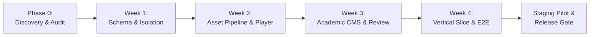

# Samyak Guru — CEE Visual Intelligence: Implementation Roadmap (AUD-005)

**Execution Framework**: Four-Week Foundation Plan + Vertical Slice  
**Target Pilot**: Human Heart & Cardiac Dynamics Lesson  
**Date**: November 23, 2026

---

## 1. Roadmap Architecture & Phase Progression

---

## 2. Sprint Milestones

### Phase 0: Discovery, Audit & Governance (COMPLETED)
- **Status**: **100% COMPLETE**
- **Evidence**:
  - Full inspection of `package.json`, 77 API routes, 33 admin panels, 47 migrations, and pre-existing prototypes (`FOR BIOLOGY ANIMATION`).
  - Baseline health: `tsc` (0 errors), `vitest` (545 passed), `build` (252 pages generated).
  - Baseline completion: 45.5% weighted platform coverage.
  - Complete documentation suite created under `docs/visual-intelligence/`.

---

### Week 1: Curriculum Schema, Scoped RBAC & Data Isolation
- **Goals**: Land additive database migration and build server-enforced scoped curriculum APIs.
- **Tasks**:
  1. `FND-001`: Create additive migration `supabase/migrations/20261124000000_cee_visual_intelligence_core.sql` for all `cee_*` tables.
  2. `FND-002`: Run migration dry-run and verify zero impact on existing tables.
  3. `FND-003`: Implement scoped curriculum read/write handlers (`/api/cee/curriculum/*`).
  4. `FND-004`: Update RBAC matrix in `src/lib/auth/rbac.ts` with `visual:author`, `visual:review`, and `visual:publish` permissions.
  5. `FND-005`: Write unit tests validating that SEE, IELTS, and IOE queries cannot access or mutate CEE visual nodes (`CEE-001`, `CEE-002`).

---

### Week 2: Asset Pipeline, Manifest Engine & Universal Player
- **Goals**: Build secure quarantine upload flow and universal visual player shell.
- **Tasks**:
  1. `FND-006`: Implement quarantine upload and SHA256 checksum validator (`/api/cee/admin/assets/upload-init`).
  2. `FND-007`: Implement Zod manifest schema validator (`src/lib/cee/visual/manifestSchema.ts`).
  3. `FND-008`: Build `VisualPlayerShell.tsx` supporting:
     - 3D WebGL Mode (Three.js OrbitControls, hotspots, layer controls).
     - 2D Simulation Mode (integrating the 13-lesson drift engine from `FOR BIOLOGY ANIMATION`).
     - 100% Accessible Fallback Diagram Mode with step notes and screen-reader support.
  4. `FND-009`: Implement WebGL context loss listener and graceful automatic fallback (`CEE-007`).

---

### Week 3: Academic CMS, Multi-Gate Review & Immutable Publishing
- **Goals**: Provide admin interface for visual lessons, multi-gate approvals, and atomic publication.
- **Tasks**:
  1. `FND-010`: Create Visual Lesson Editor (`/admin/cee-visual/lessons/[id]`).
  2. `FND-011`: Create Multi-Gate Academic Review Queue (`/admin/cee-visual/reviews`).
  3. `FND-012`: Implement transactional publication state machine (`DRAFT → IN_REVIEW → APPROVED → PUBLISHED → SUPERSEDED`).
  4. `FND-013`: Enforce that unpublished or draft revisions return 404 to students (`CEE-004`).
  5. `FND-014`: Add audit log recordings for all review decisions and publication events.

---

### Week 4: Human Heart Pilot Vertical Slice, Mobile Bridge & Verification
- **Goals**: Ship the complete end-to-end Human Heart lesson workflow and verify mobile compatibility.
- **Tasks**:
  1. `FND-015`: Populate verified Human Heart curriculum topic under CEE Biology → Human Physiology → Circulatory System.
  2. `FND-016`: Attach approved Heart 3D manifest, 2D cardiac simulation, and accessible fallback diagram (`public/art/heart.png`).
  3. `FND-017`: Link approved CEE MCQs and structure identification questions (`CEE-008`).
  4. `FND-018`: Implement JSON-RPC Mobile Bridge adapter for Flutter / PWA.
  5. `FND-019`: Wire idempotent student progress and hotspot inspection telemetry (`CEE-009`, `CEE-010`).
  6. `FND-020`: Execute end-to-end regression tests and record release gate evidence.
