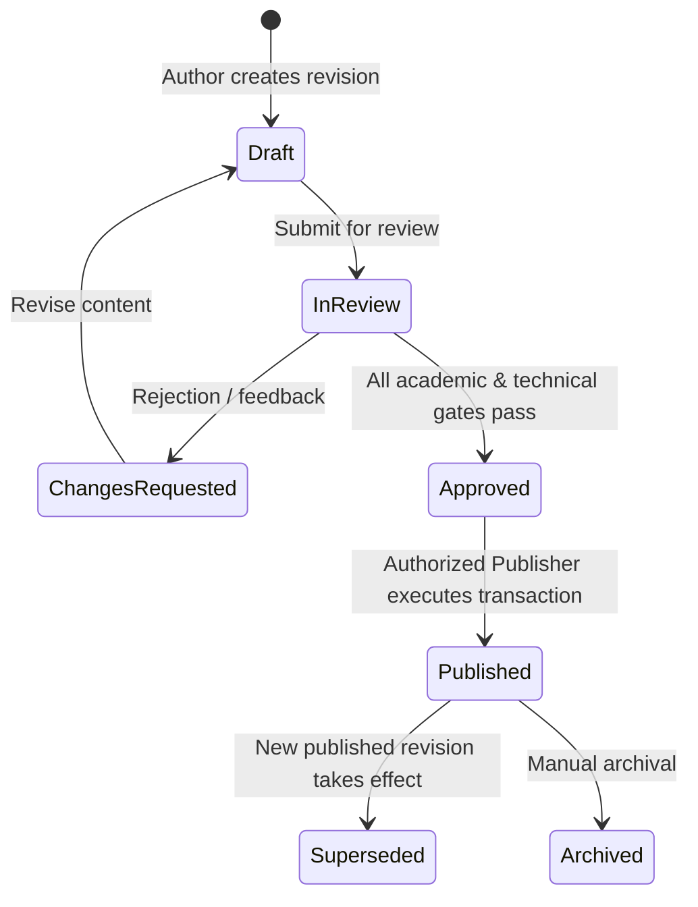

# Samyak Guru — CEE Visual Intelligence: Target Architecture (AUD-002)

**Design Principle**: Modular Monolith, Additive Schema, Zero Bleed, Zero Downtime  
**Date**: November 23, 2026

---

## 1. Target System Architecture Diagram

```mermaid
flowchart TB
  subgraph CLIENT_LAYER[Client Surface]
    WEB[Student Web & Lesson Viewer\n/learn/visual/[slug]]
    PWA[Mobile Web / PWA App]
    FLUTTER[Flutter Mobile Wrapper\n(Versioned Bridge)]
    CMS_UI[Academic CMS & Review Portal\n/admin/cee-visual/*]
  end

  subgraph EDGE_GATEWAY[Edge Gateway & Protection]
    ROUTER[Next.js App Router]
    GATE[Edge Auth & Scoped RBAC\nsrc/middleware.ts]
    RATE[Token-Bucket Rate Limiter]
  end

  subgraph VISUAL_INTELLIGENCE_SUBSYSTEM[CEE Visual Intelligence Domain]
    direction TB
    
    subgraph RUNTIME[Universal Visual Player Runtime]
      SHELL[VisualPlayerShell]
      REGISTRY[Renderer Registry]
      THREE_R[3D Model Renderer\nThree.js / Orbit / Hotspots]
      STAGE_R[2D Biological Simulation Renderer\nDrift Engine / Stages]
      FALLBACK_R[Accessible Static Diagram Renderer]
      BRIDGE[Mobile Bridge Adapter\nJSON-RPC Protocol]
    end

    subgraph ASSET_FACTORY[Asset Processing Pipeline]
      INIT[Upload Init & Quota Gate]
      QUARANTINE[Quarantine Storage]
      SCANNER[Security & Integrity Scanner\n(SHA256, Magic Bytes, GLB/SVG)]
      MANIFEST_BLDR[Manifest Builder & Versioner]
    end

    subgraph ACADEMIC_CMS[Academic CMS & Publication]
      CURR_MGR[Curriculum & Syllabus Registry]
      REV_QUEUE[Multi-Gate Review Queue\n(Director, Expert, Visual, Rights)]
      PUB_TX[Transactional Immutable Publisher]
      AUDIT[Append-Only Audit Logger]
    end
  end

  subgraph PERSISTENCE_LAYER[Data & Storage Engine]
    CEE_TABLES[(Additive CEE Entities\ncee_syllabus_versions\ncee_curriculum_nodes\ncee_lessons / cee_lesson_revisions\ncee_asset_versions\ncee_publications\ncee_player_events)]
    BLOB_STORAGE[(Object Storage Buckets\ncee-quarantine / cee-published-assets)]
  end

  WEB --> ROUTER
  PWA --> ROUTER
  FLUTTER --> ROUTER
  CMS_UI --> ROUTER

  ROUTER --> GATE
  GATE --> RATE
  RATE --> RUNTIME
  RATE --> ASSET_FACTORY
  RATE --> ACADEMIC_CMS

  RUNTIME --> PERSISTENCE_LAYER
  ASSET_FACTORY --> BLOB_STORAGE
  ACADEMIC_CMS --> PERSISTENCE_LAYER
```

---

## 2. Universal Visual Player Runtime Architecture

The Universal Visual Player (`VisualPlayerShell`) provides a seamless abstraction over three distinct rendering techniques:

1. **3D WebGL Renderer (`Model3DRenderer`)**:
   - Built on Three.js with OrbitControls, custom shader highlights, and raycasted hotspot detection.
   - Dynamic camera bookmarks: orientations configured per scene (e.g., external heart vs internal cross-section).
   - Explode views and layer visibility toggles (`layers: ['myocardium', 'valves', 'vessels']`).
   - WebGL context loss listener with auto-recovery or immediate fallback to 2D Mode.

2. **2D Biological Simulation Renderer (`SimulationRenderer`)**:
   - Reuses and refines the proven simulation engine discovered in `FOR BIOLOGY ANIMATION`.
   - Simulates biological processes through coordinate stage drift (e.g., $O_2$ and $CO_2$ exchange, cardiac chamber blood flow, action potential propagation).

3. **100% Accessible Fallback Renderer (`FallbackController`)**:
   - Guaranteed high-resolution textbook diagram fallback for low-power devices, reduced-motion preferences, or WebGL context failures.
   - Full keyboard accessibility, screen-reader landmark notes, and synchronized transcriptions.

---

## 3. Academic Review & Publication State Machine



- **Separation of Duties**: An author cannot approve their own lesson revision.
- **Atomic Publication**: Writing a publication snapshot (`cee_publications`) updates curriculum references, invalidates CDN caches, and writes an audit log in a single transaction.
- **Immutability Guarantee**: Once published or approved, a revision can never be mutated; any correction creates a new revision number.
