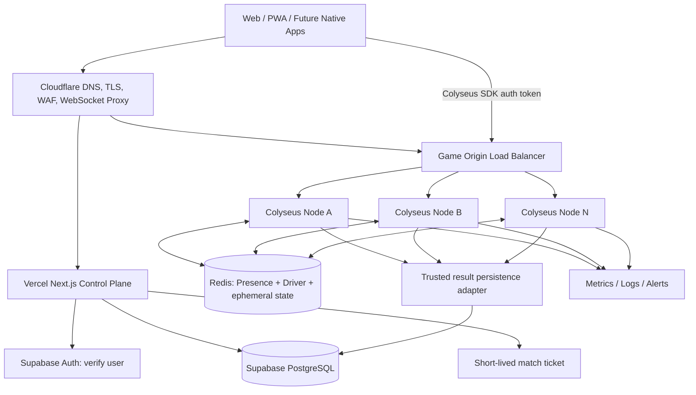

# 01 — Samyak Multiplayer Architecture Decisions

## 1. Executive decision

Adopt **Colyseus as the first authoritative real-time room engine**, while retaining the existing Samyak platform as the system of record.

This is a fit-for-purpose choice for turn-based quiz battles, team quizzes, classroom rooms, and tournaments. It is not a permanent commitment to Colyseus for every possible future game genre.

### Keep these systems

| Existing component | Keep it responsible for |
|---|---|
| Next.js / Vercel | Student experience, account workflows, course UI, ordinary APIs, administrative control plane |
| Supabase Auth | Canonical student authentication |
| Supabase PostgreSQL | Student profiles, enrollments, question bank, canonical match records, result ledger, tournament records |
| Bunny.net | Video and learning-media delivery |
| Cloudflare | DNS, TLS proxy, edge protection, WebSocket proxying to the game origin |

### Add these components

| New component | Responsibility |
|---|---|
| Colyseus service | Live room lifecycle, authoritative game rules, state/messages, room membership |
| Redis | Colyseus cross-process Presence and Driver, short-lived ticket nonces, matchmaking queues / ephemeral coordination |
| Result persistence adapter | Writes authoritative results idempotently to existing PostgreSQL tables or a transaction-safe RPC |
| Observability | WebSocket connection count, room count, message rate, latency, disconnects, room failures, Redis health, DB write failures |

## 2. Target topology

The load balancer must support WebSocket upgrades and the Colyseus seat-reservation routing model. Colyseus room instances live on a particular process; Redis Presence and a shared Driver provide cross-process coordination and room discovery. A shared Redis Presence alone is not a substitute for the shared matchmaking Driver. The Colyseus docs explain that the seat reservation can be handled by any process, after which the client connects to the process hosting that room.

## 3. Why Colyseus first

- Existing backend code is TypeScript/Node.js, so the team can share types and validation schemas more easily than with a Go- or C#-centric stack.
- Colyseus has an explicit room lifecycle and room-level authentication hook.
- It supports authoritative server-side game logic, appropriate for scored competitive academic matches.
- It can be self-hosted, allowing Samyak to control deployment and capacity planning.

The official Colyseus documentation currently presents v0.18 and recommends creating a server with `npm create colyseus-app@latest`. Confirm the generated package versions and migration notes at implementation time; do not copy an old code sample into an incompatible server version.

## 4. Why not deploy every candidate

| Product | Decision for current roadmap | Reason |
|---|---|---|
| Colyseus | Pilot now | Strong fit for TypeScript authoritative quiz rooms |
| Nakama | Re-evaluate later | Strong all-in-one game backend; may become attractive if Samyak needs a broader game-social backend and accepts another runtime/operational model |
| PlayFab | Not now | Managed game LiveOps/economy capabilities are not required for the first quiz-battle milestone; validate commercial pricing if needs change |
| Firebase Realtime Database | Not as game authority | Useful for some realtime app data, but Samyak still needs authoritative game rules and trusted result calculation |
| Photon | Not now | Better justified for fast-action, physics-heavy or engine-specific networking; unnecessary for quiz rooms |
| Unity Gaming Services | Not now | Relevant when building Unity game clients / dedicated game-server workflows |

Do not use multiple game backends for the same feature set without a specific requirement. It duplicates identity mapping, observability, data governance, support work, and costs.

## 5. Identity and authorization flow

1. Student signs into Samyak through Supabase Auth.
2. Browser obtains the current Supabase access token from the established auth client.
3. Browser sends that token to `POST /api/arena/auth/ticket` in an Authorization header.
4. Next.js validates the token with Supabase Auth (`auth.getUser(accessToken)` or the project's established verified-claims helper).
5. Next.js calls a server-side `ArenaRepository.assertPlayerCanJoinMatch(userId, matchId)` implementation. This checks match state, participant membership, ban/eligibility rules, and any product policy.
6. Next.js issues a short-lived, narrowly scoped game ticket (60 seconds is a starting policy, not a universal constant).
7. Browser sets `colyseusClient.auth.token = ticket`; it must not append the token to the WebSocket URL.
8. Colyseus room `static onAuth` verifies signature, issuer, audience, expiry, scope, `sub`, match ID, and one-time nonce.
9. Room verifies the authenticated user is an authorized participant in that specific match.
10. Every later message is validated against the authenticated room participant and current room state.

The ticket is not a Supabase service-role key and does not grant general database access. Use a dedicated secret with at least 32 random bytes, separate from Supabase keys and all other application secrets. The browser must pass it using the Colyseus SDK auth mechanism, not a URL query parameter. Make the ticket one-time where practical; a client retry after ticket consumption must request a fresh ticket.

## 6. Match authority model

The server is authoritative for:

- question sequence;
- question start/deadline;
- answer acceptance window;
- duplicate answer rejection;
- answer correctness;
- score and streak calculations;
- winner determination;
- rating/ELO change calculation;
- final result creation.

The client is authoritative only for presentation choices such as local animations and button state. `clientTimeMs`, client score, client winner, and client timer values are untrusted hints and must not determine results.

## 7. Game data placement

| Data | Location | Persistence |
|---|---|---|
| Supabase user ID | Authenticated ticket / room participant | Canonical in Supabase |
| Active room state | Colyseus room memory | Temporary; recovery policy explicit |
| Active matchmaking queue | Redis | TTL / cleanup policy |
| Room directory and process mapping | Colyseus Driver | Shared in distributed mode |
| Cross-process presence/pub-sub | Redis Presence | Ephemeral |
| Canonical question bank | Supabase PostgreSQL | Durable |
| Private answer key | Server process / trusted repository only | Never sent before reveal |
| Final battle result | Supabase PostgreSQL transaction | Durable |
| ELO/rating ledger | Supabase PostgreSQL transaction | Durable and auditable |
| Telemetry | Observability backend | Retention policy |

Do not write each timer tick or each ephemeral presence ping to PostgreSQL. Persist meaningful durable events and final match results.

## 8. Initial room policy

First vertical slice:

- Room type: `quiz_battle`.
- Players: exactly two.
- Game type: turn-synchronous multiple-choice quiz.
- Questions: load from a trusted repository after verifying the match roster.
- Answer keys: server-only.
- Timing: server-issued deadline; client countdown is visual only.
- Scoring: equal points per correct answer in v1; do not add speed bonus until network fairness is measured.
- Reconnect: allow a short configurable reconnection grace; the authoritative deadline policy must be explicit and fair.
- Persistence: a transaction-safe idempotent RPC/adapter writes result and rating changes together; no-contest/cancellation records must not silently award ELO.
- Spectators, public chat, monetary rewards, and bots are out of scope for v1.

## 9. Capacity model

Do not use the uploaded document's estimates of 15,000 CCU per VM, 20,000–50,000 CCU per node, sub-35ms latency, or a fixed monthly cost as procurement facts. They are hypotheses requiring measurement and current provider quotes.

Capacity is a function of:

- number of active rooms;
- players per room;
- state patch and event rate;
- payload size;
- message validation and scoring cost;
- CPU and garbage-collection behavior;
- RAM per active room;
- network throughput and open connection limits;
- Redis operation rate and latency;
- database result-write pattern;
- client reconnect rates;
- geographic routing.

Benchmark from Kathmandu on WorldLink, NTC, Ncell and Subisu connections when available. Compare Mumbai and Singapore rather than assuming a fixed latency.

## 10. Deployment boundaries

- Keep Next.js on Vercel initially.
- Run Colyseus as a separate long-lived Node.js service on a VM/container platform.
- Use a dedicated hostname, e.g. `arena-staging.samyakcee.com`.
- Put Cloudflare in front only after confirming WebSocket proxying is enabled and origin restrictions are correct.
- Use Redis Presence and Redis Driver when running multiple Colyseus processes/instances.
- Use a single process + in-memory driver only for local development or controlled early pilot.
- Add health checks, graceful shutdown, deployment draining, room migration/reconnect policy, and rollback.

## 11. Observability contract

At minimum collect:

- connected WebSocket clients;
- active rooms by room type;
- players per room;
- matchmaking wait time and queue depth;
- room create/join/leave failures;
- message rate by message type;
- invalid message count;
- answer accepted/rejected count;
- result persistence latency/failures;
- reconnect attempts and successful reconnects;
- Redis latency/errors;
- PostgreSQL pool wait and transaction failures;
- process CPU, RSS memory, event-loop lag, network I/O.

Never place raw access tokens, answer keys, student phone numbers, or full personal data in logs.
